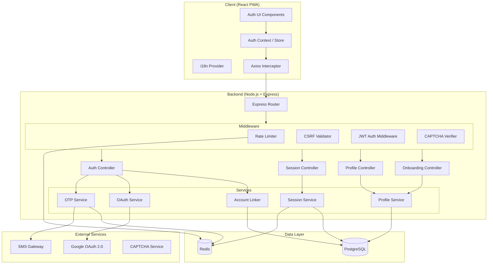
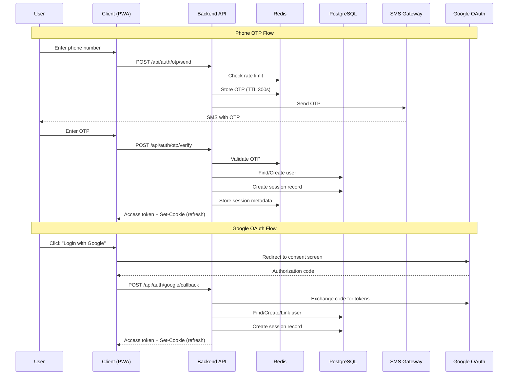
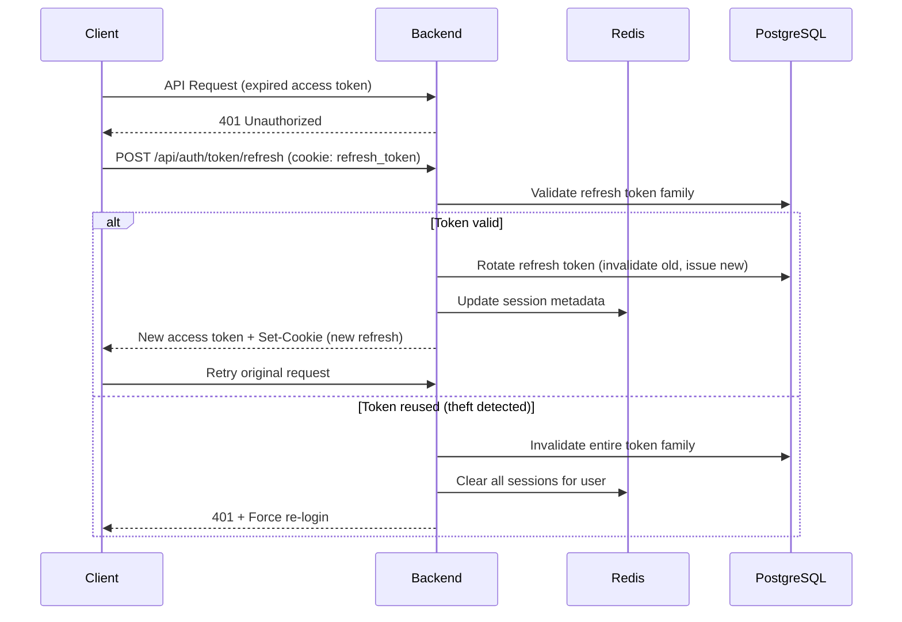
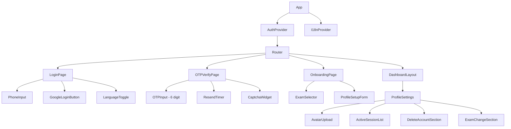
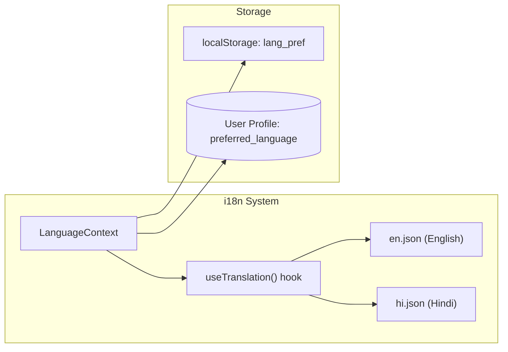

# Design Document: Auth Module

## Overview

The Auth Module is the foundational authentication and user management system for the UP Police Test Series platform. It provides secure Phone OTP-based and Google OAuth login, session management with JWT tokens, multi-device control, onboarding flow, profile management, bilingual support (Hindi/English), and account lifecycle management.

### Key Design Decisions

1. **Custom JWT over Firebase Auth** — Full control over token lifecycle, session limits, and refresh token rotation. Avoids vendor lock-in.
2. **Refresh Token Rotation** — Each refresh token is single-use with family-based revocation to detect token theft.
3. **Access Token in Memory Only** — Prevents XSS-based token theft. Refresh token in HTTP-only secure cookie handles persistence.
4. **Redis for OTP and Rate Limiting** — TTL-based expiry maps naturally to OTP lifetimes and sliding windows.
5. **i18n via JSON resource bundles** — Simple key-value structure loaded per locale, with React context for reactive language switching.
6. **Account Linking by Email/Phone Match** — Prevents duplicate accounts while giving users explicit control over merging.

## Architecture

### High-Level System Diagram



### Authentication Flow Overview



### Token Refresh Flow



## Components and Interfaces

### Backend Components

#### 1. Auth Controller (`/api/auth/*`)
- **Responsibilities:** Handles OTP send/verify, Google OAuth callback, token refresh, logout
- **Dependencies:** OTPService, OAuthService, SessionService, AccountLinkService

#### 2. Session Controller (`/api/sessions/*`)
- **Responsibilities:** List active sessions, terminate sessions, logout all devices
- **Dependencies:** SessionService

#### 3. Profile Controller (`/api/profile/*`)
- **Responsibilities:** Get/update profile, avatar upload, exam change, account deletion
- **Dependencies:** ProfileService, SessionService

#### 4. Onboarding Controller (`/api/onboarding/*`)
- **Responsibilities:** Exam list, exam selection, profile setup submission
- **Dependencies:** ProfileService

#### 5. Middleware Stack
| Middleware | Purpose |
|-----------|---------|
| `rateLimiter` | IP-based and phone-based request throttling via Redis sliding window |
| `csrfProtection` | Validates CSRF token on all state-changing requests |
| `jwtAuth` | Validates access token, attaches user context to request |
| `captchaVerifier` | Validates CAPTCHA response when triggered by failed OTP attempts |

#### 6. Services

| Service | Interface |
|---------|-----------|
| `OTPService` | `generate(phone): OTP`, `verify(phone, code): boolean`, `invalidate(phone): void` |
| `OAuthService` | `getAuthUrl(): string`, `exchangeCode(code): GoogleProfile`, `validateToken(token): Claims` |
| `SessionService` | `create(userId, deviceInfo): Session`, `refresh(refreshToken): TokenPair`, `revoke(sessionId): void`, `revokeAll(userId, exceptSessionId?): void`, `listActive(userId): Session[]` |
| `ProfileService` | `getProfile(userId): Profile`, `updateProfile(userId, data): Profile`, `uploadAvatar(userId, file): string`, `deleteAccount(userId): void`, `cancelDeletion(userId): void` |
| `AccountLinkService` | `checkExisting(email, phone): Account?`, `linkAccounts(primaryId, secondaryId): void`, `createSeparate(profile): User` |

### Frontend Components

#### Component Tree



#### Key React Components

| Component | Props | State | Responsibilities |
|-----------|-------|-------|-----------------|
| `AuthProvider` | `children` | `user`, `isAuthenticated`, `isLoading` | Manages auth state, token refresh, route guarding |
| `PhoneInput` | `onSubmit`, `disabled` | `phoneNumber`, `error` | Input with +91 prefix, validation, numeric-only |
| `OTPInput` | `onComplete`, `length=6`, `disabled` | `digits[]`, `error` | 6-cell input, auto-advance, Web OTP API integration |
| `ResendTimer` | `cooldownSeconds=30`, `onResend` | `timeLeft`, `canResend` | Countdown display, resend trigger |
| `LanguageToggle` | — | — | Switches i18n context (Hindi/English) |
| `ExamSelector` | `exams`, `currentExam`, `onSelect` | `selectedExam` | Category-grouped exam cards |
| `ProfileSetupForm` | `initialData`, `onSubmit` | `name`, `language`, `avatar` | Name validation, language select, avatar crop |
| `ActiveSessionList` | `sessions`, `currentSessionId` | — | Session cards with terminate action |
| `LoadingButton` | `loading`, `onClick`, `children` | — | Button with spinner, auto-disable |

#### Auth Context API

```typescript
interface AuthContextValue {
  user: User | null;
  isAuthenticated: boolean;
  isLoading: boolean;
  login: (phone: string) => Promise<void>;
  verifyOTP: (phone: string, otp: string) => Promise<void>;
  loginWithGoogle: () => Promise<void>;
  logout: () => Promise<void>;
  refreshToken: () => Promise<void>;
  updateProfile: (data: ProfileUpdate) => Promise<void>;
}
```

#### HTTP Client (Axios Interceptor)

- Request interceptor: Attaches access token from memory, attaches CSRF token from meta tag
- Response interceptor: On 401, queues request, calls `/token/refresh`, retries queued requests with new token
- Offline detection: Catches network errors, triggers offline banner via event bus

## Data Models

### PostgreSQL Schema

```sql
-- Users table
CREATE TABLE users (
    id UUID PRIMARY KEY DEFAULT gen_random_uuid(),
    phone VARCHAR(10) UNIQUE,
    email VARCHAR(255) UNIQUE,
    full_name VARCHAR(50),
    avatar_url TEXT,
    preferred_language VARCHAR(2) NOT NULL DEFAULT 'hi', -- 'hi' or 'en'
    selected_exam_id UUID REFERENCES exams(id),
    google_id VARCHAR(255) UNIQUE,
    google_avatar_url TEXT,
    onboarding_completed BOOLEAN NOT NULL DEFAULT false,
    exam_change_count_this_month INTEGER NOT NULL DEFAULT 0,
    exam_change_month INTEGER, -- month number (1-12) for reset tracking
    deletion_scheduled_at TIMESTAMPTZ,
    created_at TIMESTAMPTZ NOT NULL DEFAULT NOW(),
    updated_at TIMESTAMPTZ NOT NULL DEFAULT NOW()
);

-- Exams table
CREATE TABLE exams (
    id UUID PRIMARY KEY DEFAULT gen_random_uuid(),
    name_en VARCHAR(100) NOT NULL,
    name_hi VARCHAR(100) NOT NULL,
    description_en VARCHAR(100),
    description_hi VARCHAR(100),
    category VARCHAR(50) NOT NULL, -- 'state' or 'central'
    state VARCHAR(50),            -- null for central exams
    icon_url TEXT,
    is_active BOOLEAN NOT NULL DEFAULT true,
    display_order INTEGER NOT NULL DEFAULT 0,
    created_at TIMESTAMPTZ NOT NULL DEFAULT NOW()
);

-- Sessions table (refresh tokens)
CREATE TABLE sessions (
    id UUID PRIMARY KEY DEFAULT gen_random_uuid(),
    user_id UUID NOT NULL REFERENCES users(id) ON DELETE CASCADE,
    refresh_token_hash VARCHAR(64) NOT NULL,
    token_family UUID NOT NULL,       -- for rotation detection
    device_type VARCHAR(20),          -- 'mobile', 'desktop', 'tablet'
    device_info JSONB,                -- user-agent parsed info
    ip_address INET,
    city VARCHAR(100),
    is_active BOOLEAN NOT NULL DEFAULT true,
    last_active_at TIMESTAMPTZ NOT NULL DEFAULT NOW(),
    created_at TIMESTAMPTZ NOT NULL DEFAULT NOW(),
    expires_at TIMESTAMPTZ NOT NULL
);

CREATE INDEX idx_sessions_user_active ON sessions(user_id, is_active) WHERE is_active = true;
CREATE INDEX idx_sessions_token_family ON sessions(token_family);
CREATE INDEX idx_sessions_expires ON sessions(expires_at);

-- Account linking log
CREATE TABLE account_links (
    id UUID PRIMARY KEY DEFAULT gen_random_uuid(),
    primary_user_id UUID NOT NULL REFERENCES users(id) ON DELETE CASCADE,
    linked_provider VARCHAR(20) NOT NULL, -- 'google' or 'phone'
    linked_identifier VARCHAR(255) NOT NULL,
    linked_at TIMESTAMPTZ NOT NULL DEFAULT NOW()
);

-- Audit log for sensitive operations
CREATE TABLE auth_audit_log (
    id BIGSERIAL PRIMARY KEY,
    user_id UUID REFERENCES users(id) ON DELETE SET NULL,
    action VARCHAR(50) NOT NULL,       -- 'otp_generated', 'otp_verified', 'login_google', 'session_revoked', 'account_deleted', etc.
    ip_address INET,
    metadata JSONB,                    -- additional context (phone_hash, device, etc.)
    created_at TIMESTAMPTZ NOT NULL DEFAULT NOW()
);

CREATE INDEX idx_audit_user ON auth_audit_log(user_id, created_at DESC);
CREATE INDEX idx_audit_action ON auth_audit_log(action, created_at DESC);
```

### Redis Data Structures

```
# OTP storage (auto-expires)
otp:{phone_hash} → { code: "123456", attempts: 0, created_at: timestamp }
TTL: 300 seconds

# OTP rate limiting (per phone, rolling window)
otp_count:{phone_hash} → sorted set of timestamps
TTL: 3600 seconds (1 hour)

# IP rate limiting (sliding window)
ip_rate:{ip_address} → sorted set of timestamps
TTL: 3600 seconds (1 hour)

# Phone lockout (after 5 failed verifications)
lockout:{phone_hash} → { until: timestamp, reason: "max_attempts" }
TTL: 900 seconds (15 minutes)

# OTP resend cooldown
resend_cooldown:{phone_hash} → 1
TTL: 30 seconds

# Session metadata (quick lookup)
session:{session_id} → { user_id, device_type, created_at, last_active_at }
TTL: 2592000 seconds (30 days)

# Active session set per user
user_sessions:{user_id} → set of session_ids

# CSRF tokens
csrf:{token} → user_id
TTL: 86400 seconds (24 hours)
```

### API Endpoints

#### Authentication

| Method | Endpoint | Auth | Description |
|--------|----------|------|-------------|
| POST | `/api/auth/otp/send` | No | Send OTP to phone number |
| POST | `/api/auth/otp/verify` | No | Verify OTP and authenticate |
| POST | `/api/auth/otp/resend` | No | Resend OTP with cooldown |
| GET | `/api/auth/google` | No | Initiate Google OAuth flow |
| POST | `/api/auth/google/callback` | No | Handle Google OAuth callback |
| POST | `/api/auth/token/refresh` | Cookie | Refresh access token |
| POST | `/api/auth/logout` | Yes | Logout current session |
| POST | `/api/auth/logout-all` | Yes | Logout all sessions except current |

#### Sessions

| Method | Endpoint | Auth | Description |
|--------|----------|------|-------------|
| GET | `/api/sessions` | Yes | List all active sessions |
| DELETE | `/api/sessions/:sessionId` | Yes | Terminate specific session |

#### Profile

| Method | Endpoint | Auth | Description |
|--------|----------|------|-------------|
| GET | `/api/profile` | Yes | Get current user profile |
| PATCH | `/api/profile` | Yes | Update profile fields (name, language) |
| POST | `/api/profile/avatar` | Yes | Upload avatar image |
| DELETE | `/api/profile/avatar` | Yes | Remove avatar |

#### Onboarding

| Method | Endpoint | Auth | Description |
|--------|----------|------|-------------|
| GET | `/api/onboarding/exams` | Yes | Get available exams list |
| POST | `/api/onboarding/exam-selection` | Yes | Save exam selection |
| POST | `/api/onboarding/profile-setup` | Yes | Complete profile setup |

#### Exam Management

| Method | Endpoint | Auth | Description |
|--------|----------|------|-------------|
| POST | `/api/profile/exam` | Yes | Change selected exam |

#### Account Lifecycle

| Method | Endpoint | Auth | Description |
|--------|----------|------|-------------|
| POST | `/api/account/delete/request` | Yes | Initiate account deletion (triggers OTP) |
| POST | `/api/account/delete/confirm` | Yes | Confirm deletion after OTP verification |
| POST | `/api/account/delete/cancel` | Yes | Cancel pending deletion |

#### Account Linking

| Method | Endpoint | Auth | Description |
|--------|----------|------|-------------|
| POST | `/api/auth/link/confirm` | Yes | Confirm account linking |
| POST | `/api/auth/link/decline` | Yes | Decline account linking (create separate) |

### Request/Response Examples

#### POST `/api/auth/otp/send`

```json
// Request
{ "phone": "9876543210" }

// Success Response (200)
{ 
  "success": true,
  "message": "OTP sent successfully",
  "data": { "expiresIn": 300, "resendAfter": 30 }
}

// Rate Limited Response (429)
{
  "success": false,
  "error": { "code": "RATE_LIMITED", "message": "Too many requests", "retryAfter": 1823 }
}
```

#### POST `/api/auth/otp/verify`

```json
// Request
{ "phone": "9876543210", "otp": "123456", "captchaToken": null }

// Success Response (200) — New User
{
  "success": true,
  "data": {
    "accessToken": "eyJ...",
    "user": { "id": "uuid", "phone": "9876543210", "onboardingCompleted": false },
    "nextStep": "exam_selection"
  }
}

// Success Response (200) — Returning User
{
  "success": true,
  "data": {
    "accessToken": "eyJ...",
    "user": { "id": "uuid", "phone": "9876543210", "fullName": "राम कुमार", "onboardingCompleted": true },
    "nextStep": "dashboard"
  }
}

// Account Link Required (200 with linking prompt)
{
  "success": true,
  "data": {
    "accessToken": "eyJ...",
    "user": { "id": "uuid" },
    "nextStep": "account_link",
    "linkingInfo": { "existingPhone": "98****3210", "provider": "google" }
  }
}
```

#### JWT Access Token Payload

```json
{
  "sub": "user-uuid",
  "sessionId": "session-uuid",
  "iat": 1700000000,
  "exp": 1700003600
}
```

## Correctness Properties

*A property is a characteristic or behavior that should hold true across all valid executions of a system — essentially, a formal statement about what the system should do. Properties serve as the bridge between human-readable specifications and machine-verifiable correctness guarantees.*

### Property 1: Phone Number Validation

*For any* string input, the phone number validator SHALL accept it if and only if, after stripping spaces, dashes, and the "+91" prefix, the remaining string is exactly 10 digits long and starts with 6, 7, 8, or 9. All other inputs SHALL be rejected.

**Validates: Requirements 1.1, 1.2, 1.3, 1.4, 1.6, 1.7**

### Property 2: Phone Number Normalization Idempotence

*For any* valid phone number with arbitrarily inserted spaces, dashes, or "+91" prefix, applying the normalization function SHALL produce the same 10-digit result as applying it to the raw digits. Furthermore, normalizing an already-normalized number SHALL return it unchanged (idempotence).

**Validates: Requirements 1.4**

### Property 3: OTP Generation Format

*For any* invocation of the OTP generator, the output SHALL be a string of exactly 6 numeric characters representing a value in the range 000000–999999.

**Validates: Requirements 2.1**

### Property 4: OTP Single-Use and Latest-Only Validity

*For any* phone number, if multiple OTPs are generated in sequence, only the most recently generated OTP SHALL pass verification. All previously generated OTPs for that phone number SHALL be rejected, regardless of whether they are within their expiry window.

**Validates: Requirements 2.3, 3.1, 4.5, 4.6**

### Property 5: OTP Rate Limiting

*For any* phone number and any sequence of OTP generation requests, if the number of requests within a rolling 1-hour window exceeds 5, all subsequent requests within that window SHALL be rejected. The window SHALL reset on a rolling basis (oldest request drops off after 1 hour).

**Validates: Requirements 2.6, 4.2**

### Property 6: OTP Resend Cooldown

*For any* phone number and two consecutive OTP resend requests, if the time between them is less than 30 seconds, the second request SHALL be rejected. If the time is 30 seconds or more, the second request SHALL be accepted.

**Validates: Requirements 4.1**

### Property 7: OTP Verification Lockout

*For any* phone number, after 5 consecutive failed OTP verification attempts, all subsequent verification attempts SHALL be rejected for 15 minutes. The failure counter SHALL reset after a successful verification or after the lockout period expires.

**Validates: Requirements 3.2, 3.4, 3.5**

### Property 8: Account Linking Decision

*For any* login attempt (via phone or Google), if the provided email or phone number matches an existing account registered via a different authentication method, the system SHALL trigger an account linking prompt rather than creating a duplicate account. This SHALL hold regardless of whether the match is email-to-phone or phone-to-email.

**Validates: Requirements 6.1, 6.3, 6.6**

### Property 9: Account Merge Data Preservation

*For any* account merge operation between a phone-based account and a Google OAuth account, the resulting merged account SHALL preserve all profile data (name, exam selection, test history) from the primary (earlier-registered) account. The Google avatar SHALL only be applied if the primary account has no existing avatar.

**Validates: Requirements 6.2**

### Property 10: JWT Token Structure and Expiry

*For any* successful authentication event, the issued access token SHALL contain a valid `sub` (user ID), `sessionId`, `iat`, and `exp` claim where `exp - iat = 3600` (1 hour). The issued refresh token SHALL have an expiry of 30 days from issuance.

**Validates: Requirements 7.1**

### Property 11: Refresh Token Rotation

*For any* valid, unconsumed refresh token, presenting it to the refresh endpoint SHALL return a new access token and a new refresh token, and mark the original refresh token as consumed. *For any* consumed or expired or revoked refresh token, presenting it SHALL result in rejection.

**Validates: Requirements 7.2, 7.3**

### Property 12: Refresh Token Reuse Detection

*For any* refresh token that has already been consumed (used once for rotation), if it is presented again to the refresh endpoint, the system SHALL invalidate ALL tokens in that token family and terminate ALL active sessions for the affected user.

**Validates: Requirements 17.6**

### Property 13: Session Limit Invariant

*For any* user, the number of active sessions SHALL never exceed 3. When a 4th session is created, the session with the earliest `created_at` timestamp SHALL be terminated before the new session is activated.

**Validates: Requirements 7.6, 8.1**

### Property 14: Session Termination Rules

*For any* authenticated user with multiple active sessions, requesting termination of a remote session (not the current one) SHALL succeed and invalidate that session. Requesting termination of the current session SHALL be rejected. After "logout all devices", only the current session SHALL remain active.

**Validates: Requirements 8.3, 8.4, 8.5**

### Property 15: Logout Invalidates Session

*For any* active session, performing a logout SHALL invalidate both the access token and refresh token server-side and remove the session from the user's active session set. After logout, the refresh token SHALL not be usable to obtain a new access token.

**Validates: Requirements 7.5**

### Property 16: User Routing Decision

*For any* authenticated user, the system SHALL route them to: (a) the Dashboard if `onboarding_completed` is true, (b) Exam Selection if no exam is selected, or (c) Profile Setup if full name or preferred language is missing. This decision SHALL be deterministic based solely on the user's profile state.

**Validates: Requirements 9.1, 11.1, 11.2, 11.3**

### Property 17: Profile Completeness Check

*For any* user profile, the completeness function SHALL return true if and only if all three conditions hold: full name has at least 2 characters, selected exam is non-null, and preferred language is set. Otherwise it SHALL return false.

**Validates: Requirements 11.5**

### Property 18: Name Validation

*For any* string input, the name validator SHALL accept it if and only if its length is between 2 and 50 characters (inclusive) and it contains only letters (any script), spaces, hyphens, and periods. All other inputs SHALL be rejected.

**Validates: Requirements 10.3, 12.2**

### Property 19: Avatar File Validation

*For any* uploaded file, the avatar validator SHALL accept it if and only if: the MIME type is JPEG or PNG, the file size is ≤ 2MB, and the dimensions are at least 200×200 pixels. It SHALL reject the file and identify which specific constraint was violated otherwise.

**Validates: Requirements 12.6, 12.7**

### Property 20: Google Profile Data Mapping

*For any* Google OAuth response containing a subset of {name, email, profile_picture}, the mapping function SHALL extract available fields into the corresponding User_Profile fields and leave missing fields as null/empty. Email SHALL always be present (required scope).

**Validates: Requirements 5.5, 10.2**

### Property 21: Exam Change Monthly Limit

*For any* user, the system SHALL allow at most 3 exam changes within a single calendar month. The counter SHALL reset to 0 at the start of each new calendar month. Attempts beyond the limit SHALL be rejected with the date of the next month start.

**Validates: Requirements 13.5, 13.6**

### Property 22: Translation Completeness and Fallback

*For any* UI string key used in authentication screens, a translation SHALL exist for both 'hi' (Hindi) and 'en' (English). If a translation is missing for the selected language, the system SHALL return the English version as fallback. The system SHALL never return an undefined/null translation.

**Validates: Requirements 14.1, 14.5, 14.6**

### Property 23: Language Preference Persistence

*For any* language change event, if the user is authenticated the preference SHALL be persisted to the User_Profile (server-side). If the user is unauthenticated, the preference SHALL be persisted to localStorage. In both cases, the stored value SHALL match the selected language.

**Validates: Requirements 14.3**

### Property 24: IP Rate Limiting

*For any* IP address, if the number of login-related requests within a 1-hour rolling window exceeds 10, the system SHALL reject subsequent requests with HTTP 429 and a `Retry-After` header whose value correctly represents the seconds until the oldest request exits the window.

**Validates: Requirements 17.1, 17.2**

### Property 25: CAPTCHA Trigger After Failed Attempts

*For any* session where OTP verification has failed 3 or more times, all subsequent OTP verification submissions SHALL require a valid CAPTCHA token. Submissions without a valid CAPTCHA in this state SHALL be rejected.

**Validates: Requirements 17.3**

### Property 26: CSRF Token Enforcement

*For any* state-changing API request (login, profile update, account deletion, session termination, exam change), the request SHALL be rejected if it does not include a valid CSRF token, regardless of whether it includes a valid JWT access token.

**Validates: Requirements 17.5**

### Property 27: Network Retry Limit

*For any* authentication operation that encounters consecutive network failures, the system SHALL allow at most 3 retry attempts. After 3 failed retries, the system SHALL stop retrying and display a final error message advising the user to check their connection.

**Validates: Requirements 16.1**

### Property 28: Request Timeout

*For any* authentication API request, if no response is received within 30 seconds, the system SHALL cancel the request, re-enable all disabled UI elements, and present a timeout error with a retry option.

**Validates: Requirements 18.5**


## Error Handling

### Error Response Format

All API errors follow a consistent JSON structure:

```json
{
  "success": false,
  "error": {
    "code": "ERROR_CODE",
    "message": "Human-readable message in user's language",
    "details": {},          // optional: field-level errors, retry info
    "retryAfter": 30        // optional: seconds until retry allowed
  }
}
```

### Error Code Taxonomy

| Code | HTTP Status | Description |
|------|-------------|-------------|
| `INVALID_PHONE` | 400 | Phone number fails validation |
| `INVALID_OTP` | 400 | OTP does not match or wrong format |
| `OTP_EXPIRED` | 400 | OTP has exceeded 300-second window |
| `OTP_MAX_ATTEMPTS` | 429 | 5 failed verification attempts, locked out |
| `RATE_LIMITED` | 429 | IP or phone rate limit exceeded |
| `RESEND_COOLDOWN` | 429 | OTP resend requested before 30-second cooldown |
| `SMS_DELIVERY_FAILED` | 502 | SMS provider failed to deliver |
| `OAUTH_FAILED` | 502 | Google OAuth exchange failed |
| `OAUTH_CANCELLED` | 400 | User cancelled Google consent |
| `TOKEN_EXPIRED` | 401 | Access token expired (triggers refresh) |
| `TOKEN_INVALID` | 401 | Token malformed or signature invalid |
| `REFRESH_DENIED` | 401 | Refresh token invalid/expired/revoked |
| `SESSION_TERMINATED` | 401 | Session was remotely terminated |
| `CSRF_INVALID` | 403 | Missing or invalid CSRF token |
| `CAPTCHA_REQUIRED` | 403 | CAPTCHA needed after 3 failed OTP attempts |
| `CAPTCHA_INVALID` | 403 | CAPTCHA verification failed |
| `VALIDATION_ERROR` | 422 | Request body fails schema validation |
| `NAME_INVALID` | 422 | Full name doesn't meet validation rules |
| `AVATAR_TOO_LARGE` | 422 | Avatar exceeds 2MB |
| `AVATAR_INVALID_FORMAT` | 422 | Avatar not JPEG or PNG |
| `AVATAR_TOO_SMALL` | 422 | Avatar below 200×200 pixels |
| `EXAM_CHANGE_LIMIT` | 429 | Monthly exam change limit (3) reached |
| `DELETION_AUTH_FAILED` | 403 | Re-authentication for deletion failed |
| `NETWORK_ERROR` | 0 | Client-side: no response received |
| `TIMEOUT` | 408 | Request exceeded 30-second timeout |
| `SERVER_ERROR` | 500 | Unexpected server error |

### Error Handling Strategy by Layer

#### Backend Error Handling

1. **Validation Layer** — Express middleware validates request bodies using Joi/Zod schemas. Invalid requests return 400/422 immediately with field-level error details.

2. **Service Layer** — Business logic throws typed errors (custom Error subclasses) that map to error codes. Services never throw generic errors.

3. **Controller Layer** — Controllers wrap service calls in try-catch. Known errors are mapped to HTTP responses. Unknown errors produce 500 with a generic message (details logged, not exposed).

4. **Global Error Handler** — Express error middleware catches unhandled errors, logs full stack trace, and returns sanitized 500 response.

```typescript
// Error class hierarchy
class AppError extends Error {
  constructor(public code: string, public statusCode: number, public message: string, public details?: any) {
    super(message);
  }
}

class ValidationError extends AppError { /* 400/422 */ }
class AuthenticationError extends AppError { /* 401 */ }
class RateLimitError extends AppError { /* 429, includes retryAfter */ }
class ExternalServiceError extends AppError { /* 502 */ }
```

#### Frontend Error Handling

1. **Axios Interceptor** — Catches all API errors:
   - 401: Triggers token refresh flow. On refresh failure, redirects to login.
   - 429: Extracts `retryAfter`, updates UI countdown timers.
   - Network errors: Triggers offline banner.
   - 5xx: Shows generic "Something went wrong" with retry.

2. **Component-Level** — Each form component handles specific errors:
   - Displays inline validation errors below relevant fields.
   - Shows toast/banner for operation-level errors.
   - Preserves user input on error (no form reset).

3. **Offline Detection** — Service worker + navigator.onLine + periodic ping:
   - Displays persistent offline banner within 5 seconds.
   - Queues failed requests for single auto-retry on reconnection.
   - Dismisses banner within 3 seconds of confirmed connectivity.

4. **Timeout Handling** — Axios request timeout set to 30 seconds:
   - On timeout: cancel request, re-enable disabled inputs, show timeout error with retry button.

### Security Error Responses

- Error messages for authentication failures SHALL NOT reveal whether a phone number is registered (timing-safe responses).
- Rate limit error messages SHALL show remaining time without revealing internal limits.
- CSRF/token errors SHALL use generic messages that don't expose implementation details.

## Testing Strategy

### Testing Approach Overview

The auth module uses a dual testing approach combining example-based unit tests and property-based tests for comprehensive coverage.

### Property-Based Testing

**Library:** [fast-check](https://github.com/dubzzz/fast-check) (JavaScript/TypeScript)

**Configuration:**
- Minimum 100 iterations per property test
- Each test tagged with: `Feature: auth-module, Property {N}: {property_text}`
- Custom arbitraries (generators) for domain types: phone numbers, OTP codes, user profiles, session states, token families

**Properties to Implement:**
All 28 correctness properties defined above will be implemented as fast-check property tests. Key generator strategies:

| Generator | Produces |
|-----------|----------|
| `arbPhoneNumber()` | Valid and invalid 10-digit strings with various prefixes/formatting |
| `arbOTP()` | 6-digit numeric strings |
| `arbUserProfile()` | User objects with various completeness states |
| `arbSessionSet()` | Sets of 0-5 sessions with timestamps and device info |
| `arbTokenFamily()` | Chain of refresh tokens with consumed/active states |
| `arbTimestampSequence(window)` | Ordered timestamps within a time window for rate limiting |
| `arbGoogleProfile()` | Google OAuth responses with optional fields |
| `arbFileName()` | File metadata with random types, sizes, dimensions |
| `arbTranslationKey()` | Keys from the i18n dictionary |

### Unit Testing

**Library:** Jest (or Vitest for faster execution)

**Coverage targets:**
- Validation functions: 100% branch coverage
- Service layer: 90%+ line coverage
- Controllers: 85%+ line coverage

**Focus areas for example-based tests:**
- Error message content and formatting
- UI component rendering states (loading, error, success)
- Navigation/routing decisions with specific user states
- Integration with external services (mocked)
- Edge cases: empty inputs, boundary values, Unicode names
- Google OAuth error scenarios (cancelled, network failure)
- Account linking prompt display and timeout behavior

### Integration Testing

**Focus:**
- OTP lifecycle: generate → verify → invalidate (with Redis)
- Session lifecycle: create → refresh → revoke (with PostgreSQL + Redis)
- Account linking flow: detect match → prompt → merge/decline
- Token refresh rotation with database state
- Rate limiting with Redis sliding windows

### End-to-End Testing

**Tool:** Playwright or Cypress

**Key flows:**
1. Phone OTP login (new user → onboarding → dashboard)
2. Phone OTP login (returning user → dashboard)
3. Google OAuth login (new user → onboarding)
4. Google OAuth login (existing user → account linking)
5. Session management (view sessions, terminate remote)
6. Profile update (name, avatar, exam change)
7. Account deletion (request → grace period → cancel)
8. Language switching (before and after login)
9. Offline handling (disconnect → banner → reconnect → auto-retry)

### Test Environment

- **Database:** Testcontainers (PostgreSQL) for integration tests
- **Redis:** Testcontainers (Redis) or ioredis-mock for unit tests
- **External APIs:** nock or msw for HTTP mocking (Google OAuth, SMS gateway)
- **Time:** Sinon fake timers or fast-check `scheduler` for time-dependent tests

## Bilingual / i18n Approach

### Architecture



### Implementation

1. **Translation Files** — Flat JSON key-value pairs organized by screen/feature:

```json
// en.json
{
  "auth.login.title": "Login to continue",
  "auth.login.phone_placeholder": "Enter 10-digit mobile number",
  "auth.login.send_otp": "Send OTP",
  "auth.otp.title": "Enter OTP",
  "auth.otp.sent_to": "OTP sent to +91 {{phone}}",
  "auth.otp.resend": "Resend OTP",
  "auth.otp.resend_in": "Resend in {{seconds}}s",
  "auth.error.invalid_phone": "Please enter a valid 10-digit mobile number",
  "auth.error.otp_expired": "OTP has expired. Please request a new one.",
  "auth.error.rate_limited": "Too many attempts. Please try again in {{minutes}} minutes."
}
```

```json
// hi.json
{
  "auth.login.title": "जारी रखने के लिए लॉगिन करें",
  "auth.login.phone_placeholder": "10 अंकों का मोबाइल नंबर दर्ज करें",
  "auth.login.send_otp": "OTP भेजें",
  "auth.otp.title": "OTP दर्ज करें",
  "auth.otp.sent_to": "OTP +91 {{phone}} पर भेजा गया",
  "auth.otp.resend": "OTP पुनः भेजें",
  "auth.otp.resend_in": "{{seconds}} सेकंड में पुनः भेजें",
  "auth.error.invalid_phone": "कृपया एक वैध 10 अंकों का मोबाइल नंबर दर्ज करें",
  "auth.error.otp_expired": "OTP समाप्त हो गया है। कृपया नया अनुरोध करें।",
  "auth.error.rate_limited": "बहुत अधिक प्रयास। कृपया {{minutes}} मिनट बाद पुनः प्रयास करें।"
}
```

2. **React Context Provider:**

```typescript
interface I18nContextValue {
  language: 'hi' | 'en';
  setLanguage: (lang: 'hi' | 'en') => void;
  t: (key: string, params?: Record<string, string | number>) => string;
}
```

3. **Language Resolution Order:**
   1. User Profile `preferred_language` (if authenticated)
   2. localStorage `lang_pref` (if set)
   3. Default: `'hi'` (Hindi)

4. **Switching Behavior:**
   - Changing language updates React context → re-renders all translated strings
   - No page reload required (React reactivity handles update)
   - If authenticated: PATCH `/api/profile` with new language
   - If unauthenticated: Write to localStorage

5. **Fallback Strategy:**
   - If `hi.json` is missing a key, fall back to `en.json` value for that key
   - If both are missing, return the key itself (development aid)
   - Log missing translations in development mode for discovery

6. **Server-Side Error Messages:**
   - API accepts `Accept-Language: hi` or `Accept-Language: en` header
   - Backend error messages are keyed (not hardcoded strings)
   - Controller looks up message in server-side i18n based on header
   - If header missing, uses user's profile language preference
