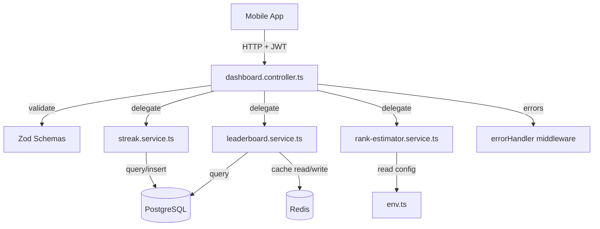

# Design Document: Dashboard Backend

## Overview

The Dashboard Backend provides three interconnected API features for the UP Police Test Series app:

1. **Leaderboard** — Ranks users by aggregated test scores with state-level (exam-filtered) and national views, cached in Redis.
2. **Streak Tracking** — Records daily user activity and computes consecutive-day engagement streaks using IST calendar boundaries.
3. **Rank Estimator** — Calculates an estimated exam rank using a configurable formula based on marks input.

All endpoints live under `/api/dashboard/*`, require JWT authentication via the existing `jwtAuth` middleware, and follow the project's established patterns: services for data access, controllers for HTTP handling, Zod for validation, and the `AppError` hierarchy for consistent error responses.

### Key Design Decisions

| Decision | Rationale |
|----------|-----------|
| New `user_activities` table with `(user_id, activity_date)` unique constraint | Enforces one record per user per day at DB level; enables simple streak queries |
| Leaderboard computed from `test_attempts` via aggregate query | Avoids maintaining a separate scores table; data is always fresh on cache miss |
| Redis caching with separate keys per exam + national | Prevents one user's cache invalidation from affecting other exam groups |
| IST timezone via `AT TIME ZONE 'Asia/Kolkata'` in SQL | Keeps timezone logic in the DB layer where date arithmetic is well-supported |
| Rank formula uses env vars (`RANK_TOTAL_APPLICANTS`, `RANK_TOTAL_MARKS`) | Allows ops to update without code deployment |
| Dense ranking with tie-breaking by earliest submission | Fair treatment of tied scores; deterministic ordering |

## Architecture



### Request Flow

1. Request hits Express router at `/api/dashboard/*`
2. `jwtAuth` middleware validates token, attaches `req.user.userId`
3. Controller validates query/body params with Zod
4. Controller calls the appropriate service function
5. Service executes DB queries / Redis operations / computations
6. Controller sends JSON response
7. On error: `AppError` subclass thrown → caught by global `errorHandler`

## Components and Interfaces

### Controller: `dashboard.controller.ts`

```typescript
// /packages/backend/src/controllers/dashboard.controller.ts
import { Router } from "express";
import { jwtAuth } from "@/middleware/jwt-auth.js";

const router = Router();
router.use(jwtAuth);

// GET  /api/dashboard/leaderboard?type=state|national
router.get("/leaderboard", getLeaderboard);

// POST /api/dashboard/activity
router.post("/activity", recordActivity);

// GET  /api/dashboard/streak
router.get("/streak", getStreak);

// GET  /api/dashboard/rank-estimate?marks=<number>
router.get("/rank-estimate", getRankEstimate);

export { router as dashboardRouter };
```

### Service: `leaderboard.service.ts`

```typescript
export interface LeaderboardEntry {
  rank: number;
  userId: string;
  fullName: string;
  avatarUrl: string | null;
  totalScore: number;
}

export interface LeaderboardResult {
  entries: LeaderboardEntry[];       // max 50
  userRank: LeaderboardEntry | null; // requesting user's position
  type: "state" | "national";
}

/**
 * Get the leaderboard for the given type.
 * Checks Redis cache first (TTL 5 min), falls back to DB query.
 */
export async function getLeaderboard(
  userId: string,
  type: "state" | "national",
  examId: string | null
): Promise<LeaderboardResult>;
```

### Service: `streak.service.ts`

```typescript
export interface StreakResult {
  currentStreak: number;
  streakDates: string[];        // ISO date strings (YYYY-MM-DD) in IST
  todayRecorded: boolean;
  milestoneReached: boolean;    // true when currentStreak === 7
}

/**
 * Record activity for today (IST). Idempotent — safe to call multiple times.
 */
export async function recordActivity(userId: string): Promise<void>;

/**
 * Compute the user's current streak from their activity records.
 */
export async function getStreak(userId: string): Promise<StreakResult>;
```

### Service: `rank-estimator.service.ts`

```typescript
export interface RankEstimateResult {
  estimatedRank: number;        // integer >= 1
  totalApplicants: number;
  marks: number;
  percentile: number;           // 2 decimal places
}

/**
 * Compute estimated rank given marks.
 * Formula: rank = totalApplicants × (1 - marks / totalMarks)
 * Rounds to nearest integer, minimum 1.
 */
export async function estimateRank(marks: number): Promise<RankEstimateResult>;
```

### Validation Schemas

```typescript
// Leaderboard query
const leaderboardQuerySchema = z.object({
  type: z.enum(["state", "national"]),
});

// Activity body (empty — no payload needed)
// Nothing to validate beyond auth

// Rank estimate query
const rankEstimateQuerySchema = z.object({
  marks: z.coerce
    .number()
    .min(0, "marks must be >= 0")
    .max(150, "marks must be <= 150")
    .refine((v) => Number((v * 100).toFixed(0)) === v * 100, {
      message: "marks accepts up to 2 decimal places",
    }),
});
```

## Data Models

### New Table: `user_activities`

Migration: `014_create-user-activities-table.ts`

```sql
CREATE TABLE user_activities (
  id          UUID PRIMARY KEY DEFAULT gen_random_uuid(),
  user_id     UUID NOT NULL REFERENCES users(id),
  activity_date DATE NOT NULL,
  created_at  TIMESTAMPTZ NOT NULL DEFAULT NOW()
);

-- One record per user per day (idempotency at DB level)
ALTER TABLE user_activities
  ADD CONSTRAINT uq_user_activity_date UNIQUE (user_id, activity_date);

-- Index for streak queries (backward scan by date)
CREATE INDEX idx_user_activities_user_date
  ON user_activities (user_id, activity_date DESC);
```

### Existing Tables Used

**`test_attempts`** — Leaderboard aggregation query:
```sql
SELECT
  ta.user_id,
  SUM(ta.total_score) AS total_score,
  MIN(ta.submitted_at) AS earliest_submission
FROM test_attempts ta
WHERE ta.status IN ('submitted', 'auto_submitted')
  AND ta.total_score IS NOT NULL
GROUP BY ta.user_id
HAVING SUM(ta.total_score) > 0
```

**`users`** — Join for `full_name`, `avatar_url`, `selected_exam_id`

### Redis Cache Keys

| Key Pattern | Value | TTL |
|-------------|-------|-----|
| `leaderboard:state:{examId}` | JSON-serialized `LeaderboardEntry[]` | 300s |
| `leaderboard:national` | JSON-serialized `LeaderboardEntry[]` | 300s |

### Environment Variables (new)

| Variable | Type | Default | Description |
|----------|------|---------|-------------|
| `RANK_TOTAL_APPLICANTS` | positive integer | — (required) | Total exam applicants for rank formula |
| `RANK_TOTAL_MARKS` | positive number | 150 | Maximum possible marks |

Added to the Zod env schema in `config/env.ts`:
```typescript
RANK_TOTAL_APPLICANTS: z.coerce.number().int().positive(),
RANK_TOTAL_MARKS: z.coerce.number().positive().default(150),
```

### Leaderboard SQL (State)

```sql
WITH ranked AS (
  SELECT
    u.id AS user_id,
    u.full_name,
    u.avatar_url,
    COALESCE(SUM(ta.total_score), 0) AS total_score,
    MIN(ta.submitted_at) AS earliest_submission,
    DENSE_RANK() OVER (
      ORDER BY COALESCE(SUM(ta.total_score), 0) DESC,
               MIN(ta.submitted_at) ASC
    ) AS rank
  FROM users u
  INNER JOIN test_attempts ta
    ON ta.user_id = u.id
    AND ta.status IN ('submitted', 'auto_submitted')
    AND ta.total_score IS NOT NULL
  WHERE u.selected_exam_id = $1
  GROUP BY u.id, u.full_name, u.avatar_url
  HAVING COALESCE(SUM(ta.total_score), 0) > 0
)
SELECT user_id, full_name, avatar_url, total_score, rank
FROM ranked
ORDER BY rank ASC, earliest_submission ASC
LIMIT 50;
```

### Streak Computation SQL

```sql
-- Get activity dates for user, ordered descending
SELECT activity_date
FROM user_activities
WHERE user_id = $1
ORDER BY activity_date DESC;
```

Streak computation happens in application code: iterate from today backward, counting consecutive dates. This allows flexibility and is simpler than a recursive CTE for small result sets (streak rarely exceeds 30-60 days).

## Correctness Properties

*A property is a characteristic or behavior that should hold true across all valid executions of a system — essentially, a formal statement about what the system should do. Properties serve as the bridge between human-readable specifications and machine-verifiable correctness guarantees.*

### Property 1: State leaderboard filtering

*For any* set of users with various `selected_exam_id` values and completed test attempts, the state leaderboard for a given exam SHALL only contain users whose `selected_exam_id` matches that exam, and the entries SHALL be sorted in descending order by total score.

**Validates: Requirements 1.1**

### Property 2: National leaderboard includes all eligible users

*For any* set of users with completed test attempts across different exams, the national leaderboard SHALL include all users regardless of their `selected_exam_id`, and entries SHALL be sorted in descending order by total score.

**Validates: Requirements 1.2**

### Property 3: Leaderboard max size invariant

*For any* dataset containing N eligible users (where N may be greater than 50), the leaderboard entries array SHALL contain at most 50 items.

**Validates: Requirements 1.5**

### Property 4: Invalid leaderboard type rejected

*For any* string that is not "state" or "national" (including empty string, undefined, or arbitrary text), requesting the leaderboard with that type SHALL result in a 400 validation error.

**Validates: Requirements 1.6**

### Property 5: Score aggregation correctness

*For any* user with a mix of test attempts in statuses (in_progress, submitted, auto_submitted), the computed total score SHALL equal the sum of `total_score` values only from attempts with status `submitted` or `auto_submitted`.

**Validates: Requirements 1.7**

### Property 6: Tie-breaking determinism

*For any* two users with identical total scores, they SHALL receive the same rank number, and the user with the earlier first submission date SHALL appear first in the ordering.

**Validates: Requirements 1.9**

### Property 7: Zero-attempt users excluded

*For any* leaderboard result (state or national), no entry SHALL have a total score of zero, and no user without at least one submitted/auto_submitted attempt SHALL appear.

**Validates: Requirements 1.10**

### Property 8: Activity recording idempotency

*For any* user and date, recording activity N times (N >= 1) SHALL result in exactly one `user_activities` record for that (user_id, activity_date) pair.

**Validates: Requirements 2.2**

### Property 9: Streak computation correctness

*For any* set of activity dates for a user, the streak count SHALL equal the length of the longest unbroken sequence of consecutive calendar days (IST) counting backward from today. If today has no record, the streak SHALL be 0.

**Validates: Requirements 2.3, 2.4, 2.6**

### Property 10: Rank estimation formula and output invariants

*For any* valid marks value M (0 ≤ M ≤ 150, up to 2 decimal places), given configuration values `totalApplicants` (T) and `totalMarks` (150), the estimated rank SHALL equal `max(1, round(T × (1 - M / 150)))`, the percentile SHALL equal `round(M / 150 × 100, 2)`, and the response SHALL include all four fields (estimatedRank as integer ≥ 1, totalApplicants, marks, percentile).

**Validates: Requirements 3.1, 3.2, 3.3, 3.4**

### Property 11: Invalid marks rejected

*For any* value that is non-numeric, less than 0, greater than 150, or missing, requesting the rank estimate SHALL result in a 400 validation error.

**Validates: Requirements 3.5**

## Error Handling

### Error Types and HTTP Codes

| Scenario | Error Code | HTTP Status | Message |
|----------|-----------|-------------|---------|
| Missing/invalid `type` query param | `VALIDATION_ERROR` | 400 | "type must be 'state' or 'national'" |
| No exam selected (state leaderboard) | `NO_EXAM_SELECTED` | 400 | "User has not selected an exam" |
| Invalid `marks` parameter | `VALIDATION_ERROR` | 400 | Specific constraint violated |
| Missing/invalid JWT | `TOKEN_INVALID` | 401 | Handled by jwtAuth middleware |
| Expired JWT | `TOKEN_EXPIRED` | 401 | Handled by jwtAuth middleware |
| Inactive session | `SESSION_TERMINATED` | 401 | Handled by jwtAuth middleware |
| Invalid `RANK_TOTAL_APPLICANTS` config | `CONFIG_ERROR` | 500 | "Rank estimation configuration error" |
| Unexpected DB/Redis failure | `SERVER_ERROR` | 500 | Generic message, details logged |

### Error Implementation Strategy

- **Validation errors**: Thrown via Zod schema parsing in the controller. The existing `validate` middleware or manual `safeParse` + `AppError` throw.
- **Business logic errors**: Custom `AppError` subclass with appropriate code/status (e.g., `NO_EXAM_SELECTED` as 400).
- **Configuration errors**: Check at request time (not startup) so the app doesn't crash if rank estimation config is missing but other endpoints work. Log `console.error` with full details.
- **Infrastructure failures**: Caught by try/catch in service, re-thrown as generic `AppError` or let the global handler produce 500.

### Redis Failure Handling

If Redis is unavailable when fetching leaderboard:
1. Log the Redis error
2. Fall through to the database query (cache miss path)
3. Do not cache the result (since Redis is down)
4. Return the response normally — Redis is a performance optimization, not a hard dependency

## Testing Strategy

### Testing Framework

- **Unit/Property tests**: Vitest + fast-check (already in devDependencies)
- **Integration tests**: Vitest with testcontainers (PostgreSQL)

### Property-Based Tests

Each correctness property maps to a property-based test using `fast-check`. Tests run a minimum of 100 iterations.

| Property | Test File | What's Generated |
|----------|-----------|------------------|
| 1: State filtering | `leaderboard.service.test.ts` | Random user sets with exam IDs and scores |
| 2: National inclusion | `leaderboard.service.test.ts` | Random user sets across exams |
| 3: Max 50 invariant | `leaderboard.service.test.ts` | Datasets of size 0–200 |
| 4: Invalid type rejected | `dashboard.controller.test.ts` | Random non-valid strings |
| 5: Score aggregation | `leaderboard.service.test.ts` | Mixed-status attempt sets |
| 6: Tie-breaking | `leaderboard.service.test.ts` | Users with identical scores, varied dates |
| 7: Zero excluded | `leaderboard.service.test.ts` | Datasets including zero-score users |
| 8: Idempotency | `streak.service.test.ts` | Random user+date, repeated N times |
| 9: Streak computation | `streak.service.test.ts` | Random activity date patterns |
| 10: Rank formula | `rank-estimator.service.test.ts` | Random marks 0–150 with decimals |
| 11: Invalid marks | `rank-estimator.service.test.ts` | Random invalid number values |

**Tag format**: Each test is annotated with:
```typescript
// Feature: dashboard-backend, Property N: <property text>
```

**Configuration**: Minimum 100 iterations per property via `fc.assert(..., { numRuns: 100 })`.

### Unit Tests (Example-Based)

- Milestone flag: streak of exactly 7 → `milestone_reached: true`; 6 and 8 → false
- Config error: invalid `RANK_TOTAL_APPLICANTS` → 500 with `CONFIG_ERROR`
- Self-rank inclusion: user at rank 51 still appears in response
- IST boundary: activity at 23:59 IST and 00:01 IST next day produce correct dates

### Integration Tests

- Redis caching: verify key set with correct TTL after leaderboard query
- JWT rejection: all endpoints return 401 without valid token
- DB constraint: duplicate `(user_id, activity_date)` insert handled gracefully
- End-to-end leaderboard: seed data → query → verify response shape and ordering

### Test File Structure

```
src/
├── services/
│   ├── leaderboard.service.ts
│   ├── leaderboard.service.test.ts      ← property + unit tests
│   ├── streak.service.ts
│   ├── streak.service.test.ts           ← property + unit tests
│   ├── rank-estimator.service.ts
│   └── rank-estimator.service.test.ts   ← property + unit tests
├── controllers/
│   ├── dashboard.controller.ts
│   └── dashboard.controller.test.ts     ← validation + integration tests
```
