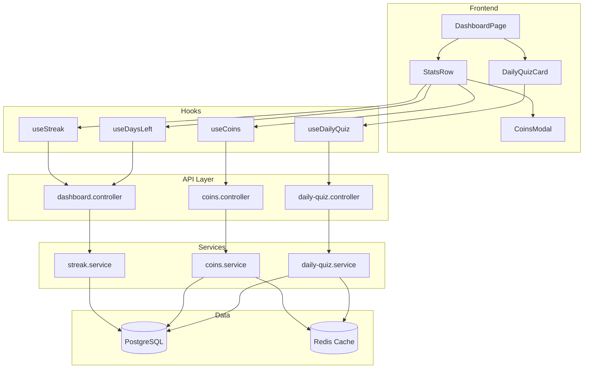

# Design Document: Dashboard Dynamic Phase 1

## Overview

This design replaces all hardcoded values in the dashboard with real, backend-driven data across four feature areas: Dynamic Streak (with best streak), Days Left countdown, Coins gamification system, and functional Daily Quiz. The architecture extends the existing Express + PostgreSQL + Redis stack with new services, database tables, and API endpoints while enhancing existing frontend components.

### Key Design Decisions

1. **Coins as a ledger** — Store individual earning events (transactions) rather than just a balance. Balance is derived from SUM of transactions. This provides auditability, prevents double-spending, and makes it trivial to show earning history.
2. **Daily quiz as a separate table** — Rather than reusing `test_attempts` (which is tied to `tests`), create a `daily_quiz_attempts` table optimized for the one-per-day constraint.
3. **Best streak in `users` table** — Add a `best_streak` column to `users` rather than computing it from history every time (O(1) read vs O(n) scan).
4. **Redis caching for hot paths** — Cache coin balance and daily quiz status with short TTLs (60s) since dashboard is loaded frequently.
5. **IST day boundaries enforced at DB level** — Use `(NOW() AT TIME ZONE 'Asia/Kolkata')::date` for all day-boundary checks to avoid timezone drift.

## Architecture



## Components and Interfaces

### Backend Services

#### 1. Enhanced Streak Service (`streak.service.ts`)

Extends the existing service to support `best_streak` tracking.

```typescript
// Enhanced return type
export interface StreakResult {
  currentStreak: number;
  bestStreak: number;
  streakDates: string[];       // last 7 days activity status
  todayRecorded: boolean;
  milestoneReached: boolean;   // true when currentStreak hits 7 (for coin award trigger)
}

// New function
export async function getStreakWithBest(userId: string): Promise<StreakResult>;

// Updated: also updates best_streak if current > stored
export async function recordActivity(userId: string): Promise<void>;
```

#### 2. Coins Service (`coins.service.ts`)

New service managing the coin economy.

```typescript
export interface CoinTransaction {
  id: string;
  userId: string;
  type: CoinEventType;
  amount: number;
  referenceId?: string;     // e.g., quiz attempt ID, test attempt ID, referred user ID
  createdAt: Date;
}

export type CoinEventType =
  | 'daily_login'
  | 'streak_bonus_7'
  | 'referral'
  | 'quiz_complete'
  | 'test_complete';

export interface CoinBalance {
  balance: number;
  lastEarnedAt: Date | null;
}

// Core functions
export async function getBalance(userId: string): Promise<CoinBalance>;
export async function getHistory(userId: string, limit: number, offset: number): Promise<CoinTransaction[]>;
export async function earnCoins(userId: string, type: CoinEventType, referenceId?: string): Promise<{ awarded: boolean; amount: number; newBalance: number }>;

// Internal validators (called by earnCoins)
function validateDailyLogin(userId: string, today: string): Promise<boolean>;
function validateStreakBonus(userId: string): Promise<boolean>;
function validateReferral(userId: string, referredUserId: string): Promise<boolean>;
function validateQuizComplete(userId: string, today: string): Promise<boolean>;
function validateTestComplete(userId: string, attemptId: string): Promise<boolean>;
```

#### 3. Daily Quiz Service (`daily-quiz.service.ts`)

New service for daily quiz generation and scoring.

```typescript
export interface DailyQuizQuestion {
  id: string;
  textEn: string;
  textHi: string;
  optionAEn: string; optionAHi: string;
  optionBEn: string; optionBHi: string;
  optionCEn: string; optionCHi: string;
  optionDEn: string; optionDHi: string;
  explanationEn?: string;
  explanationHi?: string;
}

export interface DailyQuizAttempt {
  id: string;
  userId: string;
  quizDate: string;           // YYYY-MM-DD IST
  questions: DailyQuizQuestion[];
  answers: (number | null)[];  // selected_option per question (null = unanswered)
  score: number | null;        // null if not submitted
  timeTakenSeconds: number | null;
  status: 'in_progress' | 'submitted';
  createdAt: Date;
  submittedAt: Date | null;
}

export interface QuizStatus {
  status: 'not_started' | 'in_progress' | 'completed';
  attempt?: DailyQuizAttempt;
}

// Core functions
export async function getQuizStatus(userId: string): Promise<QuizStatus>;
export async function startQuiz(userId: string): Promise<DailyQuizAttempt>;
export async function submitQuiz(userId: string, attemptId: string, answers: (number | null)[]): Promise<{ score: number; correctAnswers: number[] }>;
export async function getQuizResult(userId: string, attemptId: string): Promise<DailyQuizAttempt & { correctOptions: number[] }>;
```

### API Endpoints

#### Enhanced Dashboard Controller

```
GET /api/dashboard/streak        → Returns { currentStreak, bestStreak, streakDates, todayRecorded }
GET /api/dashboard/home          → Returns combined { streak, daysLeft, examDate, coinBalance }
```

#### Coins Controller (`coins.controller.ts`)

```
GET  /api/coins/balance          → { balance, lastEarnedAt }
GET  /api/coins/history?limit=20&offset=0  → { transactions: CoinTransaction[], total: number }
POST /api/coins/earn             → { type: CoinEventType, referenceId?: string } → { awarded, amount, newBalance }
```

#### Daily Quiz Controller (`daily-quiz.controller.ts`)

```
GET  /api/daily-quiz/status      → { status, attempt? }
POST /api/daily-quiz/start       → { attempt: DailyQuizAttempt }  (questions without correct answers)
POST /api/daily-quiz/submit      → { attemptId, answers: number[] } → { score, correctAnswers }
GET  /api/daily-quiz/result/:id  → { attempt with correct options and explanations }
```

### Frontend Hooks

```typescript
// useCoins — fetches and caches coin balance
export function useCoins(): {
  balance: number | null;
  isLoading: boolean;
  error: boolean;
  refetch: () => void;
};

// useDaysLeft — computes days until exam from dashboard/home response
export function useDaysLeft(): {
  daysLeft: number | null;
  examDateFormatted: string | null;
  isLoading: boolean;
};

// useDailyQuiz — manages daily quiz lifecycle
export function useDailyQuiz(): {
  status: QuizStatus | null;
  isLoading: boolean;
  startQuiz: () => Promise<DailyQuizAttempt>;
  submitQuiz: (answers: (number | null)[]) => Promise<QuizResult>;
};

// Enhanced useStreak — now includes bestStreak
export function useStreak(): {
  data: { currentStreak: number; bestStreak: number; streakDates: string[] } | null;
  isLoading: boolean;
  error: boolean;
  retry: () => void;
};
```

### Frontend Component Updates

#### StatsRow (Enhanced)

New props interface:
```typescript
interface StatsRowProps {
  language: 'hi' | 'en';
  currentStreak: number;
  bestStreak: number;
  daysLeft: number | null;
  examDateFormatted: string | null;
  coinBalance: number | null;
  onCoinsClick: () => void;
}
```

#### DailyQuizCard (Enhanced)

New props interface:
```typescript
interface DailyQuizCardProps {
  language: 'hi' | 'en';
  quizStatus: QuizStatus;
  onStart: () => void;
  onReattempt: () => void;
  onViewResult: () => void;
}
```

## Data Models

### New Database Tables

#### `coin_transactions` table

```sql
CREATE TABLE coin_transactions (
  id          UUID PRIMARY KEY DEFAULT gen_random_uuid(),
  user_id     UUID NOT NULL REFERENCES users(id),
  type        VARCHAR(20) NOT NULL,
  amount      INTEGER NOT NULL,
  reference_id VARCHAR(255),          -- quiz attempt ID, test attempt ID, referred user ID
  created_at  TIMESTAMPTZ NOT NULL DEFAULT NOW(),
  
  CONSTRAINT chk_coin_type CHECK (type IN ('daily_login', 'streak_bonus_7', 'referral', 'quiz_complete', 'test_complete')),
  CONSTRAINT chk_coin_amount CHECK (amount > 0)
);

-- Prevent duplicate daily login per IST day
CREATE UNIQUE INDEX uq_coin_daily_login 
  ON coin_transactions (user_id, type, (created_at AT TIME ZONE 'Asia/Kolkata')::date)
  WHERE type = 'daily_login';

-- Prevent duplicate quiz completion per IST day
CREATE UNIQUE INDEX uq_coin_quiz_daily 
  ON coin_transactions (user_id, type, (created_at AT TIME ZONE 'Asia/Kolkata')::date)
  WHERE type = 'quiz_complete';

-- Prevent duplicate test completion per attempt
CREATE UNIQUE INDEX uq_coin_test_attempt 
  ON coin_transactions (user_id, type, reference_id)
  WHERE type = 'test_complete';

-- Prevent duplicate referral per referred user
CREATE UNIQUE INDEX uq_coin_referral 
  ON coin_transactions (user_id, type, reference_id)
  WHERE type = 'referral';

CREATE INDEX idx_coin_transactions_user ON coin_transactions (user_id, created_at DESC);
```

#### `daily_quiz_attempts` table

```sql
CREATE TABLE daily_quiz_attempts (
  id              UUID PRIMARY KEY DEFAULT gen_random_uuid(),
  user_id         UUID NOT NULL REFERENCES users(id),
  quiz_date       DATE NOT NULL,           -- IST date
  question_ids    UUID[] NOT NULL,          -- ordered array of 10 question IDs
  answers         SMALLINT[],              -- user's answers (index matches question_ids)
  score           SMALLINT,                -- correct count (null if not submitted)
  time_taken_seconds INTEGER,
  status          VARCHAR(15) NOT NULL DEFAULT 'in_progress',
  created_at      TIMESTAMPTZ NOT NULL DEFAULT NOW(),
  submitted_at    TIMESTAMPTZ,
  
  CONSTRAINT chk_quiz_status CHECK (status IN ('in_progress', 'submitted')),
  CONSTRAINT uq_user_quiz_date UNIQUE (user_id, quiz_date)
);

CREATE INDEX idx_daily_quiz_user_date ON daily_quiz_attempts (user_id, quiz_date DESC);
```

### Schema Modifications

#### `users` table — add `best_streak` column

```sql
ALTER TABLE users ADD COLUMN best_streak INTEGER NOT NULL DEFAULT 0;
```

#### `exams` table — add `exam_date` column

```sql
ALTER TABLE exams ADD COLUMN exam_date DATE;
```

### Redis Cache Keys

| Key Pattern | TTL | Value |
|---|---|---|
| `coins:balance:{userId}` | 60s | `{ balance: number }` |
| `daily-quiz:status:{userId}:{date}` | 300s | `{ status, attemptId? }` |
| `streak:bonus-awarded:{userId}:{cycle}` | 30d | `"1"` (flag) |

The `cycle` in streak bonus key is the start date of the current streak, ensuring the bonus resets when the streak breaks and rebuilds.

## Correctness Properties

*A property is a characteristic or behavior that should hold true across all valid executions of a system — essentially, a formal statement about what the system should do. Properties serve as the bridge between human-readable specifications and machine-verifiable correctness guarantees.*

### Property 1: Streak computation correctness

*For any* user with a set of activity dates, the computed current_streak SHALL equal the count of consecutive IST calendar days with activity records, counting backward from today (inclusive). If today has no activity, current_streak SHALL be 0.

**Validates: Requirements 1.1**

### Property 2: Best streak monotonicity

*For any* sequence of streak computations for a user over time, the best_streak value SHALL be monotonically non-decreasing — it never decreases, even when the current_streak resets to zero.

**Validates: Requirements 2.1, 2.3**

### Property 3: Activity recording idempotency

*For any* user and any IST calendar day, calling recordActivity N times (N ≥ 1) SHALL result in exactly one record in the `user_activities` table for that user and date.

**Validates: Requirements 1.5**

### Property 4: Days-left computation

*For any* today date T (IST) and exam_date E, the computed days_left SHALL equal max(0, E - T) in calendar days. If E is null, days_left SHALL be null.

**Validates: Requirements 3.1, 3.5**

### Property 5: Coin balance equals sum of transactions

*For any* user, the coin balance returned by `getBalance` SHALL equal the sum of all `amount` values in the user's `coin_transactions` table.

**Validates: Requirements 4.1**

### Property 6: Daily login earning idempotency

*For any* user on any IST calendar day, regardless of how many times the daily login earning is triggered, exactly 10 coins SHALL be awarded total for that day (not per trigger).

**Validates: Requirements 5.1, 5.2**

### Property 7: Seven-day streak bonus — once per cycle

*For any* user within a single streak cycle (from streak start to streak break), the 50-coin streak bonus SHALL be awarded exactly once when the streak first reaches 7, and not again at 8, 9, ... until the streak resets and rebuilds to 7.

**Validates: Requirements 6.1, 6.2**

### Property 8: Referral earning uniqueness

*For any* pair of (referrer, referred user), referral coins (200) SHALL be awarded exactly once, regardless of how many times the earning is triggered. Invalid referral relationships SHALL award zero coins.

**Validates: Requirements 7.1, 7.2, 7.3**

### Property 9: Quiz completion earning idempotency

*For any* user on any IST calendar day, completing or re-triggering quiz completion earning SHALL award exactly 5 coins total for that day.

**Validates: Requirements 8.1, 8.3**

### Property 10: Test completion earning idempotency

*For any* test attempt, triggering test completion earning N times SHALL award exactly 10 coins total (not N × 10).

**Validates: Requirements 8.2, 8.4**

### Property 11: Quiz generation — exactly 10 questions

*For any* user with a selected exam that has associated active questions, starting a daily quiz SHALL produce a quiz containing exactly 10 questions.

**Validates: Requirements 9.1**

### Property 12: Quiz generation — correct subjects only

*For any* generated daily quiz, all questions SHALL belong to subjects associated with the user's selected exam (via the `question_exams` junction table).

**Validates: Requirements 9.2**

### Property 13: Quiz generation — active questions only

*For any* generated daily quiz, all included questions SHALL have `is_active = true`.

**Validates: Requirements 9.3**

### Property 14: Quiz generation — no 30-day repeats

*For any* generated daily quiz, no question SHALL appear in the user's answered questions from the last 30 days, unless fewer than 10 eligible fresh questions exist.

**Validates: Requirements 9.4**

### Property 15: Quiz scoring correctness

*For any* set of 10 user answers compared against 10 correct options, the computed score SHALL equal the count of indices where `answers[i] === correctOptions[i]`.

**Validates: Requirements 10.3**

### Property 16: One quiz attempt per user per day

*For any* user on any IST calendar day, at most one `daily_quiz_attempts` record SHALL exist. Subsequent start requests SHALL return the existing attempt.

**Validates: Requirements 10.5, 10.6**

### Property 17: Reattempt does not earn coins

*For any* reattempt of a daily quiz (where status is already 'submitted'), the user's coin balance SHALL remain unchanged.

**Validates: Requirements 11.3**

### Property 18: Bilingual data completeness

*For any* question returned in a daily quiz response, the fields text_en, text_hi, and all four option pairs (option_a_en/hi through option_d_en/hi) SHALL be non-empty strings.

**Validates: Requirements 12.1**

## Error Handling

### Backend Error Responses

All endpoints follow the existing error response pattern:

```typescript
{
  success: false,
  error: {
    code: string,    // machine-readable error code
    message: string  // human-readable message
  }
}
```

### Error Scenarios

| Scenario | HTTP Status | Error Code | Behavior |
|---|---|---|---|
| User not authenticated | 401 | `UNAUTHORIZED` | JWT middleware rejects |
| Coin earning validation fails (duplicate) | 200 | — | Returns `{ awarded: false, amount: 0 }` |
| No exam selected (days left) | 200 | — | Returns `daysLeft: null` |
| No exam selected (quiz start) | 400 | `NO_EXAM_SELECTED` | Cannot generate quiz without exam subjects |
| Quiz already in progress | 200 | — | Returns existing in-progress attempt |
| Quiz already submitted today | 200 | — | Returns existing submitted attempt |
| Quiz submit after expiry (>8min) | 200 | — | Auto-submit with answers at time of expiry (server doesn't enforce timer, frontend handles it) |
| Invalid attempt ID | 404 | `ATTEMPT_NOT_FOUND` | Attempt doesn't exist or belongs to another user |
| Insufficient questions in DB | 500 | `QUIZ_GENERATION_FAILED` | Log error, return 500 |
| Redis unavailable | — | — | Fallback to DB queries (cache miss pattern) |
| Invalid referral relationship | 200 | — | Returns `{ awarded: false }` |
| Concurrent coin earning (race condition) | — | — | Unique indexes prevent duplicates; catch constraint violation, return `{ awarded: false }` |

### Transaction Safety

- **Coin earning**: Uses `withTransaction` to ensure the validation check and INSERT are atomic. The unique indexes serve as a secondary guard against race conditions.
- **Quiz submission**: Uses `withTransaction` to update attempt + trigger coin earning atomically.
- **Best streak update**: Uses `UPDATE users SET best_streak = GREATEST(best_streak, $1)` which is safe for concurrent access.

### Graceful Degradation

- If Redis is down, services fall through to PostgreSQL queries (slightly higher latency, no crash).
- If coin earning fails mid-transaction, the transaction rolls back — no partial state.
- Frontend hooks include retry logic and show loading/error states.

## Testing Strategy

### Property-Based Tests (fast-check)

The project already uses `fast-check` (v3.22.0) as a dev dependency. Each property test will run a minimum of 100 iterations.

Property-based tests target the service layer (pure logic) with mocked database calls where needed:

- **Streak computation** — Generate random activity date sets, verify streak counting logic
- **Coin earning validators** — Generate random sequences of earning events, verify idempotency
- **Quiz scoring** — Generate random answer arrays, verify score computation
- **Quiz generation invariants** — Generate random question pools, verify selection constraints
- **Days-left computation** — Generate random date pairs, verify calculation
- **Best streak monotonicity** — Generate activity sequences over time, verify non-decreasing

Tag format: `Feature: dashboard-dynamic-phase1, Property {N}: {description}`

### Unit Tests (vitest)

- Controller request validation (Zod schemas)
- Service function edge cases (empty arrays, null exam, zero balance)
- Frontend hook state transitions
- Component rendering for each quiz status state

### Integration Tests

- Full API flow: login → record activity → check streak → earn coins → check balance
- Daily quiz lifecycle: status → start → submit → status again
- Database constraint enforcement (duplicate prevention)
- Redis cache invalidation on coin earning

### Test File Organization

```
packages/backend/src/services/
  coins.service.test.ts            # Unit + property tests
  daily-quiz.service.test.ts       # Unit + property tests
  streak.service.test.ts           # Enhanced with best_streak property tests

packages/backend/src/controllers/
  coins.controller.test.ts         # Request validation
  daily-quiz.controller.test.ts    # Request validation

packages/frontend/src/hooks/
  useCoins.test.ts
  useDailyQuiz.test.ts
  useDaysLeft.test.ts

packages/frontend/src/components/dashboard/
  StatsRow.test.tsx
  DailyQuizCard.test.tsx
```
