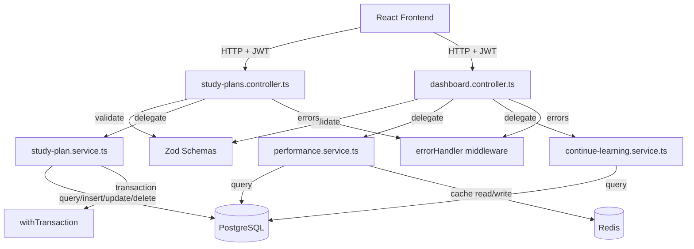

# Design Document: Dashboard Dynamic Phase 2

## Overview

Dashboard Dynamic Phase 2 replaces the remaining hardcoded dashboard components with backend-driven data. It introduces four interconnected feature areas:

1. **Study Plan CRUD** — Full lifecycle management of daily study plans with subject-time allocations
2. **Today's Plan** — Active plan selection, real-time completion tracking, and dashboard display
3. **Continue Learning** — Latest incomplete topic detection with accuracy-based progress
4. **Performance Stats** — Real performance computation from DB with Redis caching and weekly chart

All backend services follow the existing patterns: controllers for HTTP handling, services for business logic, Zod for validation, `withTransaction` for multi-table operations, and Redis for caching with graceful fallback.

### Key Design Decisions

| Decision | Rationale |
|----------|-----------|
| Separate `study-plans.controller.ts` from `dashboard.controller.ts` | Study plans are a full CRUD resource, not a dashboard sub-feature |
| `ON CONFLICT ... DO UPDATE` for active plan upsert | Enforces one active plan per day at DB level, simplifies replace logic |
| `ON CONFLICT DO NOTHING` for item completions | Idempotent completion marking without application-level checks |
| Performance stats cached in Redis with 120s TTL | Avoids expensive aggregate queries on every dashboard load |
| Continue Learning computed from `test_attempts` JOIN `attempt_answers` | Reuses existing data model, no new tracking tables needed |
| Weekly chart included in same `/performance` endpoint | Single API call for the entire performance card, reduces frontend complexity |
| IST date computation in SQL via `AT TIME ZONE 'Asia/Kolkata'` | Consistent with Phase 1 patterns, avoids timezone drift |

## Architecture



### Request Flow

1. Request hits Express router at `/api/study-plans/*` or `/api/dashboard/*`
2. `jwtAuth` middleware validates token, attaches `req.user.userId`
3. Controller validates params/body with Zod
4. Controller calls the appropriate service function
5. Service executes DB queries (with transaction where needed) / Redis operations
6. Controller sends JSON response
7. On error: `AppError` subclass thrown → caught by global `errorHandler`

## Components and Interfaces

### Controller: `study-plans.controller.ts`

```typescript
// /packages/backend/src/controllers/study-plans.controller.ts
import { Router } from "express";
import { jwtAuth } from "@/middleware/jwt-auth.js";

const router = Router();
router.use(jwtAuth);

// CRUD
router.post("/", handleCreatePlan);           // POST /api/study-plans
router.get("/", handleListPlans);             // GET  /api/study-plans
router.get("/today", handleGetTodayPlan);     // GET  /api/study-plans/today
router.get("/:planId", handleGetPlan);        // GET  /api/study-plans/:planId
router.put("/:planId", handleUpdatePlan);     // PUT  /api/study-plans/:planId
router.delete("/:planId", handleDeletePlan);  // DELETE /api/study-plans/:planId

// Active plan
router.post("/:planId/activate", handleActivatePlan);  // POST /api/study-plans/:planId/activate

// Completion tracking
router.post("/today/items/:itemId/complete", handleCompleteItem);    // POST
router.delete("/today/items/:itemId/complete", handleUncompleteItem); // DELETE

export { router as studyPlansRouter };
```

### Dashboard Controller (extended)

```typescript
// Added to existing /packages/backend/src/controllers/dashboard.controller.ts
router.get("/continue-learning", handleGetContinueLearning);  // GET /api/dashboard/continue-learning
router.get("/performance", handleGetPerformance);             // GET /api/dashboard/performance
```

### Service: `study-plan.service.ts`

```typescript
// /packages/backend/src/services/study-plan.service.ts

export interface CreatePlanInput {
  name: string;
  dayOfWeek?: string | null;
  items: { subject_id: string; duration_minutes: number }[];
}

export interface PlanSummary {
  id: string;
  name: string;
  itemCount: number;
  totalDuration: number;
  createdAt: string;
}

export interface PlanDetail {
  id: string;
  name: string;
  dayOfWeek: string | null;
  items: PlanItemDetail[];
  createdAt: string;
  updatedAt: string;
}

export interface PlanItemDetail {
  id: string;
  subjectId: string;
  subjectNameEn: string;
  subjectNameHi: string;
  durationMinutes: number;
  displayOrder: number;
}

export interface TodayPlanResponse {
  planId: string;
  planName: string;
  planDate: string;
  items: TodayPlanItem[];
  completedCount: number;
  totalCount: number;
  progressPercent: number;
}

export interface TodayPlanItem {
  id: string;
  subjectNameEn: string;
  subjectNameHi: string;
  durationMinutes: number;
  completed: boolean;
}

export async function createPlan(userId: string, input: CreatePlanInput): Promise<PlanDetail>;
export async function updatePlan(userId: string, planId: string, input: CreatePlanInput): Promise<PlanDetail>;
export async function deletePlan(userId: string, planId: string): Promise<void>;
export async function listPlans(userId: string): Promise<PlanSummary[]>;
export async function getPlan(userId: string, planId: string): Promise<PlanDetail>;
export async function activatePlan(userId: string, planId: string): Promise<{ planId: string; planDate: string }>;
export async function getTodayPlan(userId: string): Promise<TodayPlanResponse | null>;
export async function completeItem(userId: string, itemId: string): Promise<void>;
export async function uncompleteItem(userId: string, itemId: string): Promise<void>;
```

### Service: `performance.service.ts`

```typescript
// /packages/backend/src/services/performance.service.ts

export interface PerformanceStats {
  attempted: number;
  correct: number;
  wrong: number;
  accuracy: number; // integer 0-100
  weeklyChart: WeeklyChartEntry[];
}

export interface WeeklyChartEntry {
  date: string;       // YYYY-MM-DD in IST
  accuracy: number | null; // integer 0-100 or null for no data
}

/**
 * Compute performance stats for a user.
 * Checks Redis cache first (key: perf:{userId}, TTL: 120s).
 * Falls back to DB computation if Redis unavailable.
 */
export async function getPerformanceStats(userId: string): Promise<PerformanceStats>;

/**
 * Pure computation: calculate stats from raw answer data.
 * Exposed for property-based testing without DB/Redis dependency.
 */
export function computeStats(
  answers: { selectedOption: number | null; correctOption: number }[]
): { attempted: number; correct: number; wrong: number; accuracy: number };

/**
 * Pure computation: calculate daily accuracy from dated answers.
 * Exposed for property-based testing.
 */
export function computeWeeklyChart(
  answers: { date: string; selectedOption: number | null; correctOption: number }[],
  dates: string[]
): WeeklyChartEntry[];
```

### Service: `continue-learning.service.ts`

```typescript
// /packages/backend/src/services/continue-learning.service.ts

export interface ContinueLearningResponse {
  subjectNameEn: string;
  subjectNameHi: string;
  topicNameEn: string;
  topicNameHi: string;
  accuracyPercentage: number; // integer 0-100
  topicId: string;
  subjectId: string;
}

/**
 * Find the user's most recently attempted topic with accuracy below 80%.
 * Returns null if no qualifying topic exists.
 */
export async function getContinueLearning(userId: string): Promise<ContinueLearningResponse | null>;
```

### Validation Schemas

```typescript
// Study Plan creation/update body
const planBodySchema = z.object({
  name: z.string().min(1).max(100),
  dayOfWeek: z.enum(["monday", "tuesday", "wednesday", "thursday", "friday", "saturday", "sunday"]).nullable().optional(),
  items: z.array(z.object({
    subject_id: z.string().uuid(),
    duration_minutes: z.number().int().min(5).max(480),
  })).min(1).max(10).refine(
    (items) => new Set(items.map(i => i.subject_id)).size === items.length,
    { message: "Duplicate subject_id in plan items" }
  ),
});

// UUID path param
const uuidParamSchema = z.object({
  planId: z.string().uuid("Invalid plan identifier"),
});

const itemIdParamSchema = z.object({
  itemId: z.string().uuid("Invalid item identifier"),
});
```

### Frontend Components

```typescript
// packages/frontend/src/components/dashboard/TodaysPlan.tsx (refactored)
interface TodaysPlanProps {
  language: 'hi' | 'en';
}
// Fetches from GET /api/study-plans/today
// Manages optimistic checkbox state with rollback on failure
// Displays progress bar with percentage

// packages/frontend/src/components/dashboard/ContinueLearning.tsx (refactored)
interface ContinueLearningProps {
  language: 'hi' | 'en';
}
// Fetches from GET /api/dashboard/continue-learning
// Displays subject, topic, accuracy, Continue button

// packages/frontend/src/components/dashboard/PerformanceCard.tsx (refactored)
interface PerformanceCardProps {
  language: 'hi' | 'en';
}
// Fetches from GET /api/dashboard/performance
// Displays attempted, correct, wrong, accuracy stats
// Renders SVG line chart from weeklyChart data

// packages/frontend/src/pages/StudyPlanPage.tsx (new/enhanced)
// Full CRUD UI for study plans
// Plan list, create form, edit form, delete confirmation
// Activate plan for today
```

## Data Models

### Migration: `019_create-study-plans-tables.ts`

```sql
-- study_plans table
CREATE TABLE study_plans (
  id UUID PRIMARY KEY DEFAULT gen_random_uuid(),
  user_id UUID NOT NULL REFERENCES users(id) ON DELETE CASCADE,
  name VARCHAR(100) NOT NULL,
  day_of_week VARCHAR(10),
  created_at TIMESTAMPTZ NOT NULL DEFAULT NOW(),
  updated_at TIMESTAMPTZ NOT NULL DEFAULT NOW()
);

CREATE INDEX idx_study_plans_user_created
  ON study_plans (user_id, created_at DESC);

-- study_plan_items table
CREATE TABLE study_plan_items (
  id UUID PRIMARY KEY DEFAULT gen_random_uuid(),
  plan_id UUID NOT NULL REFERENCES study_plans(id) ON DELETE CASCADE,
  subject_id UUID NOT NULL REFERENCES subjects(id),
  duration_minutes INTEGER NOT NULL,
  display_order INTEGER NOT NULL,
  created_at TIMESTAMPTZ NOT NULL DEFAULT NOW()
);

ALTER TABLE study_plan_items
  ADD CONSTRAINT chk_duration_minutes CHECK (duration_minutes BETWEEN 5 AND 480);
ALTER TABLE study_plan_items
  ADD CONSTRAINT chk_display_order CHECK (display_order BETWEEN 0 AND 100);

CREATE INDEX idx_plan_items_plan_id ON study_plan_items (plan_id);

-- user_active_plans table
CREATE TABLE user_active_plans (
  id UUID PRIMARY KEY DEFAULT gen_random_uuid(),
  user_id UUID NOT NULL REFERENCES users(id) ON DELETE CASCADE,
  plan_id UUID NOT NULL REFERENCES study_plans(id) ON DELETE CASCADE,
  plan_date DATE NOT NULL,
  created_at TIMESTAMPTZ NOT NULL DEFAULT NOW()
);

ALTER TABLE user_active_plans
  ADD CONSTRAINT uq_user_active_plan_date UNIQUE (user_id, plan_date);

CREATE INDEX idx_active_plans_user_date
  ON user_active_plans (user_id, plan_date DESC);

-- plan_item_completions table
CREATE TABLE plan_item_completions (
  id UUID PRIMARY KEY DEFAULT gen_random_uuid(),
  user_id UUID NOT NULL REFERENCES users(id) ON DELETE CASCADE,
  item_id UUID NOT NULL REFERENCES study_plan_items(id) ON DELETE CASCADE,
  completion_date DATE NOT NULL,
  completed_at TIMESTAMPTZ NOT NULL DEFAULT NOW()
);

ALTER TABLE plan_item_completions
  ADD CONSTRAINT uq_user_item_completion_date UNIQUE (user_id, item_id, completion_date);

CREATE INDEX idx_completions_user_date
  ON plan_item_completions (user_id, completion_date);
```

### Key SQL Queries

**Create Plan (within transaction):**
```sql
INSERT INTO study_plans (user_id, name, day_of_week)
VALUES ($1, $2, $3)
RETURNING id, name, day_of_week, created_at, updated_at;

INSERT INTO study_plan_items (plan_id, subject_id, duration_minutes, display_order)
VALUES ($1, $2, $3, $4)
RETURNING id, subject_id, duration_minutes, display_order;
```

**Update Plan (within transaction):**
```sql
UPDATE study_plans SET name = $1, day_of_week = $2, updated_at = NOW()
WHERE id = $3 AND user_id = $4
RETURNING id, name, day_of_week, created_at, updated_at;

DELETE FROM study_plan_items WHERE plan_id = $1;

INSERT INTO study_plan_items (plan_id, subject_id, duration_minutes, display_order)
VALUES ($1, $2, $3, $4)
RETURNING id, subject_id, duration_minutes, display_order;
```

**Activate Plan (upsert):**
```sql
INSERT INTO user_active_plans (user_id, plan_id, plan_date)
VALUES ($1, $2, (NOW() AT TIME ZONE 'Asia/Kolkata')::date)
ON CONFLICT (user_id, plan_date)
DO UPDATE SET plan_id = EXCLUDED.plan_id, created_at = NOW()
RETURNING plan_id, plan_date;
```

**Get Today's Plan:**
```sql
SELECT
  sp.id AS plan_id, sp.name AS plan_name,
  uap.plan_date,
  spi.id AS item_id,
  s.name_en AS subject_name_en, s.name_hi AS subject_name_hi,
  spi.duration_minutes, spi.display_order,
  CASE WHEN pic.id IS NOT NULL THEN true ELSE false END AS completed
FROM user_active_plans uap
JOIN study_plans sp ON sp.id = uap.plan_id
JOIN study_plan_items spi ON spi.plan_id = sp.id
JOIN subjects s ON s.id = spi.subject_id
LEFT JOIN plan_item_completions pic
  ON pic.item_id = spi.id
  AND pic.user_id = $1
  AND pic.completion_date = (NOW() AT TIME ZONE 'Asia/Kolkata')::date
WHERE uap.user_id = $1
  AND uap.plan_date = (NOW() AT TIME ZONE 'Asia/Kolkata')::date
ORDER BY spi.display_order ASC;
```

**Complete Item (idempotent):**
```sql
INSERT INTO plan_item_completions (user_id, item_id, completion_date)
VALUES ($1, $2, (NOW() AT TIME ZONE 'Asia/Kolkata')::date)
ON CONFLICT (user_id, item_id, completion_date) DO NOTHING;
```

**Uncomplete Item:**
```sql
DELETE FROM plan_item_completions
WHERE user_id = $1
  AND item_id = $2
  AND completion_date = (NOW() AT TIME ZONE 'Asia/Kolkata')::date;
```

**Continue Learning:**
```sql
WITH recent_topic_attempts AS (
  SELECT
    t.topic_id,
    t.subject_id,
    ta.submitted_at,
    COUNT(aa.id) FILTER (WHERE aa.selected_option IS NOT NULL) AS attempted,
    COUNT(aa.id) FILTER (WHERE aa.selected_option = q.correct_option) AS correct_count
  FROM test_attempts ta
  JOIN tests t ON t.id = ta.test_id
  JOIN attempt_answers aa ON aa.attempt_id = ta.id
  JOIN questions q ON q.id = aa.question_id
  WHERE ta.user_id = $1
    AND ta.status IN ('submitted', 'auto_submitted')
    AND t.category = 'subject_wise'
    AND t.topic_id IS NOT NULL
  GROUP BY t.topic_id, t.subject_id, ta.submitted_at
)
SELECT
  rta.topic_id, rta.subject_id,
  tp.name_en AS topic_name_en, tp.name_hi AS topic_name_hi,
  s.name_en AS subject_name_en, s.name_hi AS subject_name_hi,
  ROUND(rta.correct_count::numeric / NULLIF(rta.attempted, 0) * 100)::int AS accuracy_percentage
FROM recent_topic_attempts rta
JOIN topics tp ON tp.id = rta.topic_id
JOIN subjects s ON s.id = rta.subject_id
WHERE rta.attempted > 0
  AND ROUND(rta.correct_count::numeric / NULLIF(rta.attempted, 0) * 100) < 80
ORDER BY rta.submitted_at DESC
LIMIT 1;
```

**Performance Stats (aggregate):**
```sql
SELECT
  COUNT(aa.id) FILTER (WHERE aa.selected_option IS NOT NULL) AS attempted,
  COUNT(aa.id) FILTER (WHERE aa.selected_option = q.correct_option) AS correct,
  COUNT(aa.id) FILTER (
    WHERE aa.selected_option IS NOT NULL AND aa.selected_option != q.correct_option
  ) AS wrong
FROM test_attempts ta
JOIN attempt_answers aa ON aa.attempt_id = ta.id
JOIN questions q ON q.id = aa.question_id
WHERE ta.user_id = $1
  AND ta.status IN ('submitted', 'auto_submitted');
```

**Weekly Chart (daily accuracy for last 7 IST days):**
```sql
WITH days AS (
  SELECT generate_series(
    (NOW() AT TIME ZONE 'Asia/Kolkata')::date - INTERVAL '6 days',
    (NOW() AT TIME ZONE 'Asia/Kolkata')::date,
    '1 day'::interval
  )::date AS day
),
daily_answers AS (
  SELECT
    (ta.submitted_at AT TIME ZONE 'Asia/Kolkata')::date AS answer_date,
    aa.selected_option,
    q.correct_option
  FROM test_attempts ta
  JOIN attempt_answers aa ON aa.attempt_id = ta.id
  JOIN questions q ON q.id = aa.question_id
  WHERE ta.user_id = $1
    AND ta.status IN ('submitted', 'auto_submitted')
    AND ta.submitted_at >= (NOW() AT TIME ZONE 'Asia/Kolkata')::date - INTERVAL '6 days'
    AND aa.selected_option IS NOT NULL
)
SELECT
  d.day AS date,
  CASE
    WHEN COUNT(da.selected_option) = 0 THEN NULL
    ELSE ROUND(
      COUNT(CASE WHEN da.selected_option = da.correct_option THEN 1 END)::numeric
      / COUNT(da.selected_option) * 100
    )::int
  END AS accuracy
FROM days d
LEFT JOIN daily_answers da ON da.answer_date = d.day
GROUP BY d.day
ORDER BY d.day ASC;
```

### Redis Cache Keys

| Key Pattern | Value | TTL |
|-------------|-------|-----|
| `perf:{userId}` | JSON-serialized `PerformanceStats` | 120s |

### Existing Tables Used

- **`test_attempts`** — Performance stats aggregation, continue learning detection
- **`attempt_answers`** — Answer correctness computation
- **`questions`** — `correct_option` for accuracy calculation
- **`tests`** — `category`, `topic_id`, `subject_id` for filtering
- **`subjects`** — Bilingual names for plan items and continue learning
- **`topics`** — Bilingual names for continue learning
- **`users`** — `selected_exam_id` for subject validation
- **`daily_quiz_attempts`** — Included in performance stats computation

## Correctness Properties

*A property is a characteristic or behavior that should hold true across all valid executions of a system — essentially, a formal statement about what the system should do. Properties serve as the bridge between human-readable specifications and machine-verifiable correctness guarantees.*

### Property 1: Plan validation accepts only valid inputs

*For any* plan name between 1 and 100 characters, and any items array with 1 to 10 items where each item has a duration between 5 and 480 and no two items share the same subject_id, the validation SHALL pass. For any input violating these constraints, the validation SHALL reject it.

**Validates: Requirements 1.2, 1.3, 1.8, 2.2**

### Property 2: Plan update atomically replaces items

*For any* existing plan with N items, when updated with M new items, the resulting plan SHALL contain exactly the M new items and zero of the previous N items.

**Validates: Requirements 2.1**

### Property 3: Invalid UUID rejection

*For any* string that is not a valid UUID v4 format, the study plan endpoints accepting a planId or itemId path parameter SHALL return a 400 validation error.

**Validates: Requirements 2.6, 3.5, 5.7**

### Property 4: Plan listing is ordered and bounded

*For any* user with N plans (N >= 0), the list endpoint SHALL return plans ordered by created_at descending, and the count SHALL be at most min(N, 100).

**Validates: Requirements 4.1**

### Property 5: Plan list summary correctness

*For any* plan in the listing, the returned item_count SHALL equal the actual number of items in the plan, and total_duration SHALL equal the sum of all item durations.

**Validates: Requirements 4.3**

### Property 6: Active plan upsert semantics

*For any* user and IST day, after N activations (N >= 1) of potentially different plans, there SHALL be exactly one active plan record for that (user_id, plan_date), and it SHALL reference the most recently activated plan.

**Validates: Requirements 5.2, 5.3**

### Property 7: Completion marking is idempotent

*For any* valid plan item, marking it as completed N times (N >= 1) on the same IST day SHALL result in exactly one completion record for that (user_id, item_id, completion_date) tuple, and all N calls SHALL return success.

**Validates: Requirements 6.2**

### Property 8: Complete/uncomplete round trip

*For any* valid plan item in the active plan, marking it complete and then uncompleting it SHALL result in no completion record existing for that item on that day (equivalent to never having marked it).

**Validates: Requirements 6.1, 6.3**

### Property 9: Today's plan completion state accuracy

*For any* active plan with items where a subset S of items have been completed, the GET /today response SHALL show `completed: true` for exactly the items in S and `completed: false` for all others, and progressPercent SHALL equal round(|S| / total × 100).

**Validates: Requirements 6.8, 7.3**

### Property 10: Continue learning returns most recent topic with accuracy below 80%

*For any* set of test attempts where multiple topics have accuracy below 80%, the continue-learning endpoint SHALL return the topic from the most recently submitted attempt (by submitted_at timestamp).

**Validates: Requirements 8.2**

### Property 11: Performance stats computation correctness

*For any* set of attempt_answers across submitted/auto_submitted test_attempts, the performance stats SHALL satisfy: attempted = count of answers where selected_option is not null, correct = count where selected_option equals correct_option, wrong = attempted - correct, and accuracy = round(correct / attempted × 100) when attempted > 0 else 0.

**Validates: Requirements 9.1, 9.2, 9.3, 9.4**

### Property 12: Weekly chart structure and daily accuracy

*For any* set of answers distributed across the last 7 IST calendar days, the weekly chart SHALL contain exactly 7 entries ordered from oldest to newest, where each entry's accuracy equals round(correct_that_day / attempted_that_day × 100) or null when no answers exist for that day.

**Validates: Requirements 10.1, 10.2, 10.5**

### Property 13: Weekly chart includes all answer sources

*For any* user with answers from both test_attempts and daily_quiz_attempts on the same day, the daily accuracy computation SHALL include answers from both sources.

**Validates: Requirements 10.7**

## Error Handling

### Error Types and HTTP Codes

| Scenario | Error Code | HTTP Status | Message |
|----------|-----------|-------------|---------|
| Invalid plan name (empty / >100 chars) | `VALIDATION_ERROR` | 400 | Specific constraint violated |
| Invalid items (count, duration, duplicates) | `VALIDATION_ERROR` | 400 | Specific constraint violated |
| Invalid UUID path param | `VALIDATION_ERROR` | 400 | "Invalid plan/item identifier" |
| Invalid subject_id (not in user's exam) | `VALIDATION_ERROR` | 400 | "Invalid subject reference" |
| No exam selected | `NO_EXAM_SELECTED` | 400 | "Select an exam before creating a study plan" |
| Plan not found | `NOT_FOUND` | 404 | "Plan not found" |
| Plan belongs to another user | `FORBIDDEN` | 403 | "Access denied" |
| Item not found | `NOT_FOUND` | 404 | "Item not found" |
| Item not in active plan | `FORBIDDEN` | 403 | "Item not in today's active plan" |
| Missing/invalid JWT | `TOKEN_INVALID` | 401 | Handled by jwtAuth middleware |
| DB/Redis failure | `SERVER_ERROR` | 500 | Generic message, details logged |

### Error Implementation Strategy

- **Validation errors**: Zod schema `.safeParse()` in controller, transform to `AppError` with 400 status
- **Authorization errors**: Service checks `user_id` ownership before operations, throws `AppError` with 403
- **Not found errors**: Service returns null or checks affected rows, controller throws `AppError` with 404
- **Subject validation**: Service queries subjects table filtered by user's exam, rejects mismatches
- **Transaction errors**: `withTransaction` automatically rolls back on any throw, error re-thrown to controller

### Redis Failure Handling

For the performance endpoint:
1. Attempt Redis `GET perf:{userId}`
2. If Redis throws or is unavailable, log error, compute directly from DB
3. If computation succeeds, attempt Redis `SET` with TTL — failure is silently logged
4. Return response normally — Redis is a performance optimization, not a hard dependency

## Testing Strategy

### Testing Framework

- **Unit/Property tests**: Vitest + fast-check (already in devDependencies)
- **Integration tests**: Vitest with testcontainers (PostgreSQL + Redis)
- **Frontend tests**: Vitest + React Testing Library

### Property-Based Tests

Each correctness property maps to a property-based test using `fast-check`. Tests run a minimum of 100 iterations.

| Property | Test File | What's Generated |
|----------|-----------|------------------|
| 1: Plan validation | `study-plan.service.test.ts` | Random names (0-200 chars), item arrays (0-15 items), durations (1-1000) |
| 2: Atomic item replacement | `study-plan.service.test.ts` | Plans with N items, updates with M items |
| 3: UUID rejection | `study-plans.controller.test.ts` | Random non-UUID strings |
| 4: List ordering/bound | `study-plan.service.test.ts` | Sets of plans with random created_at timestamps |
| 5: Summary correctness | `study-plan.service.test.ts` | Plans with 1-10 items of varying durations |
| 6: Active plan upsert | `study-plan.service.test.ts` | Sequences of plan activations on same day |
| 7: Completion idempotency | `study-plan.service.test.ts` | Random items marked complete N times |
| 8: Complete/uncomplete round trip | `study-plan.service.test.ts` | Random items with complete+uncomplete sequences |
| 9: Today completion state | `study-plan.service.test.ts` | Plans with random subsets of completed items |
| 10: Continue learning selection | `continue-learning.service.test.ts` | Sets of attempts with varying accuracies and timestamps |
| 11: Performance computation | `performance.service.test.ts` | Random answer sets with various selected_option/correct_option combinations |
| 12: Weekly chart structure | `performance.service.test.ts` | Answers distributed across 7 days with varying counts |
| 13: All sources included | `performance.service.test.ts` | Mixed test_attempt + daily_quiz_attempt answer sets |

**Tag format**: Each test is annotated with:
```typescript
// Feature: dashboard-dynamic-phase2, Property N: <property_text>
```

**Configuration**: Minimum 100 iterations per property via `fc.assert(..., { numRuns: 100 })`.

### Unit Tests (Example-Based)

- **Study Plan CRUD**: Create/edit/delete happy path, ownership checks (403), not found (404)
- **Subject validation**: Invalid subject_id, subject from wrong exam, no exam selected
- **Active plan**: Activate happy path, activation replaces previous
- **Completion**: Mark complete, unmark, item not in active plan (403)
- **Continue learning**: No attempts → null, all topics ≥80% → null, edge at exactly 80% excluded
- **Performance**: Zero attempts → all zeros, accuracy rounding edge cases
- **Weekly chart**: Mix of days with/without data, null vs 0 distinction

### Integration Tests

- **DB transaction**: Plan update rolls back on item insertion failure
- **Redis caching**: Performance endpoint sets key with 120s TTL
- **Redis fallback**: Performance endpoint works when Redis is down
- **Cascade deletion**: Deleting a plan removes items, active_plans, completions
- **UNIQUE constraints**: Duplicate active plan on same day handled by upsert
- **JWT rejection**: All endpoints return 401 without valid token
- **End-to-end**: Full create → activate → complete → get today flow

### Frontend Tests

- **TodaysPlan**: Renders items from API, checkbox toggle calls correct endpoint, rollback on failure
- **ContinueLearning**: Renders topic data, handles null/no-data states, Continue button navigation
- **PerformanceCard**: Renders stats from API, loading state, error state with "--", chart renders with gaps

### Test File Structure

```
packages/backend/src/
├── services/
│   ├── study-plan.service.ts
│   ├── study-plan.service.test.ts          ← property + unit tests
│   ├── performance.service.ts
│   ├── performance.service.test.ts         ← property + unit tests
│   ├── continue-learning.service.ts
│   └── continue-learning.service.test.ts   ← property + unit tests
├── controllers/
│   ├── study-plans.controller.ts
│   ├── study-plans.controller.test.ts      ← validation + integration tests
│   ├── dashboard.controller.ts
│   └── dashboard.controller.test.ts        ← extended with new endpoint tests
packages/frontend/src/
├── components/dashboard/
│   ├── TodaysPlan.tsx
│   ├── TodaysPlan.test.tsx
│   ├── ContinueLearning.tsx
│   ├── ContinueLearning.test.tsx
│   ├── PerformanceCard.tsx
│   └── PerformanceCard.test.tsx
```
