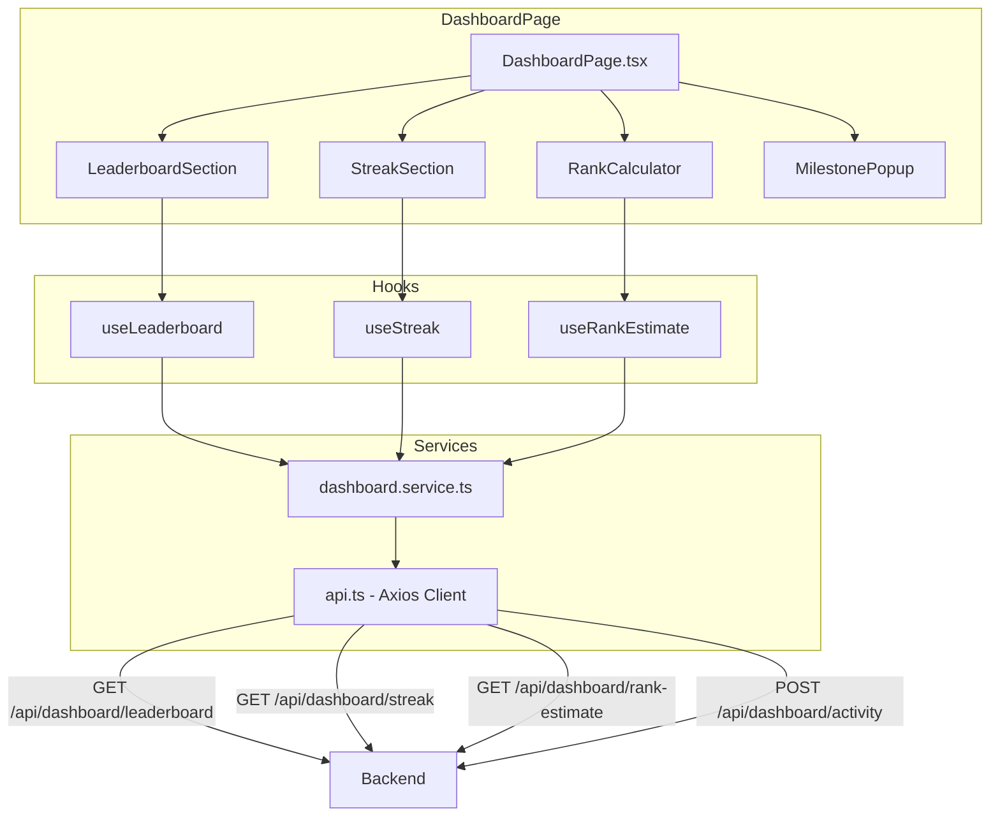
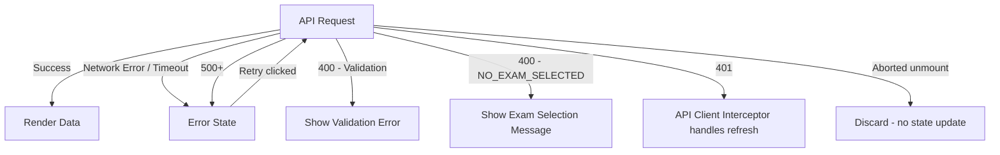

# Design Document: Dashboard Frontend Integration

## Overview

This design replaces the hardcoded mock data in `DashboardPage.tsx` with real API calls to the authenticated `/api/dashboard/*` endpoints. The integration introduces three custom hooks (`useLeaderboard`, `useStreak`, `useRankEstimate`), a fire-and-forget activity recording call, and a shared pattern for loading/error states with request cancellation on unmount.

### Key Design Decisions

| Decision | Rationale |
|----------|-----------|
| One custom hook per API endpoint | Keeps concerns isolated; each section can independently load, fail, and retry without affecting others |
| AbortController per hook instance | Prevents state updates on unmounted components; leverages existing `createCancelableRequest` from `api.ts` |
| No external state management (no Redux/Zustand) | The data is scoped to DashboardPage and not shared across routes; React state + hooks is sufficient |
| 15-second timeout per request via Axios config override | Matches Requirement 6.6; shorter than the global 30s timeout to fail faster on dashboard |
| Activity recording as fire-and-forget `useEffect` | No UI feedback needed; errors silently ignored per requirements |
| Extracting sub-components for Leaderboard, Streak, RankCalculator | Keeps DashboardPage readable; co-locates each section with its hook usage |

## Architecture



### Request Flow

1. `DashboardPage` mounts → triggers `useLeaderboard('state')`, `useStreak()`, and a one-shot `POST /api/dashboard/activity`
2. Each hook creates an `AbortController`, fires its API call via `dashboard.service.ts`, and manages loading/error/data state
3. On success → data is set, loading clears
4. On failure → error is set, loading clears, retry function exposed
5. On unmount → `AbortController.abort()` cancels in-flight requests
6. Streak response drives `MilestonePopup` visibility via `milestoneReached` flag

## Components and Interfaces

### Service Layer: `dashboard.service.ts`

```typescript
// /packages/frontend/src/services/dashboard.service.ts
import api from '@/services/api';
import type {
  LeaderboardResponse,
  StreakResponse,
  RankEstimateResponse,
} from '@/services/dashboard.types';

export async function fetchLeaderboard(
  type: 'state' | 'national',
  signal?: AbortSignal
): Promise<LeaderboardResponse> {
  const response = await api.get('/api/dashboard/leaderboard', {
    params: { type },
    signal,
    timeout: 15_000,
  });
  return response.data.data;
}

export async function fetchStreak(signal?: AbortSignal): Promise<StreakResponse> {
  const response = await api.get('/api/dashboard/streak', {
    signal,
    timeout: 15_000,
  });
  return response.data.data;
}

export async function fetchRankEstimate(
  marks: number,
  signal?: AbortSignal
): Promise<RankEstimateResponse> {
  const response = await api.get('/api/dashboard/rank-estimate', {
    params: { marks },
    signal,
    timeout: 15_000,
  });
  return response.data.data;
}

export async function recordActivity(signal?: AbortSignal): Promise<void> {
  await api.post('/api/dashboard/activity', null, {
    signal,
    timeout: 15_000,
  });
}
```

### Hook: `useLeaderboard`

```typescript
// /packages/frontend/src/hooks/useLeaderboard.ts
import { useState, useEffect, useCallback, useRef } from 'react';
import { fetchLeaderboard } from '@/services/dashboard.service';
import type { LeaderboardResponse } from '@/services/dashboard.types';

export interface UseLeaderboardResult {
  data: LeaderboardResponse | null;
  isLoading: boolean;
  error: LeaderboardError | null;
  retry: () => void;
}

export interface LeaderboardError {
  message: string;
  code?: string; // e.g. 'NO_EXAM_SELECTED'
}

export function useLeaderboard(type: 'state' | 'national'): UseLeaderboardResult {
  const [data, setData] = useState<LeaderboardResponse | null>(null);
  const [isLoading, setIsLoading] = useState(true);
  const [error, setError] = useState<LeaderboardError | null>(null);
  const abortControllerRef = useRef<AbortController | null>(null);

  const fetch = useCallback(async () => {
    // Cancel previous in-flight request (for tab switches)
    abortControllerRef.current?.abort();
    const controller = new AbortController();
    abortControllerRef.current = controller;

    setIsLoading(true);
    setError(null);
    setData(null); // Clear stale data on tab switch

    try {
      const result = await fetchLeaderboard(type, controller.signal);
      if (!controller.signal.aborted) {
        setData(result);
      }
    } catch (err: unknown) {
      if (!controller.signal.aborted) {
        setError(parseLeaderboardError(err));
      }
    } finally {
      if (!controller.signal.aborted) {
        setIsLoading(false);
      }
    }
  }, [type]);

  useEffect(() => {
    fetch();
    return () => {
      abortControllerRef.current?.abort();
    };
  }, [fetch]);

  return { data, isLoading, error, retry: fetch };
}
```

### Hook: `useStreak`

```typescript
// /packages/frontend/src/hooks/useStreak.ts
import { useState, useEffect, useCallback, useRef } from 'react';
import { fetchStreak } from '@/services/dashboard.service';
import type { StreakResponse } from '@/services/dashboard.types';

export interface UseStreakResult {
  data: StreakResponse | null;
  isLoading: boolean;
  error: boolean;
  retry: () => void;
}

export function useStreak(): UseStreakResult {
  const [data, setData] = useState<StreakResponse | null>(null);
  const [isLoading, setIsLoading] = useState(true);
  const [error, setError] = useState(false);
  const abortControllerRef = useRef<AbortController | null>(null);

  const fetch = useCallback(async () => {
    abortControllerRef.current?.abort();
    const controller = new AbortController();
    abortControllerRef.current = controller;

    setIsLoading(true);
    setError(false);

    try {
      const result = await fetchStreak(controller.signal);
      if (!controller.signal.aborted) {
        setData(result);
      }
    } catch {
      if (!controller.signal.aborted) {
        setError(true);
      }
    } finally {
      if (!controller.signal.aborted) {
        setIsLoading(false);
      }
    }
  }, []);

  useEffect(() => {
    fetch();
    return () => {
      abortControllerRef.current?.abort();
    };
  }, [fetch]);

  return { data, isLoading, error, retry: fetch };
}
```

### Hook: `useRankEstimate`

```typescript
// /packages/frontend/src/hooks/useRankEstimate.ts
import { useState, useCallback, useRef } from 'react';
import { fetchRankEstimate } from '@/services/dashboard.service';
import type { RankEstimateResponse } from '@/services/dashboard.types';

export interface UseRankEstimateResult {
  data: RankEstimateResponse | null;
  isLoading: boolean;
  error: RankEstimateError | null;
  calculate: (marks: number) => void;
}

export interface RankEstimateError {
  message: string;
  isValidationError: boolean; // true for 400s
}

export function useRankEstimate(): UseRankEstimateResult {
  const [data, setData] = useState<RankEstimateResponse | null>(null);
  const [isLoading, setIsLoading] = useState(false);
  const [error, setError] = useState<RankEstimateError | null>(null);
  const abortControllerRef = useRef<AbortController | null>(null);

  const calculate = useCallback(async (marks: number) => {
    abortControllerRef.current?.abort();
    const controller = new AbortController();
    abortControllerRef.current = controller;

    setIsLoading(true);
    setError(null);
    setData(null);

    try {
      const result = await fetchRankEstimate(marks, controller.signal);
      if (!controller.signal.aborted) {
        setData(result);
      }
    } catch (err: unknown) {
      if (!controller.signal.aborted) {
        setError(parseRankEstimateError(err));
      }
    } finally {
      if (!controller.signal.aborted) {
        setIsLoading(false);
      }
    }
  }, []);

  return { data, isLoading, error, calculate };
}
```

### Component Structure (Refactored DashboardPage)

```typescript
// /packages/frontend/src/pages/DashboardPage.tsx (refactored structure)
export function DashboardPage() {
  const { user } = useAuth();
  const { language } = useTranslation();

  // Fire-and-forget activity recording (once per mount)
  useActivityRecording();

  // Streak data drives milestone popup
  const streak = useStreak();
  const [showMilestone, setShowMilestone] = useState(false);

  useEffect(() => {
    if (streak.data?.milestoneReached) {
      setShowMilestone(true);
    }
  }, [streak.data?.milestoneReached]);

  return (
    <div className="space-y-8">
      {showMilestone && (
        <MilestonePopup
          streak={streak.data!.currentStreak}
          language={language}
          onClose={() => setShowMilestone(false)}
        />
      )}
      <HeroBanner user={user} language={language} />
      <StreakSection streak={streak} language={language} />
      <div className="grid grid-cols-1 lg:grid-cols-3 gap-4">
        <StatsSection language={language} />
        <RankCalculatorSection language={language} />
      </div>
      <LeaderboardSection language={language} />
      <TestCategories language={language} />
      <MotivationalBanners language={language} />
    </div>
  );
}
```

### Activity Recording Hook

```typescript
// /packages/frontend/src/hooks/useActivityRecording.ts
import { useEffect, useRef } from 'react';
import { recordActivity } from '@/services/dashboard.service';

/**
 * Fire-and-forget hook that records user activity once per mount.
 * Errors are silently ignored. Cancels on unmount.
 */
export function useActivityRecording(): void {
  const calledRef = useRef(false);

  useEffect(() => {
    if (calledRef.current) return;
    calledRef.current = true;

    const controller = new AbortController();
    recordActivity(controller.signal).catch(() => {
      // Silently ignore - per Requirement 3.4
    });

    return () => {
      controller.abort();
    };
  }, []);
}
```

## Data Models

### TypeScript Interfaces

```typescript
// /packages/frontend/src/services/dashboard.types.ts

export interface LeaderboardEntry {
  rank: number;
  userId: string;
  fullName: string;
  avatarUrl: string | null;
  totalScore: number;
}

export interface LeaderboardResponse {
  entries: LeaderboardEntry[];
  userRank: LeaderboardEntry | null;
  type: 'state' | 'national';
}

export interface StreakResponse {
  currentStreak: number;
  streakDates: string[];       // ISO date strings (YYYY-MM-DD)
  todayRecorded: boolean;
  milestoneReached: boolean;
}

export interface RankEstimateResponse {
  estimatedRank: number;
  totalApplicants: number;
  marks: number;
  percentile: number;          // 2 decimal places
}

/** Wrapper shape for all API responses from the backend */
export interface ApiResponse<T> {
  success: boolean;
  data: T;
}

/** Error response shape from the backend */
export interface ApiErrorResponse {
  success: false;
  error: {
    code: string;
    message: string;
  };
}
```

### Client-Side Validation

```typescript
// /packages/frontend/src/hooks/useRankEstimate.ts (validation logic)

export interface ValidationResult {
  valid: boolean;
  error?: string;
}

/**
 * Validates marks input before sending to API.
 * Rules: numeric, 0–150 inclusive, up to 2 decimal places.
 */
export function validateMarks(input: string): ValidationResult {
  const trimmed = input.trim();
  if (trimmed === '') {
    return { valid: false, error: 'Please enter marks' };
  }

  const num = Number(trimmed);
  if (isNaN(num)) {
    return { valid: false, error: 'Marks must be a number' };
  }
  if (num < 0 || num > 150) {
    return { valid: false, error: 'Marks must be between 0 and 150' };
  }

  // Check up to 2 decimal places
  const decimalPart = trimmed.split('.')[1];
  if (decimalPart && decimalPart.length > 2) {
    return { valid: false, error: 'Up to 2 decimal places allowed' };
  }

  return { valid: true };
}
```

### Error Parsing Utilities

```typescript
// /packages/frontend/src/services/dashboard.service.ts (error helpers)
import { AxiosError } from 'axios';
import type { ApiErrorResponse } from '@/services/dashboard.types';
import type { LeaderboardError } from '@/hooks/useLeaderboard';
import type { RankEstimateError } from '@/hooks/useRankEstimate';

export function parseLeaderboardError(err: unknown): LeaderboardError {
  if (err instanceof AxiosError && err.response?.data) {
    const data = err.response.data as ApiErrorResponse;
    return {
      message: data.error?.message || 'Failed to load leaderboard',
      code: data.error?.code,
    };
  }
  return { message: 'Failed to load leaderboard. Please try again.' };
}

export function parseRankEstimateError(err: unknown): RankEstimateError {
  if (err instanceof AxiosError && err.response?.status === 400) {
    const data = err.response.data as ApiErrorResponse;
    return {
      message: data.error?.message || 'Invalid input',
      isValidationError: true,
    };
  }
  return {
    message: 'Could not calculate rank. Please try again.',
    isValidationError: false,
  };
}
```

## Correctness Properties

*A property is a characteristic or behavior that should hold true across all valid executions of a system — essentially, a formal statement about what the system should do. Properties serve as the bridge between human-readable specifications and machine-verifiable correctness guarantees.*

### Property 1: Leaderboard renders all entry fields

*For any* valid leaderboard API response containing between 0 and 50 entries, the LeaderboardSection SHALL render exactly `entries.length` items, and each rendered item SHALL display the entry's rank, fullName, and totalScore.

**Validates: Requirements 1.4**

### Property 2: Streak day indicators match streakDates

*For any* valid streak API response containing a `streakDates` array (subset of the last 7 calendar days), the StreakSection SHALL render exactly 7 day indicators, and a day indicator SHALL be visually active if and only if its corresponding date appears in the `streakDates` array.

**Validates: Requirements 2.3**

### Property 3: Rank estimate displays all response fields

*For any* valid rank estimate API response, the RankCalculator SHALL display the `estimatedRank`, `totalApplicants`, `marks`, and `percentile` (formatted to 2 decimal places) values from the response.

**Validates: Requirements 4.2**

### Property 4: Marks validation correctness

*For any* string input to the marks field, the `validateMarks` function SHALL return `valid: true` if and only if the string represents a numeric value in the range [0, 150] with at most 2 decimal places. For all other inputs (non-numeric, out of range, more than 2 decimal places), it SHALL return `valid: false` with an appropriate error message.

**Validates: Requirements 4.6, 4.7**

### Property 5: Independent section error isolation

*For any* combination of dashboard API request outcomes (success or failure for leaderboard, streak, and activity independently), a section whose request succeeded SHALL render its data normally, and a section whose request failed SHALL display its own Error_State, regardless of the outcomes of other sections.

**Validates: Requirements 6.1, 6.2**

### Property 6: Request cancellation on unmount

*For any* set of in-flight dashboard API requests at the time the DashboardPage unmounts, all requests SHALL have their AbortController's `abort()` method called, preventing state updates on the unmounted component.

**Validates: Requirements 6.5**

## Error Handling

### Error Handling Strategy

| Section | Error Behavior | Retry |
|---------|---------------|-------|
| LeaderboardSection | Shows error message + retry button; special message for `NO_EXAM_SELECTED` | Yes — re-fetches with current tab |
| StreakSection | Shows fallback (streak = 0, all days inactive) + retry button | Yes — re-fetches |
| Activity Recording | Silently ignored | No |
| RankCalculator | Shows validation error (400) or generic error (other) in result area | Yes — user re-clicks calculate |

### Error Flow



### Timeout Configuration

All dashboard API requests use a 15-second timeout (overriding the global 30s default) via the `timeout` option passed to Axios. When a request exceeds 15 seconds:
1. Axios rejects with `ERR_CANCELED` or `ECONNABORTED`
2. The hook catches the error and sets the error state
3. The section displays its Error_State with a retry option

### Error Message Display Rules

- **Leaderboard errors**: Show the backend's error message if available, else generic "Failed to load leaderboard"
- **Streak errors**: No message — just show fallback state with zero streak
- **Rank estimate 400 errors**: Show the backend's specific validation message (e.g., "marks must be >= 0")
- **Rank estimate other errors**: Generic "Could not calculate rank. Please try again."
- **Activity errors**: No display whatsoever

## Testing Strategy

### Testing Framework

- **Unit/Property tests**: Vitest + fast-check + @testing-library/react (already in devDependencies)
- **Component tests**: @testing-library/react with mock API responses

### Property-Based Tests

Each correctness property maps to a property-based test using `fast-check`. Tests run a minimum of 100 iterations.

| Property | Test File | What's Generated |
|----------|-----------|------------------|
| 1: Leaderboard renders entries | `LeaderboardSection.test.tsx` | Random LeaderboardEntry arrays (0–50 entries) |
| 2: Streak day indicators | `StreakSection.test.tsx` | Random subsets of last 7 days as streakDates |
| 3: Rank estimate display | `RankCalculator.test.tsx` | Random RankEstimateResponse objects |
| 4: Marks validation | `useRankEstimate.test.ts` | Random strings: valid numbers 0–150 with ≤2dp, invalid strings |
| 5: Error isolation | `DashboardPage.test.tsx` | Random success/failure combinations for each API |
| 6: Cancellation on unmount | `DashboardPage.test.tsx` | Random timing of unmount relative to in-flight requests |

**Tag format**: Each test is annotated with:
```typescript
// Feature: dashboard-frontend-integration, Property N: <property text>
```

**Configuration**: Minimum 100 iterations per property via `fc.assert(..., { numRuns: 100 })`.

### Unit Tests (Example-Based)

- **Mount behavior**: Verify leaderboard fetched with `type=state` on mount
- **Tab switching**: Verify leaderboard re-fetched with correct type on tab change
- **Loading state**: Verify skeleton/spinner shown during fetch, stale data cleared
- **Retry**: Verify retry button triggers re-fetch
- **Empty state**: Verify empty leaderboard message when entries is `[]`
- **NO_EXAM_SELECTED**: Verify specific message for this error code
- **User highlight**: Verify current user entry highlighted when `userRank` is non-null
- **Activity fire-and-forget**: Verify POST called once, errors ignored, no UI feedback
- **Milestone popup**: Verify shown only when `milestoneReached: true`, dismissed via click/Escape
- **Focus trap**: Verify keyboard focus trapped in milestone popup
- **Button disabled during loading**: Verify calculate button disabled while rank estimate loading

### Test File Structure

```
src/
├── hooks/
│   ├── useLeaderboard.ts
│   ├── useLeaderboard.test.ts
│   ├── useStreak.ts
│   ├── useStreak.test.ts
│   ├── useRankEstimate.ts
│   ├── useRankEstimate.test.ts
│   └── useActivityRecording.ts
├── services/
│   ├── dashboard.service.ts
│   ├── dashboard.service.test.ts
│   └── dashboard.types.ts
├── pages/
│   ├── DashboardPage.tsx
│   └── DashboardPage.test.tsx
├── components/
│   └── dashboard/
│       ├── LeaderboardSection.tsx
│       ├── LeaderboardSection.test.tsx
│       ├── StreakSection.tsx
│       ├── StreakSection.test.tsx
│       ├── RankCalculatorSection.tsx
│       ├── RankCalculator.test.tsx
│       ├── MilestonePopup.tsx
│       ├── HeroBanner.tsx
│       ├── StatsSection.tsx
│       ├── TestCategories.tsx
│       └── MotivationalBanners.tsx
```

### Mocking Strategy

- Mock `api.get` and `api.post` via `vi.mock('@/services/api')` for hook/service tests
- Use `@testing-library/react`'s `renderHook` for hook isolation tests
- Use `vi.useFakeTimers()` for timeout and debounce testing
- Mock `AbortController` to verify cancellation behavior
