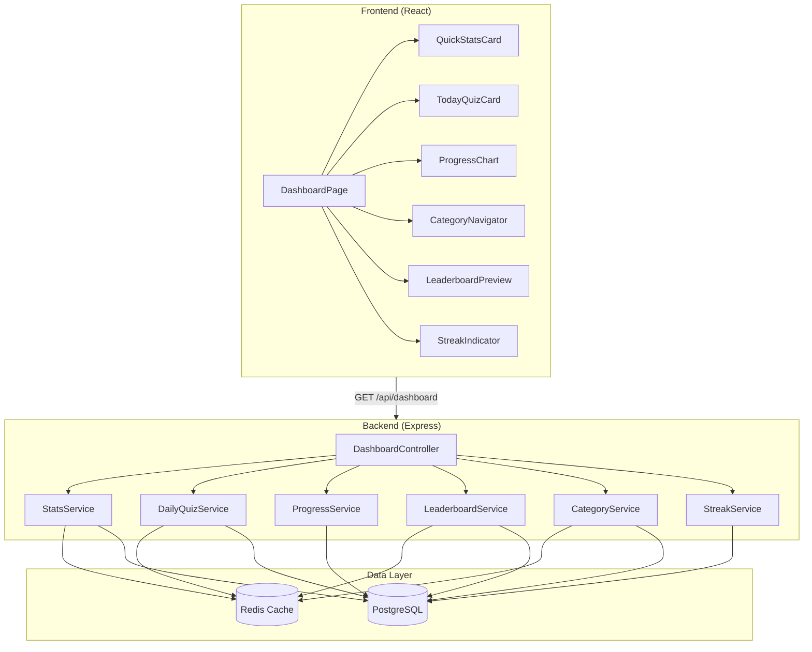
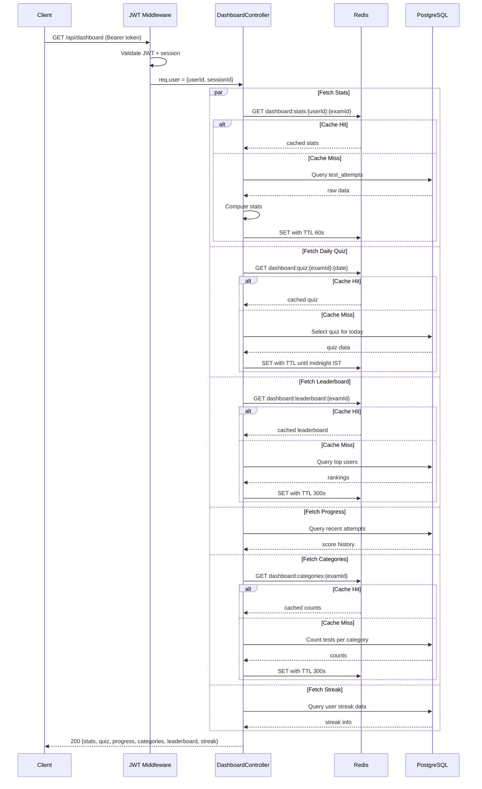

# Design Document: Dashboard Module

## Overview

The Dashboard Module is the primary home screen for authenticated users of the UP Police Test Series platform. It aggregates data from multiple backend services (stats, daily quiz, progress, leaderboard, categories, streak) and presents a personalized, mobile-first view filtered by the user's selected exam. The module follows a stale-while-revalidate caching strategy with Redis-backed server-side caching and implements independent section loading with graceful error handling per section.

### Key Design Decisions

1. **Parallel API calls per section** — The frontend fetches each dashboard section independently so that one failing service doesn't block the others.
2. **Single aggregated endpoint with sub-section keys** — A single `GET /api/dashboard` endpoint returns all sections in one response to reduce round trips on slow mobile connections, while keeping internal service calls parallel.
3. **Redis cache with TTL per section** — Different cache TTLs per data type (60s stats, 300s leaderboard, daily quiz until midnight IST) balance freshness with performance.
4. **Stale-while-revalidate on frontend** — Show cached data immediately, refresh in background, discard stale data > 10 minutes.
5. **IST-based streak calculation** — All streak logic uses UTC+5:30 calendar day boundaries for consistency.

## Architecture

### High-Level System Diagram



### Request Flow



## Components and Interfaces

### Backend Services

#### DashboardController

```typescript
// GET /api/dashboard
// Headers: Authorization: Bearer <token>
// Response: DashboardResponse (see Data Models)
router.get('/api/dashboard', jwtAuth, dashboardController.getDashboard);

// POST /api/dashboard/refresh
// Force-refresh bypassing cache (for pull-to-refresh)
router.post('/api/dashboard/refresh', jwtAuth, dashboardController.refreshDashboard);
```

#### StatsService

```typescript
interface StatsService {
  /**
   * Get user's quick stats for a given exam.
   * Returns cached data if available (TTL 60s).
   */
  getUserStats(userId: string, examId: string): Promise<QuickStats>;

  /**
   * Compute rank among all users for the given exam.
   * Uses average score descending, tie-broken by most recent submission date.
   */
  computeRank(userId: string, examId: string): Promise<number>;

  /**
   * Invalidate cached stats for a user+exam (called after test submission).
   */
  invalidateStats(userId: string, examId: string): Promise<void>;
}
```

#### DailyQuizService

```typescript
interface DailyQuizService {
  /**
   * Get today's quiz for the given exam.
   * Selects a 10-question quiz rotating across subjects weekly.
   * Cached per exam until midnight IST.
   */
  getTodayQuiz(examId: string): Promise<DailyQuiz>;

  /**
   * Get user's attempt status for today's quiz.
   */
  getUserQuizStatus(userId: string, quizTestId: string): Promise<QuizStatus>;
}
```

#### ProgressService

```typescript
interface ProgressService {
  /**
   * Get score trend data for the user over a time period.
   * @param period 'weekly' (7 days) | 'monthly' (30 days)
   * Returns daily/weekly average scores. Days with no attempts are omitted.
   */
  getProgressData(
    userId: string,
    examId: string,
    period: 'weekly' | 'monthly'
  ): Promise<ProgressDataPoint[]>;
}
```

#### LeaderboardService

```typescript
interface LeaderboardService {
  /**
   * Get top N users for the exam leaderboard.
   * Cached for 5 minutes per exam.
   * Includes current user's position if outside top N.
   */
  getLeaderboardPreview(
    examId: string,
    userId: string,
    limit?: number // default 5
  ): Promise<LeaderboardPreview>;
}
```

#### CategoryService

```typescript
interface CategoryService {
  /**
   * Get test counts per category for the user's selected exam.
   * Categories: topic_wise, sectional, full_mock, previous_year
   * Only counts published tests within active schedule window.
   */
  getCategoryCounts(examId: string): Promise<CategoryCount[]>;
}
```

#### StreakService

```typescript
interface StreakService {
  /**
   * Get or compute the user's current streak.
   * Checks last_practice_date against current IST date.
   * Resets to 0 if previous day was missed.
   */
  getUserStreak(userId: string): Promise<StreakData>;

  /**
   * Update streak after a test submission.
   * Called by the test attempt submission handler.
   */
  recordPracticeDay(userId: string): Promise<void>;
}
```

### Frontend Components

#### DashboardPage (Container)

```typescript
interface DashboardPageProps {}

// Responsibilities:
// - Fetch dashboard data via useDashboard hook
// - Handle pull-to-refresh
// - Render section components with loading/error states
// - Handle exam-not-selected redirect
```

#### useDashboard Hook

```typescript
interface UseDashboardReturn {
  data: DashboardData | null;
  isLoading: boolean;
  error: Error | null;
  sectionErrors: Record<DashboardSection, string | null>;
  refetch: () => Promise<void>;
  retrySection: (section: DashboardSection) => Promise<void>;
  retryCounts: Record<DashboardSection, number>;
}

type DashboardSection = 'stats' | 'quiz' | 'progress' | 'categories' | 'leaderboard' | 'streak';
```

#### QuickStatsCard

```typescript
interface QuickStatsCardProps {
  stats: QuickStats | null;
  isLoading: boolean;
  error: string | null;
  onRetry: () => void;
}
```

#### TodayQuizCard

```typescript
interface TodayQuizCardProps {
  quiz: DailyQuizData | null;
  status: QuizStatus;
  isLoading: boolean;
  error: string | null;
  onRetry: () => void;
  onStartQuiz: () => void;
  onViewScore: () => void;
}
```

#### ProgressChart

```typescript
interface ProgressChartProps {
  data: ProgressDataPoint[];
  period: 'weekly' | 'monthly';
  onPeriodChange: (period: 'weekly' | 'monthly') => void;
  isLoading: boolean;
  error: string | null;
  onRetry: () => void;
  onNavigateToAnalytics: () => void;
}
```

#### CategoryNavigator

```typescript
interface CategoryNavigatorProps {
  categories: CategoryCount[];
  isLoading: boolean;
  error: string | null;
  onRetry: () => void;
  onCategorySelect: (category: TestCategory) => void;
}

type TestCategory = 'topic_wise' | 'sectional' | 'full_mock' | 'previous_year';
```

#### LeaderboardPreview

```typescript
interface LeaderboardPreviewProps {
  entries: LeaderboardEntry[];
  currentUserEntry: LeaderboardEntry | null;
  currentUserInTop: boolean;
  isLoading: boolean;
  error: string | null;
  onRetry: () => void;
  onNavigateToLeaderboard: () => void;
}
```

#### StreakIndicator

```typescript
interface StreakIndicatorProps {
  streak: StreakData | null;
  isLoading: boolean;
  error: string | null;
  onRetry: () => void;
}
```

## Data Models

### Database Tables (used by Dashboard, defined in Test Series module)

The dashboard reads from these existing tables:

```sql
-- Already defined in test-series module migrations
-- questions, question_exams, tests, test_questions, test_attempts, attempt_answers
```

#### Users Table Extension (streak fields)

```sql
-- Migration: add streak columns to users table
ALTER TABLE users
  ADD COLUMN streak_count INTEGER NOT NULL DEFAULT 0,
  ADD COLUMN last_practice_date DATE;
```

#### Daily Quiz Selection Table

```sql
CREATE TABLE daily_quizzes (
  id UUID PRIMARY KEY DEFAULT gen_random_uuid(),
  exam_id UUID NOT NULL REFERENCES exams(id),
  test_id UUID NOT NULL REFERENCES tests(id),
  quiz_date DATE NOT NULL,
  subject_focus VARCHAR(50) NOT NULL, -- 'GK', 'Math', 'Reasoning', 'Hindi', 'mixed'
  created_at TIMESTAMPTZ NOT NULL DEFAULT NOW(),
  UNIQUE(exam_id, quiz_date)
);

CREATE INDEX idx_daily_quizzes_exam_date ON daily_quizzes(exam_id, quiz_date);
```

### API Response Types

```typescript
// GET /api/dashboard response
interface DashboardResponse {
  success: boolean;
  data: {
    stats: QuickStats | null;
    quiz: DailyQuizData | null;
    progress: ProgressSection;
    categories: CategoryCount[];
    leaderboard: LeaderboardPreview | null;
    streak: StreakData | null;
  };
  errors: Record<string, string>; // section-level errors
}

interface QuickStats {
  testsCompleted: number;       // integer, min 0
  averageScore: number | null;  // percentage with 1 decimal, null if no attempts
  rank: number | null;          // 1-based position, null if no attempts
  rankBadge: 'constable' | 'head_constable' | 'si' | 'inspector';
}

interface DailyQuizData {
  testId: string;
  titleHi: string;
  titleEn: string;
  subjects: string[];           // subject tags
  questionCount: number;        // always 10
  durationMinutes: number;      // always 10
  status: QuizStatus;
  score: number | null;         // percentage if completed
}

type QuizStatus = 'not_started' | 'in_progress' | 'completed' | 'unavailable';

interface ProgressSection {
  period: 'weekly' | 'monthly';
  dataPoints: ProgressDataPoint[];
  hasEnoughData: boolean;       // false if fewer than 2 data points
}

interface ProgressDataPoint {
  label: string;                // "Mon", "Tue" or "01/06" date
  date: string;                 // ISO date
  averageScore: number;         // rounded integer percentage
}

interface CategoryCount {
  category: TestCategory;
  titleHi: string;
  titleEn: string;
  icon: string;                 // icon identifier
  count: number;                // published tests in active schedule
  enabled: boolean;             // false if count === 0
}

interface LeaderboardPreview {
  entries: LeaderboardEntry[];
  currentUserEntry: LeaderboardEntry | null;  // if not in top 5
  currentUserInTop: boolean;
}

interface LeaderboardEntry {
  rank: number;
  userId: string;
  userName: string;             // truncated to 15 chars
  avatarUrl: string | null;
  averageScore: number;         // 1 decimal percentage
  isCurrentUser: boolean;
}

interface StreakData {
  count: number;                // 0 to 9999
  lastPracticeDate: string | null;  // ISO date in IST
  practicedToday: boolean;
  showWarning: boolean;         // true if active streak + not practiced today
  showFlame: boolean;           // true if count >= 7
}
```

### Redis Cache Keys

| Key Pattern | TTL | Description |
|---|---|---|
| `dashboard:stats:{userId}:{examId}` | 60s | User's quick stats |
| `dashboard:leaderboard:{examId}` | 300s | Top 100 entries per exam |
| `dashboard:quiz:{examId}:{YYYY-MM-DD}` | Until midnight IST | Daily quiz selection |
| `dashboard:categories:{examId}` | 300s | Test counts per category |

### Zod Validation Schemas

```typescript
import { z } from 'zod';

export const dashboardQuerySchema = z.object({
  period: z.enum(['weekly', 'monthly']).optional().default('weekly'),
  forceRefresh: z.coerce.boolean().optional().default(false),
});
```

## Correctness Properties

*A property is a characteristic or behavior that should hold true across all valid executions of a system — essentially, a formal statement about what the system should do. Properties serve as the bridge between human-readable specifications and machine-verifiable correctness guarantees.*

### Property 1: Exam-scoped data filtering

*For any* authenticated user with a selected exam ID, all data returned by the dashboard endpoint (stats, quiz, progress, categories, leaderboard) SHALL contain only records associated with that exam ID.

**Validates: Requirements 1.3**

### Property 2: Average score computation

*For any* non-empty array of submitted test attempt percentage scores (each between 0.0 and 100.0), the computed average score SHALL equal the arithmetic mean of all scores rounded to one decimal place.

**Validates: Requirements 2.3**

### Property 3: Rank ordering

*For any* set of users with average scores for the same exam, the rank assignment SHALL produce a total ordering where higher average score yields a lower (better) rank number, and ties in average score are broken by the user whose most recent submission date is earlier receiving the lower rank.

**Validates: Requirements 2.4**

### Property 4: Rank badge mapping

*For any* valid rank number (positive integer), the badge mapping function SHALL return exactly one badge from the set {constable, head_constable, si, inspector}, and the mapping SHALL be deterministic and monotonically non-decreasing (higher rank thresholds map to higher badges).

**Validates: Requirements 2.6**

### Property 5: Daily quiz uniqueness

*For any* exam and any calendar date (IST), the daily quiz service SHALL produce at most one quiz selection, and the same (exam, date) pair SHALL always resolve to the same quiz.

**Validates: Requirements 3.1**

### Property 6: Subject rotation coverage

*For any* 7-consecutive-day window of daily quiz selections for an exam, all four subjects (GK, Math, Reasoning, Hindi) SHALL appear as the primary subject focus at least once.

**Validates: Requirements 3.7**

### Property 7: Progress daily average with empty day omission

*For any* set of test attempts with timestamps within a date range, the progress computation SHALL return one data point per calendar day (IST) that has at least one attempt, with the value being the arithmetic mean of that day's scores rounded to the nearest integer, and SHALL produce no data point for days with zero attempts.

**Validates: Requirements 4.2**

### Property 8: Category count correctness

*For any* set of tests associated with an exam, the category count for a given category SHALL equal the number of tests whose status is 'published' AND whose schedule window includes the current timestamp (or has no schedule constraints).

**Validates: Requirements 5.3**

### Property 9: Leaderboard ranking

*For any* set of users with average scores (rounded to 1 decimal) and completed test counts for the same exam, the leaderboard ranking SHALL order users by average score descending, with ties broken by total tests completed descending (more tests ranked higher).

**Validates: Requirements 6.2**

### Property 10: Name truncation

*For any* user name string, the display name SHALL be the original string if its length is 15 characters or fewer, or the first 15 characters followed by an ellipsis ("…") if longer.

**Validates: Requirements 6.5**

### Property 11: Streak computation

*For any* sequence of test submission timestamps and a reference "today" date (IST), the streak count SHALL equal the length of the longest consecutive sequence of IST calendar days ending on today (or yesterday if no submission today) where each day contains at least one submission. If the previous calendar day has no submission and today has no submission, the streak SHALL be 0.

**Validates: Requirements 7.1, 7.2, 7.5**

### Property 12: Bilingual field selection with fallback

*For any* bilingual content object with optional Hindi and English fields, and any user language preference, the selection function SHALL return the field matching the preferred language if it is non-empty, or fall back to the English field if the preferred language field is empty or missing.

**Validates: Requirements 8.4, 8.5**

### Property 13: Number formatting by locale

*For any* non-negative number and locale ('hi' or 'en'), the formatting function SHALL produce Indian numeral grouping (X,XX,XXX pattern) for Hindi locale and international grouping (XXX,XXX pattern) for English locale, using Arabic digits (0-9) in both cases.

**Validates: Requirements 8.6**

### Property 14: Retry limit enforcement

*For any* dashboard section, after 3 consecutive failed retry attempts, the retry mechanism SHALL report the section as exhausted (retry disabled), and no further automatic retries SHALL be attempted until a full page reload.

**Validates: Requirements 11.4**

### Property 15: Cache TTL until midnight IST

*For any* timestamp, the computed TTL for daily quiz cache SHALL equal the number of seconds remaining until the next 00:00:00 IST boundary, and SHALL always be a positive integer between 1 and 86400.

**Validates: Requirements 12.3**

## Error Handling

### Backend Error Strategy

| Scenario | Response | HTTP Status | Client Action |
|---|---|---|---|
| JWT missing/invalid/expired | `{error: {code: "TOKEN_INVALID"}}` | 401 | Redirect to login |
| User has no selected exam | `{error: {code: "EXAM_NOT_SELECTED"}}` | 400 | Redirect to exam selection |
| Individual section cache miss + DB error | Partial response with section set to `null` + error in `errors` map | 200 | Show section error card |
| Redis completely unavailable | Fall back to DB queries directly | 200 | Transparent to user |
| DB query timeout (>3s) | Section returns `null` with error message | 200 | Show retry |
| All sections fail | `{success: false, error: {code: "SERVICE_UNAVAILABLE"}}` | 503 | Full-page error |

### Frontend Error Handling

```typescript
// Section-level error state machine
type SectionState = 'idle' | 'loading' | 'success' | 'error' | 'exhausted';

// Rules:
// - Each section independently tracks its state
// - Retry increments a counter per section
// - After 3 consecutive errors → state = 'exhausted', retry disabled
// - Full page refresh resets all counters
// - Online event triggers auto-retry of 'error' sections (not 'exhausted')
```

### Error Boundaries

- **Section-level**: Each dashboard card is wrapped in an error boundary to prevent one component crash from taking down the page.
- **Page-level**: A top-level error boundary catches unexpected rendering errors and shows a generic "Something went wrong" message with a refresh button.

### Timeout Configuration

| Operation | Timeout | Fallback |
|---|---|---|
| API call per section | 15s | Show error card |
| Redis GET | 2s | Query DB directly |
| DB query (on cache miss) | 3s | Return error for section |
| Pull-to-refresh total | 10s | Dismiss spinner + error toast |

## Testing Strategy

### Property-Based Tests (fast-check)

Each correctness property maps to a property-based test with minimum 100 iterations. Tests are placed in the service file's corresponding `.test.ts` file.

**Backend property tests** (using `fast-check` + `vitest`):
- Property 2: `stats.service.test.ts` — average score computation
- Property 3: `stats.service.test.ts` — rank ordering
- Property 4: `stats.service.test.ts` — rank badge mapping
- Property 5: `daily-quiz.service.test.ts` — quiz uniqueness per day
- Property 6: `daily-quiz.service.test.ts` — subject rotation
- Property 7: `progress.service.test.ts` — daily average with omission
- Property 8: `category.service.test.ts` — count correctness
- Property 9: `leaderboard.service.test.ts` — ranking
- Property 11: `streak.service.test.ts` — streak computation
- Property 15: `daily-quiz.service.test.ts` — TTL until midnight

**Frontend property tests** (using `fast-check` + `vitest`):
- Property 1: `useDashboard.test.ts` — exam-scoped filtering
- Property 10: `formatters.test.ts` — name truncation
- Property 12: `i18n-utils.test.ts` — bilingual field selection
- Property 13: `formatters.test.ts` — number formatting by locale
- Property 14: `useDashboard.test.ts` — retry limit enforcement

### Unit Tests (example-based)

- Section component rendering with mock data (empty state, loaded state, error state)
- Navigation handlers (category tap, leaderboard tap, analytics tap)
- Pull-to-refresh trigger
- Language toggle behavior
- Responsive layout breakpoints (CSS class assertions)
- Auth guard redirect scenarios
- Stale-while-revalidate behavior

### Integration Tests

- Full dashboard API endpoint with seeded DB data
- Redis caching: verify cache hit/miss, TTL behavior
- Cache invalidation on test submission
- Redis fallback to DB when unavailable

### Test Configuration

```typescript
// Property test minimum iterations
// fast-check default: { numRuns: 100 }
// Tag format in comments:
// Feature: dashboard-module, Property {N}: {title}
```

### Test File Organization

```
packages/backend/src/services/
  dashboard/
    stats.service.ts
    stats.service.test.ts          ← Properties 2, 3, 4
    daily-quiz.service.ts
    daily-quiz.service.test.ts     ← Properties 5, 6, 15
    progress.service.ts
    progress.service.test.ts       ← Property 7
    category.service.ts
    category.service.test.ts       ← Property 8
    leaderboard.service.ts
    leaderboard.service.test.ts    ← Property 9
    streak.service.ts
    streak.service.test.ts         ← Property 11

packages/frontend/src/
  hooks/
    useDashboard.ts
    useDashboard.test.ts           ← Properties 1, 14
  utils/
    formatters.ts
    formatters.test.ts             ← Properties 10, 13
    i18n-utils.ts
    i18n-utils.test.ts             ← Property 12
  pages/
    DashboardPage.tsx
    DashboardPage.test.tsx         ← Unit tests (example-based)
  components/dashboard/
    QuickStatsCard.tsx
    QuickStatsCard.test.tsx
    TodayQuizCard.tsx
    ProgressChart.tsx
    CategoryNavigator.tsx
    LeaderboardPreview.tsx
    StreakIndicator.tsx
```

