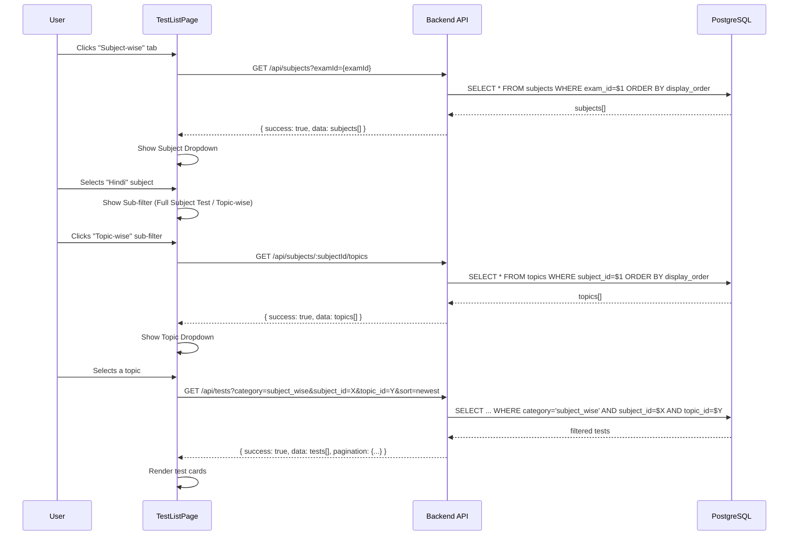
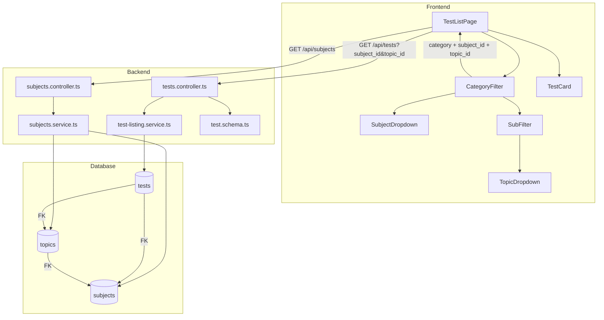
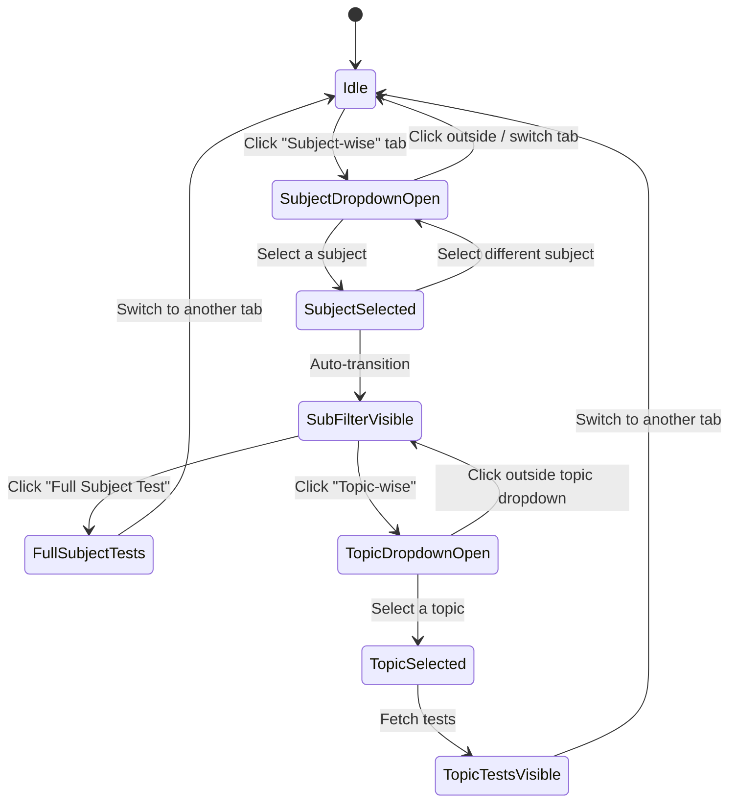

# Design Document: Subject Category Restructuring

## Overview

This feature restructures the test category system by removing "Topic-wise" as a standalone category and merging it into "Subject-wise" with a hierarchical dropdown flow: Subject → Sub-filter (Full Subject Test / Topic-wise) → Topic. New `subjects` and `topics` tables provide normalized, bilingual subject/topic data linked to exams. The existing `tests` table gains `subject_id` and `topic_id` foreign keys. A seed migration populates the UP Police Constable exam with 4 subjects, 16 topics, and 80 sample tests.

### Key Design Decisions

1. **Separate `subjects` and `topics` tables** — Normalized relational design with `display_order` for consistent UI ordering. This supports future expansion to other exams without schema changes.
2. **CHECK constraint on tests table** — `topic_id` requires `subject_id` to be set (prevents orphan topic references). The `category` CHECK constraint is updated to remove `topic_wise`.
3. **Existing `topic_wise` tests migrated to `subject_wise`** — The migration updates `category` from `topic_wise` to `subject_wise` before dropping the constraint value.
4. **Frontend state machine for dropdown flow** — A clear state progression (idle → subject_selected → sub_filter_selected → topic_selected) prevents stale filter combinations.
5. **`topic_id=null` semantic for full subject tests** — Tests with `subject_id` set but `topic_id` NULL are "Full Subject Tests"; tests with both set are "Topic Tests". This avoids an extra boolean column.
6. **API returns subjects/topics ordered by `display_order`** — Eliminates frontend sorting and ensures consistent ordering across clients.
7. **Invalid UUID parameters silently ignored** — Follows existing graceful degradation pattern from the category filter (Requirement 6.7).

## Architecture

### Subject-wise Filtering Data Flow



### Component Architecture



### Frontend State Machine



## Components and Interfaces

### Backend Components

#### 1. Migration `012_add-subjects-topics-tables.ts`

Creates `subjects` and `topics` tables, adds `subject_id` and `topic_id` to `tests`, updates the category CHECK constraint.

```typescript
// Migration responsibilities:
// 1. Create subjects table (id, exam_id, name_en, name_hi, display_order, created_at)
// 2. Create topics table (id, subject_id, name_en, name_hi, display_order, created_at)
// 3. Add subject_id (UUID, nullable, FK → subjects) to tests
// 4. Add topic_id (UUID, nullable, FK → topics) to tests
// 5. Add CHECK: topic_id IS NOT NULL implies subject_id IS NOT NULL
// 6. Add indexes on tests.subject_id and tests.topic_id
// 7. Add UNIQUE constraint on topics(subject_id, name_en)
// 8. Update existing tests with category='topic_wise' to category='subject_wise'
// 9. Drop old CHECK constraint, add new one without 'topic_wise'
```

#### 2. Migration `013_seed-subjects-topics-data.ts`

Seeds 4 subjects, 16 topics, and 80 tests for UP Police Constable exam.

#### 3. Subjects Service (`subjects.service.ts`)

```typescript
export interface Subject {
  id: string;
  examId: string;
  nameEn: string;
  nameHi: string;
  displayOrder: number;
}

export interface Topic {
  id: string;
  subjectId: string;
  nameEn: string;
  nameHi: string;
  displayOrder: number;
}

/** Fetch all subjects for a given exam, ordered by display_order. */
export async function getSubjectsByExam(examId: string): Promise<Subject[]>;

/** Fetch all topics for a given subject, ordered by display_order. */
export async function getTopicsBySubject(subjectId: string): Promise<Topic[]>;

/** Check if a subject exists by ID. */
export async function subjectExists(subjectId: string): Promise<boolean>;
```

#### 4. Subjects Controller (`subjects.controller.ts`)

| Route | Handler | Description |
|-------|---------|-------------|
| `GET /api/subjects` | `listSubjects` | Returns subjects for user's selected exam |
| `GET /api/subjects/:subjectId/topics` | `listTopics` | Returns topics for a subject |

```typescript
// GET /api/subjects
// Requires: JWT auth (to get user's selected exam)
// Response: { success: true, data: Subject[] }

// GET /api/subjects/:subjectId/topics
// Requires: JWT auth
// Params: subjectId (UUID)
// Response: { success: true, data: Topic[] }
// Error: 404 { success: false, error: { code: 'SUBJECT_NOT_FOUND' } }
```

#### 5. Updated Test Listing Service (`test-listing.service.ts`)

Extended function signature:

```typescript
export async function getTestsForUser(
  userId: string,
  examId: string,
  sort: SortOption,
  page: number,
  limit: number,
  category?: TestCategory,
  subjectId?: string,
  topicId?: string | null  // null = explicitly filter for topic_id IS NULL
): Promise<{ tests: TestListItem[]; total: number }>
```

Changes:
- When `subjectId` is provided: add `AND t.subject_id = $N`
- When `topicId` is a UUID string: add `AND t.topic_id = $N`
- When `topicId` is explicitly `null`: add `AND t.topic_id IS NULL`
- Update `TestListItem` to include `subjectId` and `topicId`

#### 6. Updated Tests Controller (`tests.controller.ts`)

Changes to `listTests`:
- Parse `subject_id` from query params
- Parse `topic_id` from query params (support `"null"` string for explicit NULL filter)
- Validate UUID format for both; ignore invalid values
- Pass to `getTestsForUser`

#### 7. Updated Test Schema (`test.schema.ts`)

```typescript
// Updated VALID_CATEGORIES (remove topic_wise)
export const VALID_CATEGORIES = ['full_mock', 'subject_wise', 'previous_year', 'daily_practice'] as const;

// Add to createTestSchema:
subjectId: z.string().uuid().optional(),
topicId: z.string().uuid().optional(),

// Add refinement: if topicId is set, subjectId must also be set
```

### Frontend Components

#### 1. Updated `CategoryFilter.tsx`

```typescript
// Updated CATEGORY_OPTIONS (remove topic_wise)
const CATEGORY_OPTIONS = ['all', 'full_mock', 'subject_wise', 'previous_year', 'daily_practice'] as const;

export interface CategoryFilterProps {
  activeCategory: string;
  onCategoryChange: (category: string) => void;
  selectedSubject: Subject | null;
  onSubjectSelect: (subject: Subject | null) => void;
  subFilter: 'full_subject' | 'topic_wise' | null;
  onSubFilterChange: (filter: 'full_subject' | 'topic_wise' | null) => void;
  selectedTopic: Topic | null;
  onTopicSelect: (topic: Topic | null) => void;
  subjects: Subject[];
  topics: Topic[];
}
```

#### 2. New `SubjectDropdown.tsx`

```typescript
interface SubjectDropdownProps {
  subjects: Subject[];
  language: 'en' | 'hi';
  onSelect: (subject: Subject) => void;
  onClose: () => void;
}
```

Renders a positioned dropdown listing subjects in the user's language, ordered by `displayOrder`. Closes on outside click.

#### 3. New `SubFilter.tsx`

```typescript
interface SubFilterProps {
  activeFilter: 'full_subject' | 'topic_wise' | null;
  onFilterChange: (filter: 'full_subject' | 'topic_wise') => void;
}
```

Two buttons: "Full Subject Test" and "Topic-wise" with active indicator styling.

#### 4. New `TopicDropdown.tsx`

```typescript
interface TopicDropdownProps {
  topics: Topic[];
  language: 'en' | 'hi';
  onSelect: (topic: Topic) => void;
  onClose: () => void;
}
```

Similar to SubjectDropdown but for topics within the selected subject.

#### 5. Updated `TestListPage.tsx`

New state:
```typescript
const [selectedSubject, setSelectedSubject] = useState<Subject | null>(null);
const [subFilter, setSubFilter] = useState<'full_subject' | 'topic_wise' | null>(null);
const [selectedTopic, setSelectedTopic] = useState<Topic | null>(null);
const [subjects, setSubjects] = useState<Subject[]>([]);
const [topics, setTopics] = useState<Topic[]>([]);
```

Effects:
- Fetch subjects when category becomes `'subject_wise'`
- Fetch topics when `selectedSubject` changes and `subFilter === 'topic_wise'`
- Fetch tests when any filter changes (category, subject, topic, sort)
- Reset subject/topic/subFilter when category changes away from `subject_wise`
- Reset topic and subFilter when subject changes

#### 6. i18n Updates

New keys in both `en.json` and `hi.json`:

```json
{
  "testList": {
    "categories": {
      "all": "All / सभी",
      "full_mock": "Full Mock Test / पूर्ण मॉक टेस्ट",
      "subject_wise": "Subject-wise / विषयवार",
      "previous_year": "Previous Year / पिछले वर्ष के प्रश्न",
      "daily_practice": "Daily Practice / दैनिक अभ्यास"
    },
    "subFilter": {
      "fullSubject": "Full Subject Test / पूर्ण विषय टेस्ट",
      "topicWise": "Topic-wise / टॉपिक वार"
    },
    "selectSubject": "Select Subject / विषय चुनें",
    "selectTopic": "Select Topic / टॉपिक चुनें"
  }
}
```

## Data Models

### New Tables

#### `subjects` Table

```sql
CREATE TABLE subjects (
  id UUID PRIMARY KEY DEFAULT gen_random_uuid(),
  exam_id UUID NOT NULL REFERENCES exams(id),
  name_en VARCHAR(100) NOT NULL,
  name_hi VARCHAR(100) NOT NULL,
  display_order INTEGER NOT NULL,
  created_at TIMESTAMPTZ NOT NULL DEFAULT NOW()
);

CREATE INDEX idx_subjects_exam_id ON subjects(exam_id);
```

#### `topics` Table

```sql
CREATE TABLE topics (
  id UUID PRIMARY KEY DEFAULT gen_random_uuid(),
  subject_id UUID NOT NULL REFERENCES subjects(id) ON DELETE CASCADE,
  name_en VARCHAR(100) NOT NULL,
  name_hi VARCHAR(100) NOT NULL,
  display_order INTEGER NOT NULL,
  created_at TIMESTAMPTZ NOT NULL DEFAULT NOW(),
  CONSTRAINT uq_topic_name_per_subject UNIQUE (subject_id, name_en)
);

CREATE INDEX idx_topics_subject_id ON topics(subject_id);
```

#### `tests` Table Changes

```sql
-- Add new columns
ALTER TABLE tests ADD COLUMN subject_id UUID REFERENCES subjects(id);
ALTER TABLE tests ADD COLUMN topic_id UUID REFERENCES topics(id);

-- Enforce: topic_id requires subject_id
ALTER TABLE tests ADD CONSTRAINT chk_topic_requires_subject
  CHECK (topic_id IS NULL OR subject_id IS NOT NULL);

-- Indexes for filter queries
CREATE INDEX idx_tests_subject_id ON tests(subject_id);
CREATE INDEX idx_tests_topic_id ON tests(topic_id);

-- Update existing topic_wise tests
UPDATE tests SET category = 'subject_wise' WHERE category = 'topic_wise';

-- Replace CHECK constraint
ALTER TABLE tests DROP CONSTRAINT chk_test_category;
ALTER TABLE tests ADD CONSTRAINT chk_test_category
  CHECK (category IN ('full_mock', 'subject_wise', 'previous_year', 'daily_practice'));
```

### Updated TypeScript Interfaces

```typescript
// Backend: TestListItem (updated)
export interface TestListItem {
  id: string;
  titleEn: string;
  titleHi: string;
  duration: number;
  totalQuestions: number;
  totalMarks: number;
  pricingType: 'free' | 'premium';
  attemptStatus: 'not_attempted' | 'in_progress' | 'completed';
  lastScore?: number;
  lastAttemptId?: string;
  attemptCount: number;
  maxAttempts: number;
  createdAt: Date;
  category: TestCategory;
  subjectId: string | null;  // NEW
  topicId: string | null;    // NEW
}

// Updated TestCategory
export type TestCategory = 'full_mock' | 'subject_wise' | 'previous_year' | 'daily_practice';
```

### API Contracts

#### `GET /api/subjects`

**Request:** Requires JWT auth (exam derived from user's `selected_exam_id`)

**Response (200):**
```json
{
  "success": true,
  "data": [
    { "id": "uuid", "nameEn": "Hindi", "nameHi": "हिन्दी", "displayOrder": 1 },
    { "id": "uuid", "nameEn": "General Knowledge", "nameHi": "सामान्य ज्ञान", "displayOrder": 2 },
    { "id": "uuid", "nameEn": "Numerical Ability", "nameHi": "संख्यात्मक योग्यता", "displayOrder": 3 },
    { "id": "uuid", "nameEn": "Mental Ability/Reasoning", "nameHi": "मानसिक योग्यता/तर्कशक्ति", "displayOrder": 4 }
  ]
}
```

#### `GET /api/subjects/:subjectId/topics`

**Request:** Requires JWT auth. `subjectId` must be a valid UUID.

**Response (200):**
```json
{
  "success": true,
  "data": [
    { "id": "uuid", "nameEn": "Synonyms", "nameHi": "पर्यायवाची शब्द", "displayOrder": 1 },
    { "id": "uuid", "nameEn": "Antonyms", "nameHi": "विलोम शब्द", "displayOrder": 2 },
    { "id": "uuid", "nameEn": "Grammar", "nameHi": "व्याकरण", "displayOrder": 3 }
  ]
}
```

**Error (404):**
```json
{
  "success": false,
  "error": { "code": "SUBJECT_NOT_FOUND", "message": "Subject not found" }
}
```

#### `GET /api/tests` (Updated)

New optional query params:
- `subject_id` — UUID string
- `topic_id` — UUID string or `"null"` (for full subject tests)

**Example:** `GET /api/tests?category=subject_wise&subject_id=abc123&topic_id=null&sort=newest&page=1`

### Seed Data Structure

| Subject (EN) | Subject (HI) | Order | Topics (EN) | Topics (HI) |
|---|---|---|---|---|
| Hindi | हिन्दी | 1 | Synonyms, Antonyms, Grammar | पर्यायवाची शब्द, विलोम शब्द, व्याकरण |
| General Knowledge | सामान्य ज्ञान | 2 | Indian History, Indian Geography, Indian Polity, Current Affairs, General Science | भारतीय इतिहास, भारतीय भूगोल, भारतीय राजव्यवस्था, समसामयिकी, सामान्य विज्ञान |
| Numerical Ability | संख्यात्मक योग्यता | 3 | Arithmetic, Percentage, Time and Distance, Profit and Loss | अंकगणित, प्रतिशत, समय और दूरी, लाभ और हानि |
| Mental Ability/Reasoning | मानसिक योग्यता/तर्कशक्ति | 4 | Number Series, Analogy, Classification, Coding-Decoding | संख्या श्रृंखला, सादृश्यता, वर्गीकरण, कोडिंग-डिकोडिंग |

**Tests per topic:** 5 (3 premium + 2 free)
- Title format: `"{TopicName} Test {N}"` / `"{TopicNameHi} टेस्ट {N}"`
- All tests: `category = 'subject_wise'`, `status = 'published'`, linked to UP Police Constable exam
- Duration: 15 min, 10 questions, 10 marks, 0.25 negative marking


## Correctness Properties

*A property is a characteristic or behavior that should hold true across all valid executions of a system — essentially, a formal statement about what the system should do. Properties serve as the bridge between human-readable specifications and machine-verifiable correctness guarantees.*

### Property 1: Topic Requires Subject Constraint

*For any* test record, if `topic_id` is not null then `subject_id` must also be not null. Conversely, a test with `subject_id` set and `topic_id` null is valid (full subject test), and a test with both null is valid (non-subject test). Only the combination of `topic_id` set with `subject_id` null shall be rejected.

**Validates: Requirements 2.6**

### Property 2: Bilingual Name Resolution

*For any* subject or topic with `name_en` and `name_hi` fields, and *for any* language setting (`'en'` or `'hi'`), the display function shall return `name_en` when language is `'en'` and `name_hi` when language is `'hi'`. The returned value shall always be a non-empty string.

**Validates: Requirements 3.2, 4.3, 8.1, 8.2**

### Property 3: Display Order Sorting Invariant

*For any* list of subjects returned by `getSubjectsByExam` or topics returned by `getTopicsBySubject`, the items shall be sorted in ascending order by their `display_order` field. That is, for any two adjacent items at indices i and i+1, `items[i].displayOrder <= items[i+1].displayOrder`.

**Validates: Requirements 3.3, 4.4**

### Property 4: Subject and Topic Filter Correctness

*For any* set of test records with varying `category`, `subject_id`, and `topic_id` values:
- When filtering by `subject_id` alone: all returned tests have matching `subject_id` (regardless of `topic_id`), and no test with that `subject_id` is excluded.
- When filtering by `subject_id` with explicit `topic_id = null`: all returned tests have matching `subject_id` AND `topic_id` IS NULL.
- When filtering by both `subject_id` and a specific `topic_id`: all returned tests have matching `subject_id` AND matching `topic_id`.

**Validates: Requirements 4.1, 4.5, 6.3, 6.4, 6.5**

### Property 5: Hierarchical Data Scoping

*For any* exam with subjects, `getSubjectsByExam(examId)` shall return only subjects where `exam_id` matches the provided `examId` and shall not include subjects from other exams. Similarly, *for any* subject with topics, `getTopicsBySubject(subjectId)` shall return only topics where `subject_id` matches and shall not include topics from other subjects.

**Validates: Requirements 5.1, 5.3**

### Property 6: Filter Composition

*For any* combination of filters (category, subject_id, topic_id, exam_id, published status), the result set returned by the test listing service shall equal the intersection of applying each filter independently. Adding a filter shall never increase the result count, and removing a filter shall never decrease it.

**Validates: Requirements 6.6**

### Property 7: Invalid UUID Graceful Degradation

*For any* string that is not a valid UUID v4 format, when provided as `subject_id` or `topic_id` query parameter, the API shall return the same results as if the parameter were not provided (all tests for the active category). The invalid value shall be silently ignored without returning an error.

**Validates: Requirements 6.7**

### Property 8: State Reset on Navigation

*For any* valid filter state (selectedSubject, subFilter, selectedTopic), when the user switches to a different top-level category tab, all subject-related state (selectedSubject, subFilter, selectedTopic) shall be reset to null. Similarly, when a different subject is selected, subFilter and selectedTopic shall be reset to null.

**Validates: Requirements 9.1, 9.2**

## Error Handling

### Error Scenarios

| Scenario | HTTP Status | Error Code | Behavior |
|----------|-------------|------------|----------|
| `GET /api/subjects/:id/topics` with non-existent subject | 404 | `SUBJECT_NOT_FOUND` | Return error response |
| `GET /api/subjects` when user has no exam selected | 400 | `NO_EXAM_SELECTED` | Return error (same as test listing) |
| Invalid UUID format for `subject_id` query param | 200 | N/A | Silently ignored, returns unfiltered results |
| Invalid UUID format for `topic_id` query param | 200 | N/A | Silently ignored, returns unfiltered results |
| Test creation with `topicId` but no `subjectId` | 422 | `VALIDATION_ERROR` | Zod refinement rejects |
| Database CHECK constraint violation (topic_id without subject_id) | 500 | `SERVER_ERROR` | Safety net if app validation bypassed |
| `GET /api/subjects/:id/topics` with invalid UUID format for `:id` | 404 | `SUBJECT_NOT_FOUND` | No DB match for malformed UUID |

### Error Handling Strategy

1. **Input Validation (Zod)** — The `createTestSchema` uses a `.refine()` to ensure `topicId` implies `subjectId`. Invalid requests receive 422 with field-level errors.

2. **Query Parameter Normalization** — In the `listTests` handler, `subject_id` and `topic_id` query params are validated as UUID format via a simple regex (`/^[0-9a-f]{8}-[0-9a-f]{4}-4[0-9a-f]{3}-[89ab][0-9a-f]{3}-[0-9a-f]{12}$/i`). Invalid formats are discarded (set to `undefined`), following the graceful degradation pattern.

3. **Resource Not Found** — The topics endpoint first checks if the subject exists via `subjectExists()`. If not, returns 404 immediately without querying topics.

4. **Database Constraints** — The CHECK constraint `chk_topic_requires_subject` and UNIQUE constraint `uq_topic_name_per_subject` serve as safety nets. Violations propagate as 500 errors and are logged.

5. **Migration Rollback Safety** — Both migrations have complete `down()` functions that reverse all changes (drop tables, restore old constraint, revert category values).

## Testing Strategy

### Property-Based Tests (Vitest + fast-check)

Each correctness property maps to a property-based test with minimum 100 iterations:

| Property | Test File | Generator Strategy |
|----------|-----------|-------------------|
| Property 1 | `subjects.service.test.ts` | `fc.record({ subjectId: fc.oneof(fc.uuid(), fc.constant(null)), topicId: fc.oneof(fc.uuid(), fc.constant(null)) })` — verify constraint logic |
| Property 2 | `subjects.service.test.ts` | `fc.record({ nameEn: fc.string({minLength:1}), nameHi: fc.string({minLength:1}) })` × `fc.constantFrom('en','hi')` |
| Property 3 | `subjects.service.test.ts` | `fc.array(fc.record({ displayOrder: fc.integer() }))` — verify sorted output |
| Property 4 | `test-listing.service.test.ts` | `fc.array(fc.record({ category, subjectId: fc.oneof(fc.uuid(), fc.constant(null)), topicId: fc.oneof(fc.uuid(), fc.constant(null)) }))` — apply filter, verify results |
| Property 5 | `subjects.service.test.ts` | `fc.array(fc.record({ examId: fc.constantFrom('exam1','exam2'), ... }))` — verify scoping |
| Property 6 | `test-listing.service.test.ts` | Generate tests with random attributes, apply random filter combos, verify intersection |
| Property 7 | `tests.controller.test.ts` | `fc.string().filter(s => !isValidUUID(s))` — verify graceful handling |
| Property 8 | `CategoryFilter.test.tsx` | `fc.record({ subject: fc.oneof(...), subFilter: fc.oneof(...), topic: fc.oneof(...) })` — verify reset |

**Configuration:**
- Library: `fast-check`
- Runner: `vitest`
- Min iterations: 100 per property
- Tag format: `Feature: subject-category-restructuring, Property {N}: {description}`

### Unit Tests (Example-Based)

| Test | Validates |
|------|-----------|
| CategoryFilter renders 5 tabs (not 6) | Req 1.1, 1.2 |
| SubjectDropdown closes on outside click | Req 3.4 |
| SubFilter appears after subject selection | Req 3.5 |
| TopicDropdown appears when "Topic-wise" sub-filter clicked | Req 4.2 |
| SubFilter shows active styling on selected option | Req 4.6 |
| 404 returned for non-existent subject | Req 5.5 |
| i18n keys exist for sub-filter labels (en + hi) | Req 8.3 |
| i18n keys exist for updated category labels (en + hi) | Req 8.4 |
| "All" filter makes no subject/topic API params | Req 9.3 |
| "Subject-wise" tab retains active styling while dropdown open | Req 9.5 |

### Integration Tests

| Test | Validates |
|------|-----------|
| Migration 012 creates subjects and topics tables | Req 2.1, 2.2 |
| Migration 012 adds subject_id/topic_id columns to tests | Req 2.3, 2.4 |
| Migration 012 creates indexes on subject_id and topic_id | Req 2.5 |
| Migration 012 updates topic_wise → subject_wise and removes from CHECK | Req 1.3, 1.4 |
| Migration 012 rollback restores topic_wise | Req 1.5 |
| Migration 013 seeds 4 subjects, 16 topics, 80 tests | Req 7.1, 7.2, 7.3 |
| Seeded tests have correct category, subject_id, topic_id | Req 7.4 |
| Seeded tests have bilingual titles with topic name | Req 7.5 |
| Migration 013 rollback removes all seeded data | Req 7.6 |
| UNIQUE constraint prevents duplicate topic names per subject | Req 2.7 |

### Test File Locations

- `packages/backend/src/services/subjects.service.test.ts` — Property tests for subject/topic service (Properties 1, 2, 3, 5)
- `packages/backend/src/services/test-listing.service.test.ts` — Property tests for filtering (Properties 4, 6)
- `packages/backend/src/controllers/tests.controller.test.ts` — Property tests for UUID validation (Property 7)
- `packages/frontend/src/components/CategoryFilter.test.tsx` — Property + unit tests for state reset (Property 8)
- `packages/frontend/src/components/SubjectDropdown.test.tsx` — Unit tests
- `packages/frontend/src/components/SubFilter.test.tsx` — Unit tests
- `packages/frontend/src/components/TopicDropdown.test.tsx` — Unit tests
- `packages/backend/src/db/migrations.integration.test.ts` — Integration tests for migrations
