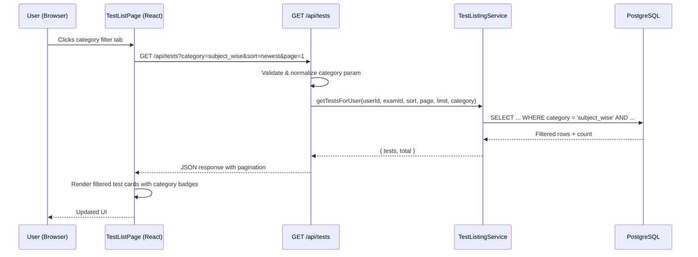
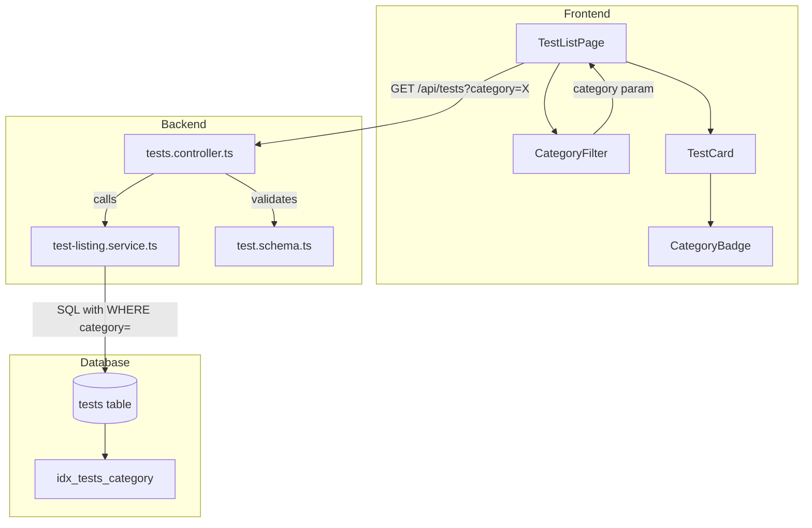

# Design Document: Test Categories

## Overview

The Test Categories feature adds a classification system to the UP Police Test Series platform, enabling students to filter tests by category (Full Mock Test, Subject-wise, Previous Year, Daily Practice, Topic-wise) on the test listing page. This involves a database schema change, backend filtering support, and a frontend category filter UI with bilingual labels.

### Key Design Decisions

1. **Predefined categories via CHECK constraint** — Five fixed categories stored as a varchar enum in PostgreSQL with a CHECK constraint. This avoids a separate lookup table since the category list is small and unlikely to change frequently.
2. **`full_mock` as migration default** — Existing tests default to `full_mock` during migration, ensuring no NULL values and backward compatibility.
3. **Category filter as query parameter** — The `category` query param integrates with existing sort/pagination on `GET /api/tests`, keeping the API surface minimal.
4. **Invalid category silently defaults to "all"** — Rather than returning 400 for an invalid category, the API treats it as "all" for a graceful frontend experience (Requirement 3.4).
5. **Bilingual labels via i18n JSON** — Category labels are stored as translation keys in the existing i18n framework, not in the database, keeping the frontend language-agnostic.

## Architecture

### Category Data Flow



### Component Interaction



## Components and Interfaces

### Backend Changes

#### 1. Database Migration (`011_add-test-category.ts`)

Adds the `category` column to the existing `tests` table with:
- Column type: `varchar(20) NOT NULL DEFAULT 'full_mock'`
- CHECK constraint: limits values to the five allowed categories
- Index: `idx_tests_category` on the `category` column

#### 2. Schema Update (`test.schema.ts`)

Add `category` field to both `createTestSchema` and `updateTestSchema`:

```typescript
const VALID_CATEGORIES = ['full_mock', 'subject_wise', 'previous_year', 'daily_practice', 'topic_wise'] as const;
export type TestCategory = typeof VALID_CATEGORIES[number];

// Added to createTestSchema
category: z.enum(VALID_CATEGORIES),

// In updateTestSchema (partial), category becomes optional
```

#### 3. Test Listing Service (`test-listing.service.ts`)

Updated function signature:

```typescript
export async function getTestsForUser(
  userId: string,
  examId: string,
  sort: SortOption,
  page: number,
  limit: number,
  category?: TestCategory
): Promise<{ tests: TestListItem[]; total: number }>
```

Changes:
- Add optional `category` parameter
- Append `AND t.category = $N` to WHERE clause when category is provided
- Include `category` in the SELECT column list
- Update count query to include category filter
- Add `category` field to `TestListItem` interface

#### 4. Tests Controller (`tests.controller.ts`)

Changes to `listTests` handler:
- Parse `category` from `req.query.category`
- Validate against allowed values; if invalid or missing, treat as undefined (all categories)
- Pass category to `getTestsForUser`

Changes to `createTest` handler:
- Include `category` from validated request body in INSERT

Changes to `updateTest` handler:
- Include `category` in dynamic SET clause when provided

Changes to `getTest` handler:
- Include `category` in response via `formatTest`

Update `formatTest` helper to include category field.

#### 5. Service Interface

| Function | Signature Change |
|----------|-----------------|
| `getTestsForUser` | Add optional `category?: TestCategory` parameter |
| `createTest` | `category` field included via schema validation |
| `updateTest` | `category` field included in dynamic update |

### Frontend Changes

#### 1. CategoryFilter Component (New)

```typescript
interface CategoryFilterProps {
  activeCategory: string; // 'all' | TestCategory
  onCategoryChange: (category: string) => void;
}
```

Renders a horizontal row of tab-style buttons. Uses `useTranslation()` for bilingual labels.

#### 2. CategoryBadge Component (New)

```typescript
interface CategoryBadgeProps {
  category: TestCategory;
}
```

Small pill/badge displaying the category label in the user's language. Used inside TestCard.

#### 3. TestListPage Updates

- Add `category` state (default: `'all'`)
- Pass `category` query param to `GET /api/tests` call
- Render `<CategoryFilter>` above the test grid
- Pass `category` to each `<TestCard>`

#### 4. TestCard Updates

- Accept `category` prop in `TestListItem` type
- Render `<CategoryBadge>` on each card

#### 5. i18n Updates

New translation keys under `testList.categories`:

| Key | English | Hindi |
|-----|---------|-------|
| `testList.categories.all` | All | सभी |
| `testList.categories.full_mock` | Full Mock Test | पूर्ण मॉक टेस्ट |
| `testList.categories.subject_wise` | Subject-wise | विषयवार टेस्ट |
| `testList.categories.previous_year` | Previous Year | पिछले वर्ष के प्रश्न |
| `testList.categories.daily_practice` | Daily Practice | दैनिक अभ्यास |
| `testList.categories.topic_wise` | Topic-wise | टॉपिक वार टेस्ट |

## Data Models

### Schema Change (tests table)

```sql
-- Add category column
ALTER TABLE tests
  ADD COLUMN category VARCHAR(20) NOT NULL DEFAULT 'full_mock';

-- Add CHECK constraint
ALTER TABLE tests
  ADD CONSTRAINT chk_test_category
  CHECK (category IN ('full_mock', 'subject_wise', 'previous_year', 'daily_practice', 'topic_wise'));

-- Add index for filter queries
CREATE INDEX idx_tests_category ON tests(category);
```

### Updated TestListItem Interface

```typescript
export interface TestListItem {
  id: string;
  titleEn: string;
  titleHi: string;
  duration: number;
  totalQuestions: number;
  totalMarks: number;
  pricingType: 'free' | 'premium';
  attemptStatus: 'not_attempted' | 'in_progress' | 'completed';
  lastScore?: number;
  lastAttemptId?: string;
  attemptCount: number;
  maxAttempts: number;
  createdAt: Date;
  category: TestCategory; // NEW
}
```

### API Response Change

`GET /api/tests` response now includes `category` in each test object:

```json
{
  "success": true,
  "data": [
    {
      "id": "uuid",
      "titleEn": "UP Police Constable Full Mock 1",
      "titleHi": "यूपी पुलिस कांस्टेबल पूर्ण मॉक 1",
      "category": "full_mock",
      "duration": 120,
      "totalQuestions": 150,
      "totalMarks": 300,
      "pricingType": "free",
      "attemptStatus": "not_attempted",
      "attemptCount": 0,
      "maxAttempts": 5,
      "createdAt": "2024-01-15T10:00:00Z"
    }
  ],
  "pagination": { "page": 1, "limit": 10, "total": 25, "totalPages": 3 }
}
```

### Migration File Structure

```typescript
// migrations/011_add-test-category.ts
import type { MigrationBuilder } from 'node-pg-migrate';

export async function up(pgm: MigrationBuilder): Promise<void> {
  pgm.addColumn('tests', {
    category: {
      type: 'varchar(20)',
      notNull: true,
      default: "'full_mock'",
    },
  });

  pgm.addConstraint('tests', 'chk_test_category', {
    check: "category IN ('full_mock', 'subject_wise', 'previous_year', 'daily_practice', 'topic_wise')",
  });

  pgm.createIndex('tests', 'category', { name: 'idx_tests_category' });
}

export async function down(pgm: MigrationBuilder): Promise<void> {
  pgm.dropIndex('tests', 'category', { name: 'idx_tests_category' });
  pgm.dropConstraint('tests', 'chk_test_category');
  pgm.dropColumn('tests', 'category');
}
```


## Correctness Properties

*A property is a characteristic or behavior that should hold true across all valid executions of a system — essentially, a formal statement about what the system should do. Properties serve as the bridge between human-readable specifications and machine-verifiable correctness guarantees.*

### Property 1: Category Validation Accepts Only Valid Values

*For any* string input, the category validator SHALL accept it if and only if it is exactly one of: `full_mock`, `subject_wise`, `previous_year`, `daily_practice`, `topic_wise`. All other strings — including empty strings, strings with extra whitespace, different casing, or partial matches — SHALL be rejected.

**Validates: Requirements 1.2, 5.3, 5.4**

### Property 2: Category Filtering Returns Only Matching Tests

*For any* valid category value and any set of test records with mixed categories, when the category filter is applied, the returned result set SHALL contain only tests whose `category` field exactly matches the requested value. Additionally, the category filter SHALL compose correctly with existing filters (exam_id, schedule window, published status) — meaning the result is the intersection of all applied filter conditions.

**Validates: Requirements 2.5, 3.2, 3.5**

### Property 3: "All" Filter Returns All Categories

*For any* set of test records, when the category parameter is omitted or set to `'all'`, the service SHALL return tests from all categories without any category-based exclusion. The result set SHALL be identical to querying without a category filter.

**Validates: Requirements 2.6, 3.3**

### Property 4: Invalid Category Defaults to All

*For any* string that is NOT one of the five valid category values and is NOT `'all'`, the API SHALL treat it equivalently to the "all" filter — returning tests from all categories with no category-based restriction.

**Validates: Requirements 3.4**

### Property 5: Pagination Total Reflects Filtered Count

*For any* category filter applied to a test dataset, the `total` value in the pagination response SHALL equal the actual count of tests matching all active filters (including category). This invariant SHALL hold regardless of the page or limit parameters.

**Validates: Requirements 3.6**

### Property 6: Bilingual Category Label Correctness

*For any* valid category value and any supported language (`'en'` or `'hi'`), looking up the category translation key SHALL return a non-empty string that matches the expected label for that category-language pair. The lookup SHALL never return undefined or an empty string.

**Validates: Requirements 2.3, 4.2**

## Error Handling

### Error Scenarios

| Scenario | HTTP Status | Error Code | Behavior |
|----------|-------------|------------|----------|
| Test created without `category` field | 422 | `VALIDATION_ERROR` | Zod schema rejects; returns field-level error |
| Test created with invalid `category` value | 422 | `VALIDATION_ERROR` | Zod enum rejects; returns allowed values in error details |
| Test updated with invalid `category` value | 422 | `VALIDATION_ERROR` | Same as create validation |
| Invalid `category` query param on GET /api/tests | 200 | N/A | Silently ignored; returns all tests (graceful degradation) |
| Database CHECK constraint violation (bypasses app layer) | 500 | `SERVER_ERROR` | Caught by global error handler; logged for investigation |

### Error Handling Strategy

1. **Validation Layer** — Zod schemas handle category validation at the controller boundary. Invalid create/update requests receive a 422 with the specific field error.

2. **Query Layer** — The `listTests` handler normalizes the category param before passing to the service. Invalid values are discarded (treated as "all"), following Requirement 3.4's graceful behavior.

3. **Database Layer** — The CHECK constraint is a safety net. If application validation is bypassed, the database rejects invalid values, and the error propagates as a 500 (unexpected server error).

## Testing Strategy

### Property-Based Tests (Vitest + fast-check)

Each correctness property maps to a property-based test with minimum 100 iterations:

| Property | Test Description | Generator Strategy |
|----------|-----------------|-------------------|
| Property 1 | Category validator correctness | `fc.string()` for invalid inputs; `fc.constantFrom(...validCategories)` for valid |
| Property 2 | Filtering returns only matching tests | `fc.array(fc.record(...))` with random categories, pick one to filter |
| Property 3 | "All" filter returns everything | `fc.array(fc.record(...))` with mixed categories |
| Property 4 | Invalid category defaults to all | `fc.string().filter(s => !validCategories.includes(s))` |
| Property 5 | Pagination total invariant | `fc.array(...)` of tests + `fc.constantFrom(...)` for category |
| Property 6 | Bilingual label lookup | `fc.constantFrom(...validCategories)` × `fc.constantFrom('en', 'hi')` |

**Configuration:**
- Library: `fast-check` (already in project)
- Runner: `vitest`
- Min iterations: 100 per property
- Tag format: `Feature: test-categories, Property N: <description>`

### Unit Tests (Example-Based)

| Test | Validates |
|------|-----------|
| CategoryFilter renders 6 buttons on mount | Req 2.1 |
| "All" is selected by default | Req 2.2 |
| Translation keys exist for all category labels (en + hi) | Req 2.4 |
| Active filter has distinct styling class | Req 2.7 |
| GET /api/tests accepts category query param | Req 3.1 |
| TestCard displays CategoryBadge | Req 4.1 |
| Badge visible when "All" filter active | Req 4.3 |
| POST /api/tests accepts category in body | Req 5.1 |
| PUT /api/tests/:id accepts category in body | Req 5.2 |
| GET /api/tests/:id response includes category | Req 5.5 |
| Test creation without category field returns 422 | Req 1.4 |

### Integration Tests

| Test | Validates |
|------|-----------|
| Migration adds category column with correct type | Req 1.1, 6.1 |
| Migration sets existing rows to 'full_mock' | Req 6.2 |
| Migration rollback removes column, index, constraint | Req 6.3 |
| Index idx_tests_category exists after migration | Req 1.3 |

### Test File Locations

- `packages/backend/src/services/test-listing.service.test.ts` — Property tests for filtering logic
- `packages/backend/src/schemas/test.schema.test.ts` — Property tests for category validation
- `packages/frontend/src/components/CategoryFilter.test.tsx` — Component unit tests
- `packages/frontend/src/components/CategoryBadge.test.tsx` — Badge rendering tests
- `packages/frontend/src/pages/TestListPage.test.tsx` — Integration with filter state
