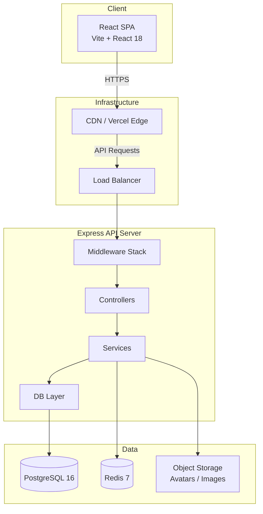
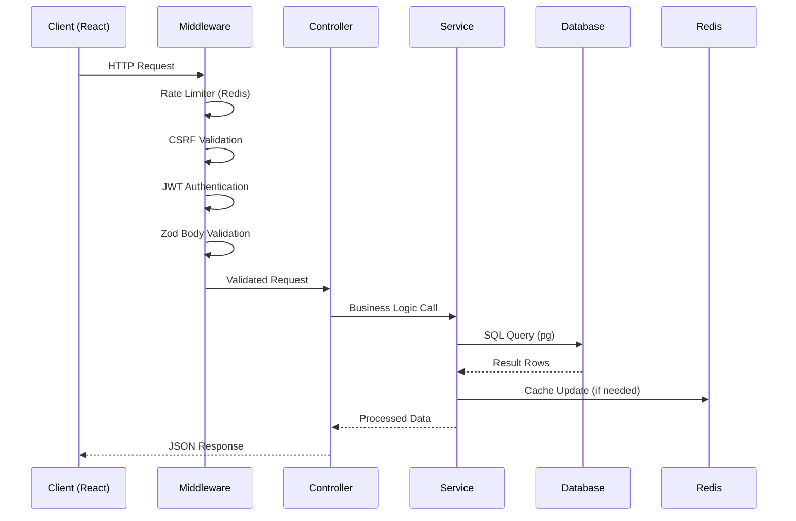
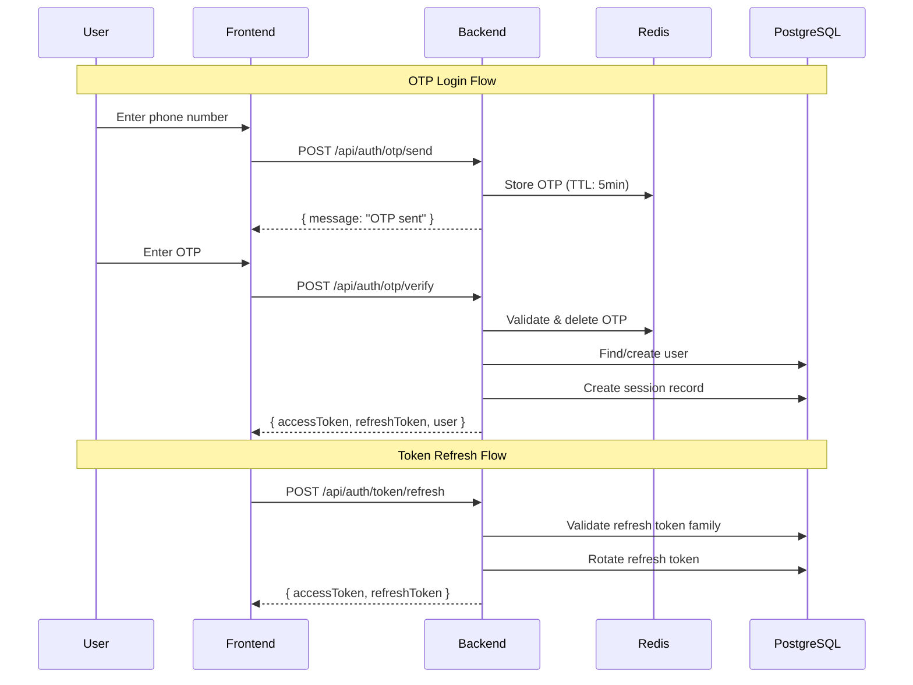

# Architecture — UP Police Test Series

## System Architecture



## Folder Structure

```
packages/backend/
├── migrations/              # 018 sequential migrations (node-pg-migrate)
├── src/
│   ├── config/              # Environment config (Zod-validated)
│   │   └── env.ts
│   ├── controllers/         # Route handlers (thin, delegate to services)
│   ├── db/                  # Pool, query helpers, transaction wrapper
│   ├── errors/              # AppError hierarchy
│   ├── i18n/                # en.json, hi.json, translation utilities
│   ├── middleware/          # Auth, rate-limit, CSRF, captcha, validation
│   ├── routes/              # Express Router definitions
│   ├── services/            # Business logic layer
│   ├── types/               # TypeScript type definitions
│   ├── utils/               # Shared utilities (date, token, hash)
│   ├── validators/          # Zod schemas for request validation
│   └── index.ts             # App bootstrap
└── package.json

packages/frontend/
├── public/                  # Static assets
├── src/
│   ├── api/                 # Axios instance + API call functions
│   ├── components/          # Reusable UI components
│   │   ├── common/          # Buttons, Inputs, Modals, Cards
│   │   ├── dashboard/       # Dashboard-specific widgets
│   │   ├── layout/          # Header, Sidebar, BottomNav
│   │   └── test/            # Test-taking components
│   ├── contexts/            # React Context providers (AuthContext)
│   ├── hooks/               # Custom hooks (useAuth, useStreak, etc.)
│   ├── pages/               # Route-level page components
│   ├── styles/              # Global CSS / Tailwind config
│   ├── types/               # Frontend TypeScript types
│   ├── utils/               # Formatters, validators, constants
│   ├── App.tsx              # Router + Layout
│   └── main.tsx             # Entry point
├── index.html
├── tailwind.config.js
└── vite.config.ts
```

## Request Flow



## Middleware Stack (Order Matters)

```
1. CORS
2. Helmet (security headers)
3. Body Parser (JSON, limit: 10kb)
4. Cookie Parser
5. Rate Limiter (Redis-backed, per-IP)
6. CSRF Token Validation (double-submit cookie)
7. JWT Authentication (extracts user from Bearer token)
8. Request Validation (Zod schemas via validate middleware)
9. Route Handler (Controller)
10. Error Handler (catches AppError, formats response)
```

## Authentication Flow



## State Management (Frontend)

```
┌─────────────────────────────────────────────┐
│  AuthContext (global)                       │
│  - user, tokens, isAuthenticated            │
│  - login(), logout(), refreshToken()        │
└─────────────────────────────────────────────┘
         │
         ▼
┌─────────────────────────────────────────────┐
│  Page-Level State (local)                   │
│  - Form state, loading flags, errors        │
│  - Fetched data (tests, attempts, etc.)     │
└─────────────────────────────────────────────┘
         │
         ▼
┌─────────────────────────────────────────────┐
│  Custom Hooks (encapsulated logic)          │
│  - useStreak, useCoins, useDailyQuiz        │
│  - useLeaderboard, useRankEstimate          │
│  - useOnlineStatus, useActivityRecording    │
└─────────────────────────────────────────────┘
```

No external state library (Redux, Zustand, Jotai) — React Context handles auth globally, everything else is local component state or custom hooks with `useState`/`useEffect`.

## Routing

### Frontend Routing (React Router 6)

```
/login              → LoginPage (public, AuthLayout)
/verify-otp         → OTPVerifyPage (public, AuthLayout)
/onboarding         → OnboardingPage (protected, AuthLayout)
/dashboard          → DashboardPage (protected, AppLayout)
/profile            → ProfileSettingsPage (protected, AppLayout)
/study-plan         → StudyPlanPage (protected, AppLayout)
/progress           → ProgressPage (protected, AppLayout)
/community          → DashboardPage placeholder (protected, AppLayout)
/tests              → TestListPage (protected, AppLayout)
/tests/:testId/attempt         → TestAttemptPage (protected, AppLayout)
/tests/:testId/results/:id     → TestResultsPage (protected, AppLayout)
/tests/:testId/review/:id      → AnswerReviewPage (protected, AppLayout)
/                   → Redirect to /dashboard
/*                  → Redirect to /dashboard
```

**Route Guards:**
- `AuthGuard` component wraps protected routes — redirects to `/login` if unauthenticated
- Public routes (login, verify-otp) accessible without auth
- Onboarding has its own guard — blocks navigation until completed

**Layouts:**
- `AuthLayout` — Centered card on branded background (login/OTP/onboarding)
- `AppLayout` — Full content area + BottomNavBar on mobile

### Backend Routing (Express Router)

```
/api/auth/*                    → authRouter (OTP, OAuth, tokens, CSRF)
/api/sessions/*                → sessionRouter (list, terminate)
/api/profile/*                 → profileRouter (CRUD, avatar, exam)
/api/onboarding/*              → onboardingRouter (exams, setup)
/api/questions/*               → questionsRouter (CRUD)
/api/subjects/*                → subjectsRouter (list, topics)
/api/tests/*                   → testsRouter (CRUD, listing)
/api/tests/:testId/attempts/*  → testsAttemptsRouter (start, current, history)
/api/attempts/*                → attemptsRouter (answers, submit, results, review)
/api/dashboard/*               → dashboardRouter (leaderboard, streak, home, rank)
/api/coins/*                   → coinsRouter (balance, history, earn)
/api/daily-quiz/*              → dailyQuizRouter (status, start, submit, result)
```

All routes registered in `packages/backend/src/routes/index.ts` and mounted via `app.use(routes)` in `src/index.ts`.

## Theme & Design System

### Color Palette (Police-Inspired)

| Token | Hex | Usage |
|-------|-----|-------|
| `primary` | #1B3A5C | Dark Navy Blue — headers, buttons, text |
| `primary-50` to `primary-600` | Shades | Backgrounds, hover states |
| `accent` | #E63946 | Red — errors, warnings, urgency |
| `accent-50` to `accent-600` | Shades | Error backgrounds, alerts |
| `background` | #F0F4F8 | Light grey-blue — page backgrounds |
| `success` | #2ECC71 | Green — correct answers, confirmations |
| `gold` | #C5A028 | Gold/Khaki — badges, premium, gamification |

### Tailwind Configuration

- Custom color tokens defined in `tailwind.config.js`
- Mobile-first breakpoints: `sm:` (640px), `md:` (768px), `lg:` (1024px)
- Font: System default (Inter/Poppins planned)
- Border radius: `rounded-md` (buttons), `rounded-lg` (cards), `rounded-xl` (modals)
- Shadows: `shadow-sm` (cards), `shadow-lg` (modals/overlays)

### Component Visual Patterns

- **Cards:** White background, `border border-gray-100`, `shadow-sm`, `rounded-xl`, `p-4`
- **Buttons:** Primary (navy), Secondary (border), Danger (red), LoadingButton with spinner
- **Inputs:** `border-primary-200`, focus ring `ring-primary-200`, error state `border-accent-500`
- **Bottom Nav:** 5 tabs, fixed bottom, `md:hidden` (only on mobile)
- **Dashboard widgets:** Gradient backgrounds for feature cards (green, purple, orange, blue)

## Repository Pattern (Data Access)

This project uses a **Service + Query Helper** pattern rather than a traditional ORM repository pattern.

### Data Access Layers

```
Controller → Service → Query Helpers → PostgreSQL Pool
```

**Query Helpers (packages/backend/src/db/):**

| Function | Purpose |
|----------|---------|
| `query<T>(sql, params)` | Execute SQL, return all rows typed as T |
| `queryOne<T>(sql, params)` | Execute SQL, return first row or null |
| `queryMany<T>(sql, params)` | Alias for query (semantic clarity) |
| `withTransaction(fn)` | BEGIN → execute fn(client) → COMMIT or ROLLBACK |

**Why not an ORM (Prisma/TypeORM/Drizzle)?**
- Direct SQL gives full control over complex aggregation queries (leaderboards, analytics)
- No N+1 query problem — queries are hand-optimized
- Easier bilingual column handling (`name_en`, `name_hi`)
- Smaller bundle, fewer dependencies
- Migration management via dedicated tool (node-pg-migrate)

**Pattern:**
- Services own business logic AND data access (no separate repository layer)
- SQL queries are co-located with the service that uses them
- Transaction support via `withTransaction` wrapper
- All queries parameterized (no string interpolation)

## Dependency Injection

This project does **NOT** use a formal DI container (no InversifyJS, no tsyringe, no Awilix).

### Current Approach: Manual Instantiation

```
Services → instantiated in controller files
Middleware → imported directly
DB Layer → singleton pool exported from db/pool.ts
Redis → singleton client exported from redis module
Config → singleton env object from config/env.ts
```

**Service instantiation patterns:**

1. **Singleton export** (most common):
   - `leaderboard.service.ts` exports functions directly
   - `streak.service.ts` exports `recordActivity`, `getStreakWithBest`
   - `coins.service.ts` exports `getBalance`, `earnCoins`

2. **Class instantiation in controller** (for services needing constructor params):
   - `OtpService` instantiated with `SmsGateway` (mock in dev, HTTP in prod)
   - `ProfileService` instantiated as `new ProfileService()`
   - `SessionService` instantiated as `new SessionService()`

3. **Middleware as pure functions:**
   - `jwtAuth`, `csrfProtection`, `ipRateLimiter` — stateless, imported directly

**Why no DI container?**
- Small team, ~15 services — manual wiring is manageable
- Testing uses direct function imports + mocking via Vitest
- No circular dependencies (layered architecture prevents this)
- Adding a container would be over-engineering at current scale

## Authorization

### Access Control Model

The project currently implements **authentication-only** access control (no role-based authorization).

**Current state:**
- All authenticated users have equal access to all endpoints
- No admin/student role distinction enforced at middleware level
- Question/Test CRUD endpoints (admin operations) are protected only by `jwtAuth` — any authenticated user can call them

### Ownership-Based Authorization

Where authorization exists, it's **ownership-based** (resource belongs to user):

| Resource | Check | Location |
|----------|-------|----------|
| Study Plans | `plan.user_id === req.user.userId` | Service layer |
| Test Attempts | `attempt.user_id === req.user.userId` | Service layer |
| Sessions | `session.user_id === req.user.userId` | Controller |
| Profile | Only own profile accessible | Controller (implicit) |
| Coin Transactions | Only own balance/history | Controller (implicit) |

### Future: Role-Based Access (Planned)

```
Roles: student (default), admin, super_admin
Middleware: requireRole('admin') — to be built
Admin endpoints: /api/questions/*, /api/tests/* (create/update/delete)
```

Currently, the `users` table has no `role` column. This is planned for the Admin Panel phase.

## Caching Strategy (Redis)

| Data | Key Pattern | TTL | Purpose |
|------|-------------|-----|---------|
| OTP codes | `otp:{phone}` | 5 min | SMS verification |
| Rate limit counters | `rl:{ip}:{endpoint}` | 1–15 min | Abuse prevention |
| CSRF tokens | `csrf:{sessionId}` | 24 hours | Request forgery protection |
| Session blacklist | `bl:{tokenFamily}` | Until refresh expiry | Revoked token detection |
| Refresh token family | `rtf:{userId}:{family}` | 30 days | Token rotation tracking |
| Daily quiz cache | `dq:{date}:{examId}` | 24 hours | Avoid repeated DB queries |

## Error Handling Pipeline

```typescript
// Error hierarchy
AppError (base)
├── ValidationError (400)
├── AuthenticationError (401)
├── AuthorizationError (403)
├── NotFoundError (404)
├── ConflictError (409)
├── RateLimitError (429)
└── InternalError (500)
```

**Flow:**
1. Service throws typed `AppError` subclass
2. Controller does NOT catch (lets it propagate)
3. Express error-handler middleware catches all errors
4. Formats consistent JSON response: `{ success: false, error: { code, message, details? } }`
5. Logs stack trace for 5xx errors only
6. Returns bilingual error message based on `Accept-Language` header

## i18n Approach

**Backend:**
- System messages (errors, validation) stored in `src/i18n/en.json` and `hi.json`
- `getLanguage(req)` extracts preference from user profile or `Accept-Language` header
- Response messages translated before sending

**Database:**
- Content columns duplicated: `name_en`/`name_hi`, `text_en`/`text_hi`
- Service layer selects appropriate column based on user's `preferred_language`

**Frontend:**
- Renders content from API response (already in correct language)
- UI labels managed via constants/translation files (planned full i18n library integration)

## Security Layers

1. **Helmet** — Security headers (X-Content-Type-Options, X-Frame-Options, etc.)
2. **CORS** — Whitelist frontend origin only
3. **Rate Limiting** — Redis-backed, per-IP, stricter on auth endpoints
4. **CSRF** — Double-submit cookie pattern
5. **CAPTCHA** — Turnstile verification on OTP send (after N failures)
6. **JWT** — Short-lived access tokens (15 min), long-lived refresh (30 days)
7. **Token Rotation** — Refresh tokens are one-time use with family tracking
8. **Input Validation** — Zod schemas on every endpoint
9. **SQL Injection Prevention** — Parameterized queries only (pg)
10. **Password-less** — No passwords stored, OTP + OAuth only


## Coding Standards

### Naming Conventions

| Context | Convention | Example |
|---------|-----------|---------|
| Database columns | snake_case | `created_at`, `user_id`, `full_name` |
| API response keys | camelCase | `createdAt`, `userId`, `fullName` |
| TypeScript variables | camelCase | `const userId = ...` |
| TypeScript interfaces | PascalCase | `interface UserProfile {}` |
| React components | PascalCase | `TestAttemptPage`, `DailyQuizCard` |
| Custom hooks | camelCase with `use` prefix | `useStreak`, `useDailyQuiz` |
| Backend service files | kebab-case | `streak.service.ts`, `daily-quiz.service.ts` |
| Backend controllers | kebab-case | `daily-quiz.controller.ts` |
| Migration files | numbered + kebab-case | `012_add-subjects-topics-tables.ts` |
| Test files | `.test.ts` (unit), `.spec.ts` (e2e) | `auth.controller.test.ts` |
| Constants | UPPER_SNAKE_CASE | `MAX_OTP_ATTEMPTS`, `TOKEN_EXPIRY` |
| Environment variables | UPPER_SNAKE_CASE | `DB_URL`, `JWT_SECRET` |

### Backend Patterns

- **Controllers are thin** — parse input (Zod), call service, format output
- **Services own business logic** — validation, DB queries, Redis operations
- **Errors propagate** — services throw `AppError` subclasses, controllers do NOT catch
- **Transactions via wrapper** — `withTransaction(async (client) => { ... })`
- **All queries parameterized** — never interpolate values into SQL strings
- **Zod validates everything** — request bodies, query params, env vars

### Frontend Patterns

- **Hooks encapsulate data** — `useStreak()`, `useCoins()`, `useDailyQuiz()`
- **AbortController on unmount** — all hooks cancel in-flight requests on cleanup
- **Optimistic updates** — profile changes update UI immediately, revert on failure
- **Error/loading/data triple** — every hook returns `{ data, isLoading, error }`
- **Bilingual rendering** — components accept `language` prop, select `*En`/`*Hi` fields

### Import Aliases

```
Backend:  @/ → packages/backend/src/
Frontend: @/ → packages/frontend/src/
```

### Code Style (Prettier + ESLint)

- Semicolons: yes
- Quotes: single
- Trailing commas: all
- Print width: 100
- Tab width: 2
- ESLint: `@typescript-eslint/recommended`
- No `any` (warn level)
- Unused vars with `_` prefix allowed

### File Organization Rules

1. One component per file (React)
2. Test files co-located with source (`service.ts` → `service.test.ts`)
3. Barrel exports via `index.ts` for errors (`@/errors`) and db (`@/db`)
4. Zod schemas in controller files (simple) or dedicated `schemas/` folder (complex)
5. No circular imports — layered architecture enforces this (controller → service → db)
