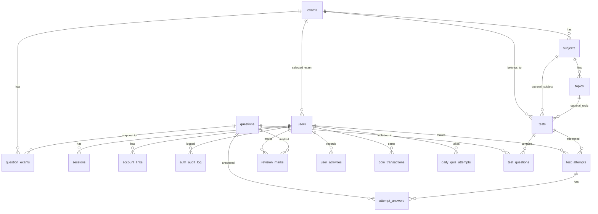

# Database Schema — UP Police Test Series

## Overview

- **Engine:** PostgreSQL 16
- **Migrations:** node-pg-migrate (18 sequential migrations)
- **Naming:** snake_case for all tables and columns
- **IDs:** UUID (generated via `gen_random_uuid()`)
- **Timestamps:** `TIMESTAMPTZ` with `DEFAULT NOW()`

## Entity Relationship Diagram

## Tables

### 1. exams

| Column | Type | Constraints | Description |
|--------|------|-------------|-------------|
| id | UUID | PK, DEFAULT gen_random_uuid() | Unique identifier |
| name_en | VARCHAR(255) | NOT NULL | Exam name in English |
| name_hi | VARCHAR(255) | NOT NULL | Exam name in Hindi |
| description_en | TEXT | | Description in English |
| description_hi | TEXT | | Description in Hindi |
| category | VARCHAR(100) | NOT NULL | Exam category (e.g., "police") |
| state | VARCHAR(50) | NOT NULL, DEFAULT 'uttar_pradesh' | State relevance |
| icon_url | TEXT | | Exam icon/logo URL |
| is_active | BOOLEAN | NOT NULL, DEFAULT true | Visibility flag |
| display_order | INTEGER | NOT NULL, DEFAULT 0 | UI ordering |
| exam_date | DATE | | Upcoming exam date |
| created_at | TIMESTAMPTZ | NOT NULL, DEFAULT NOW() | |
| updated_at | TIMESTAMPTZ | NOT NULL, DEFAULT NOW() | |

**Indexes:** `idx_exams_category` on (category), `idx_exams_is_active` on (is_active)

---

### 2. users

| Column | Type | Constraints | Description |
|--------|------|-------------|-------------|
| id | UUID | PK, DEFAULT gen_random_uuid() | Unique identifier |
| phone | VARCHAR(15) | UNIQUE | Phone number (E.164) |
| email | VARCHAR(255) | UNIQUE | Email address |
| full_name | VARCHAR(255) | | Display name |
| avatar_url | TEXT | | Profile picture URL |
| preferred_language | VARCHAR(5) | NOT NULL, DEFAULT 'hi' | 'en' or 'hi' |
| selected_exam_id | UUID | FK → exams(id) ON DELETE SET NULL | Currently selected exam |
| google_id | VARCHAR(255) | UNIQUE | Google OAuth subject ID |
| google_avatar_url | TEXT | | Avatar from Google |
| onboarding_completed | BOOLEAN | NOT NULL, DEFAULT false | Onboarding flow done |
| exam_change_count_this_month | INTEGER | NOT NULL, DEFAULT 0 | Monthly exam change limit |
| exam_change_month | INTEGER | | Month tracker for exam changes |
| deletion_scheduled_at | TIMESTAMPTZ | | Account deletion schedule |
| best_streak | INTEGER | NOT NULL, DEFAULT 0 | All-time best daily streak |
| created_at | TIMESTAMPTZ | NOT NULL, DEFAULT NOW() | |
| updated_at | TIMESTAMPTZ | NOT NULL, DEFAULT NOW() | |

**Indexes:** `idx_users_phone` on (phone), `idx_users_email` on (email), `idx_users_google_id` on (google_id), `idx_users_selected_exam` on (selected_exam_id)

**CHECK:** `preferred_language IN ('en', 'hi')`

---

### 3. sessions

| Column | Type | Constraints | Description |
|--------|------|-------------|-------------|
| id | UUID | PK, DEFAULT gen_random_uuid() | Session identifier |
| user_id | UUID | NOT NULL, FK → users(id) ON DELETE CASCADE | Owner |
| refresh_token_hash | VARCHAR(255) | NOT NULL | Hashed refresh token |
| token_family | UUID | NOT NULL | Token rotation family |
| device_type | VARCHAR(50) | | 'mobile', 'desktop', 'tablet' |
| device_info | JSONB | | User-agent parsed details |
| ip_address | VARCHAR(45) | | IPv4/IPv6 |
| city | VARCHAR(100) | | GeoIP city (approximate) |
| is_active | BOOLEAN | NOT NULL, DEFAULT true | Session active status |
| last_active_at | TIMESTAMPTZ | DEFAULT NOW() | Last token refresh |
| expires_at | TIMESTAMPTZ | NOT NULL | Session expiry |
| created_at | TIMESTAMPTZ | NOT NULL, DEFAULT NOW() | |

**Indexes:** `idx_sessions_user_id` on (user_id), `idx_sessions_token_family` on (token_family), `idx_sessions_is_active` on (user_id, is_active)

---

### 4. account_links

| Column | Type | Constraints | Description |
|--------|------|-------------|-------------|
| id | UUID | PK, DEFAULT gen_random_uuid() | |
| user_id | UUID | NOT NULL, FK → users(id) ON DELETE CASCADE | Owner |
| provider | VARCHAR(50) | NOT NULL | 'google', 'phone' |
| provider_id | VARCHAR(255) | NOT NULL | External provider ID |
| linked_at | TIMESTAMPTZ | NOT NULL, DEFAULT NOW() | |

**Unique:** (user_id, provider)  
**Indexes:** `idx_account_links_user_provider` on (user_id, provider)

---

### 5. auth_audit_log

| Column | Type | Constraints | Description |
|--------|------|-------------|-------------|
| id | UUID | PK, DEFAULT gen_random_uuid() | |
| user_id | UUID | FK → users(id) ON DELETE SET NULL | Related user |
| action | VARCHAR(100) | NOT NULL | Action type (login, logout, otp_sent, etc.) |
| ip_address | VARCHAR(45) | | Request IP |
| user_agent | TEXT | | Raw user-agent string |
| metadata | JSONB | | Additional context |
| created_at | TIMESTAMPTZ | NOT NULL, DEFAULT NOW() | |

**Indexes:** `idx_audit_user_id` on (user_id), `idx_audit_action` on (action)

---

### 6. questions

| Column | Type | Constraints | Description |
|--------|------|-------------|-------------|
| id | UUID | PK, DEFAULT gen_random_uuid() | |
| text_en | TEXT | NOT NULL | Question text (English) |
| text_hi | TEXT | NOT NULL | Question text (Hindi) |
| option_a_en | TEXT | NOT NULL | Option A (English) |
| option_a_hi | TEXT | NOT NULL | Option A (Hindi) |
| option_b_en | TEXT | NOT NULL | Option B (English) |
| option_b_hi | TEXT | NOT NULL | Option B (Hindi) |
| option_c_en | TEXT | NOT NULL | Option C (English) |
| option_c_hi | TEXT | NOT NULL | Option C (Hindi) |
| option_d_en | TEXT | NOT NULL | Option D (English) |
| option_d_hi | TEXT | NOT NULL | Option D (Hindi) |
| correct_option | SMALLINT | NOT NULL, CHECK (0–3) | 0=A, 1=B, 2=C, 3=D |
| explanation_en | TEXT | | Answer explanation (English) |
| explanation_hi | TEXT | | Answer explanation (Hindi) |
| subject | VARCHAR(100) | | Subject category |
| topic | VARCHAR(100) | | Topic within subject |
| difficulty | VARCHAR(20) | CHECK ('easy','medium','hard') | Difficulty level |
| image_url | TEXT | | Optional question image |
| is_active | BOOLEAN | NOT NULL, DEFAULT true | Visibility |
| created_at | TIMESTAMPTZ | NOT NULL, DEFAULT NOW() | |
| updated_at | TIMESTAMPTZ | NOT NULL, DEFAULT NOW() | |

**Indexes:** `idx_questions_subject` on (subject), `idx_questions_topic` on (topic), `idx_questions_difficulty` on (difficulty)  
**CHECK:** `correct_option >= 0 AND correct_option <= 3`

---

### 7. question_exams

| Column | Type | Constraints | Description |
|--------|------|-------------|-------------|
| question_id | UUID | NOT NULL, FK → questions(id) ON DELETE CASCADE | |
| exam_id | UUID | NOT NULL, FK → exams(id) ON DELETE CASCADE | |

**PK:** (question_id, exam_id) — composite primary key

---

### 8. tests

| Column | Type | Constraints | Description |
|--------|------|-------------|-------------|
| id | UUID | PK, DEFAULT gen_random_uuid() | |
| title_en | VARCHAR(255) | NOT NULL | Test title (English) |
| title_hi | VARCHAR(255) | NOT NULL | Test title (Hindi) |
| description_en | TEXT | | Description (English) |
| description_hi | TEXT | | Description (Hindi) |
| exam_id | UUID | NOT NULL, FK → exams(id) | Parent exam |
| duration_minutes | INTEGER | NOT NULL | Time limit |
| total_marks | INTEGER | NOT NULL | Maximum possible score |
| marks_per_question | NUMERIC(4,2) | NOT NULL, DEFAULT 1 | Marks for correct answer |
| negative_marking_ratio | NUMERIC(4,2) | NOT NULL, DEFAULT 0.25 | Deduction ratio for wrong |
| passing_marks | INTEGER | | Minimum to pass |
| pricing_type | VARCHAR(20) | NOT NULL, DEFAULT 'free' | 'free' or 'premium' |
| status | VARCHAR(20) | NOT NULL, DEFAULT 'draft' | 'draft', 'published', 'archived' |
| available_from | TIMESTAMPTZ | | Start availability |
| available_until | TIMESTAMPTZ | | End availability |
| attempt_count | INTEGER | NOT NULL, DEFAULT 0 | Total attempts (denormalized) |
| category | VARCHAR(50) | | Test category (full_mock, subject, topic, pyq) |
| subject_id | UUID | FK → subjects(id) ON DELETE SET NULL | Optional subject filter |
| topic_id | UUID | FK → topics(id) ON DELETE SET NULL | Optional topic filter |
| created_at | TIMESTAMPTZ | NOT NULL, DEFAULT NOW() | |
| updated_at | TIMESTAMPTZ | NOT NULL, DEFAULT NOW() | |

**Indexes:** `idx_tests_exam_id` on (exam_id), `idx_tests_status` on (status), `idx_tests_category` on (category)  
**CHECK:** `pricing_type IN ('free', 'premium')`, `status IN ('draft', 'published', 'archived')`

---

### 9. test_questions

| Column | Type | Constraints | Description |
|--------|------|-------------|-------------|
| test_id | UUID | NOT NULL, FK → tests(id) ON DELETE CASCADE | |
| question_id | UUID | NOT NULL, FK → questions(id) ON DELETE CASCADE | |
| question_order | INTEGER | NOT NULL | Display order in test |

**PK:** (test_id, question_id) — composite primary key  
**Unique:** (test_id, question_order)

---

### 10. test_attempts

| Column | Type | Constraints | Description |
|--------|------|-------------|-------------|
| id | UUID | PK, DEFAULT gen_random_uuid() | |
| user_id | UUID | NOT NULL, FK → users(id) ON DELETE CASCADE | Attempt owner |
| test_id | UUID | NOT NULL, FK → tests(id) ON DELETE CASCADE | Test attempted |
| started_at | TIMESTAMPTZ | NOT NULL, DEFAULT NOW() | When started |
| ends_at | TIMESTAMPTZ | NOT NULL | Auto-submit deadline |
| submitted_at | TIMESTAMPTZ | | When submitted (NULL = in-progress) |
| status | VARCHAR(20) | NOT NULL, DEFAULT 'in_progress' | Status of attempt |
| total_score | NUMERIC(6,2) | | Computed score |
| correct_count | INTEGER | DEFAULT 0 | Correct answers |
| wrong_count | INTEGER | DEFAULT 0 | Wrong answers |
| skipped_count | INTEGER | DEFAULT 0 | Skipped questions |
| percentage | NUMERIC(5,2) | | Score percentage |
| time_taken_seconds | INTEGER | | Total time used |
| created_at | TIMESTAMPTZ | NOT NULL, DEFAULT NOW() | |

**Indexes:** `idx_attempts_user_id` on (user_id), `idx_attempts_test_id` on (test_id), `idx_attempts_status` on (status)  
**CHECK:** `status IN ('in_progress', 'submitted', 'expired', 'abandoned')`

---

### 11. attempt_answers

| Column | Type | Constraints | Description |
|--------|------|-------------|-------------|
| id | UUID | PK, DEFAULT gen_random_uuid() | |
| attempt_id | UUID | NOT NULL, FK → test_attempts(id) ON DELETE CASCADE | Parent attempt |
| question_id | UUID | NOT NULL, FK → questions(id) | Answered question |
| question_order | INTEGER | NOT NULL | Order in test |
| selected_option | SMALLINT | CHECK (0–3 or NULL) | 0=A, 1=B, 2=C, 3=D, NULL=skipped |
| marked_for_review | BOOLEAN | NOT NULL, DEFAULT false | Review flag |
| answered_at | TIMESTAMPTZ | DEFAULT NOW() | When answered |

**Indexes:** `idx_answers_attempt_id` on (attempt_id)  
**Unique:** (attempt_id, question_id)  
**CHECK:** `selected_option >= 0 AND selected_option <= 3` (when not NULL)

---

### 12. revision_marks

| Column | Type | Constraints | Description |
|--------|------|-------------|-------------|
| id | UUID | PK, DEFAULT gen_random_uuid() | |
| user_id | UUID | NOT NULL, FK → users(id) ON DELETE CASCADE | |
| question_id | UUID | NOT NULL, FK → questions(id) ON DELETE CASCADE | |
| created_at | TIMESTAMPTZ | NOT NULL, DEFAULT NOW() | |

**Unique:** (user_id, question_id)

---

### 13. subjects

| Column | Type | Constraints | Description |
|--------|------|-------------|-------------|
| id | UUID | PK, DEFAULT gen_random_uuid() | |
| exam_id | UUID | NOT NULL, FK → exams(id) ON DELETE CASCADE | Parent exam |
| name_en | VARCHAR(255) | NOT NULL | Subject name (English) |
| name_hi | VARCHAR(255) | NOT NULL | Subject name (Hindi) |
| display_order | INTEGER | NOT NULL, DEFAULT 0 | Ordering |
| created_at | TIMESTAMPTZ | NOT NULL, DEFAULT NOW() | |

**Indexes:** `idx_subjects_exam_id` on (exam_id)

---

### 14. topics

| Column | Type | Constraints | Description |
|--------|------|-------------|-------------|
| id | UUID | PK, DEFAULT gen_random_uuid() | |
| subject_id | UUID | NOT NULL, FK → subjects(id) ON DELETE CASCADE | Parent subject |
| name_en | VARCHAR(255) | NOT NULL | Topic name (English) |
| name_hi | VARCHAR(255) | NOT NULL | Topic name (Hindi) |
| display_order | INTEGER | NOT NULL, DEFAULT 0 | Ordering |
| created_at | TIMESTAMPTZ | NOT NULL, DEFAULT NOW() | |

**Indexes:** `idx_topics_subject_id` on (subject_id)

---

### 15. user_activities

| Column | Type | Constraints | Description |
|--------|------|-------------|-------------|
| id | UUID | PK, DEFAULT gen_random_uuid() | |
| user_id | UUID | NOT NULL, FK → users(id) ON DELETE CASCADE | |
| activity_date | DATE | NOT NULL | Date of activity |
| created_at | TIMESTAMPTZ | NOT NULL, DEFAULT NOW() | |

**Unique:** (user_id, activity_date)  
**Indexes:** `idx_user_activities_user_date` on (user_id, activity_date)

---

### 16. coin_transactions

| Column | Type | Constraints | Description |
|--------|------|-------------|-------------|
| id | UUID | PK, DEFAULT gen_random_uuid() | |
| user_id | UUID | NOT NULL, FK → users(id) ON DELETE CASCADE | |
| type | VARCHAR(50) | NOT NULL | Transaction type |
| amount | INTEGER | NOT NULL | Coins earned (positive) |
| reference_id | UUID | | Related entity (quiz, test, etc.) |
| created_at | TIMESTAMPTZ | NOT NULL, DEFAULT NOW() | |

**Indexes:** `idx_coins_user_id` on (user_id), `idx_coins_type` on (type)  
**CHECK:** `type IN ('daily_login', 'streak_bonus_7', 'referral', 'quiz_complete', 'test_complete')`

---

### 17. daily_quiz_attempts

| Column | Type | Constraints | Description |
|--------|------|-------------|-------------|
| id | UUID | PK, DEFAULT gen_random_uuid() | |
| user_id | UUID | NOT NULL, FK → users(id) ON DELETE CASCADE | |
| quiz_date | DATE | NOT NULL | Date of the quiz |
| question_ids | UUID[] | NOT NULL | Array of question UUIDs |
| answers | SMALLINT[] | | User's answers array |
| score | INTEGER | | Final score |
| time_taken_seconds | INTEGER | | Time to complete |
| status | VARCHAR(20) | NOT NULL, DEFAULT 'in_progress' | |
| submitted_at | TIMESTAMPTZ | | Submission time |
| created_at | TIMESTAMPTZ | NOT NULL, DEFAULT NOW() | |

**Unique:** (user_id, quiz_date) — one attempt per user per day  
**Indexes:** `idx_daily_quiz_user_date` on (user_id, quiz_date)  
**CHECK:** `status IN ('in_progress', 'submitted')`

---

## Migration Numbering

| # | File | Purpose |
|---|------|---------|
| 001 | create-exams-table | Exams table |
| 002 | create-users-table | Users table with exam FK |
| 003 | create-sessions-table | Session management |
| 004 | create-account-links-table | OAuth link records |
| 005 | create-auth-audit-log-table | Auth audit trail |
| 006 | seed-exams-data | Initial exam entries (UP Police Constable, SI, etc.) |
| 007 | create-questions-tables | Questions + question_exams |
| 008 | create-tests-tables | Tests + test_questions |
| 009 | create-test-attempts-tables | Attempts + answers + revision_marks |
| 010 | seed-test-series-data | Sample test data |
| 011 | add-test-category | Category column to tests |
| 012 | add-subjects-topics-tables | Subjects + Topics tables |
| 013 | seed-subjects-topics-data | Initial subjects/topics for exams |
| 014 | create-user-activities-table | Daily activity tracking |
| 015 | add-best-streak-to-users | best_streak column |
| 016 | add-exam-date-to-exams | exam_date column |
| 017 | create-coin-transactions-table | Gamification coins |
| 018 | create-daily-quiz-attempts-table | Daily quiz feature |

## Key Relationships

- `users.selected_exam_id` → `exams.id` (ON DELETE SET NULL)
- `sessions.user_id` → `users.id` (ON DELETE CASCADE) — delete user removes all sessions
- `test_attempts.user_id` → `users.id` (ON DELETE CASCADE)
- `attempt_answers.attempt_id` → `test_attempts.id` (ON DELETE CASCADE) — delete attempt removes answers
- `topics.subject_id` → `subjects.id` (ON DELETE CASCADE)
- `subjects.exam_id` → `exams.id` (ON DELETE CASCADE)
- All user-owned data cascades on user deletion (GDPR-friendly)

## Missing Tables (Needed for Features with Hardcoded Data)

These tables are required by features that currently exist as frontend UI shells with hardcoded mock data.

| Table | Needed For | Priority | Spec Exists? |
|-------|-----------|----------|--------------|
| `study_plans` | Study Plan CRUD — plan name, user, day-of-week | High | Yes (dashboard-dynamic-phase2) |
| `study_plan_items` | Plan items — subject + duration per plan | High | Yes (dashboard-dynamic-phase2) |
| `user_active_plans` | Active plan per user per IST day | High | Yes (dashboard-dynamic-phase2) |
| `plan_item_completions` | Checkbox tracking — which items done today | High | Yes (dashboard-dynamic-phase2) |

### study_plans (planned)

| Column | Type | Constraints |
|--------|------|-------------|
| id | UUID | PK |
| user_id | UUID | FK → users ON DELETE CASCADE |
| name | VARCHAR(100) | NOT NULL |
| day_of_week | VARCHAR(10) | NULLABLE |
| created_at | TIMESTAMPTZ | DEFAULT NOW() |
| updated_at | TIMESTAMPTZ | DEFAULT NOW() |

### study_plan_items (planned)

| Column | Type | Constraints |
|--------|------|-------------|
| id | UUID | PK |
| plan_id | UUID | FK → study_plans ON DELETE CASCADE |
| subject_id | UUID | FK → subjects |
| duration_minutes | INTEGER | CHECK 5–480 |
| display_order | INTEGER | CHECK 0–100 |
| created_at | TIMESTAMPTZ | DEFAULT NOW() |

### user_active_plans (planned)

| Column | Type | Constraints |
|--------|------|-------------|
| id | UUID | PK |
| user_id | UUID | FK → users ON DELETE CASCADE |
| plan_id | UUID | FK → study_plans ON DELETE CASCADE |
| plan_date | DATE | NOT NULL |
| created_at | TIMESTAMPTZ | DEFAULT NOW() |

UNIQUE: (user_id, plan_date)

### plan_item_completions (planned)

| Column | Type | Constraints |
|--------|------|-------------|
| id | UUID | PK |
| user_id | UUID | FK → users ON DELETE CASCADE |
| item_id | UUID | FK → study_plan_items ON DELETE CASCADE |
| completion_date | DATE | NOT NULL |
| completed_at | TIMESTAMPTZ | DEFAULT NOW() |

UNIQUE: (user_id, item_id, completion_date)

---

## Unused Tables

Tables that exist in the database but have no active frontend consumer or are underutilized.

| Table | Status | Notes |
|-------|--------|-------|
| `subjects` | ⚠️ Underutilized | Backend API exists (`GET /api/subjects`), but NO frontend page calls it. TestListPage uses hardcoded filters instead. |
| `topics` | ⚠️ Underutilized | Backend API exists (`GET /api/subjects/:id/topics`), but NO frontend page calls it. |
| `account_links` | ⚠️ Low usage | Created during linking flow but never queried after creation. No "manage linked accounts" UI exists. |
| `auth_audit_log` | ⚠️ Write-only | Data is written on auth events, but NO admin UI or reporting reads from it. No cleanup/retention policy. |
| `revision_marks` | ⚠️ Partial | Written during answer review, but no "Revision Due Today" feature reads from it (that component is hardcoded). |

**Note:** None of these tables are truly "dead" — they store data correctly. They are just not consumed by the frontend yet.

---

## Future Tables (Planned for Upcoming Phases)

### Phase 5: Payments & Subscriptions

| Table | Purpose |
|-------|---------|
| `subscriptions` | User subscription records (plan_type, status, starts_at, expires_at, gateway_subscription_id) |
| `payments` | Payment transaction log (amount, currency, status, gateway_order_id, gateway_payment_id, receipt_url) |
| `coupons` | Discount codes (code, discount_type, discount_value, max_uses, used_count, valid_from, expires_at) |
| `coupon_redemptions` | Tracks which user used which coupon (coupon_id, user_id, redeemed_at) |

### Phase 6: Notifications

| Table | Purpose |
|-------|---------|
| `notifications` | In-app notification store (user_id, type, title_en, title_hi, body_en, body_hi, data JSONB, read_at, created_at) |
| `notification_preferences` | Per-type opt-in/opt-out (user_id, notification_type, enabled, channel) |
| `push_tokens` | Device FCM tokens for push notifications (user_id, token, device_type, created_at) |

### Phase 6: Admin Panel

| Table | Purpose |
|-------|---------|
| `admin_roles` | Role definitions (admin, super_admin, content_manager) — OR add `role` column to existing `users` table |
| `content_schedules` | Scheduled test publications (test_id, publish_at, created_by) |

### Phase 7: Achievements & Gamification

| Table | Purpose |
|-------|---------|
| `achievements` | Achievement/badge definitions (id, name_en, name_hi, icon_url, condition_type, condition_value, reward_coins) |
| `user_achievements` | Earned badges per user (user_id, achievement_id, earned_at) |

### Phase 8: Community & Social

| Table | Purpose |
|-------|---------|
| `discussion_posts` | Forum posts (id, user_id, title, body, category, upvotes, created_at) |
| `discussion_comments` | Post replies (id, post_id, user_id, body, created_at) |
| `referrals` | Referral tracking (referrer_id, referred_id, status, reward_given, created_at) |

---

## Index Audit

### Existing Indexes (from migrations)

| Table | Index Name | Columns | Type |
|-------|-----------|---------|------|
| sessions | idx_sessions_user_active | (user_id, is_active) WHERE is_active=true | Partial |
| sessions | idx_sessions_token_family | (token_family) | B-tree |
| sessions | idx_sessions_expires | (expires_at) | B-tree |
| test_attempts | idx_test_attempts_user_test | (user_id, test_id) | B-tree |
| subjects | idx_subjects_exam_id | (exam_id) | B-tree |
| topics | idx_topics_subject_id | (subject_id) | B-tree |
| tests | idx_tests_subject_id | (subject_id) | B-tree |
| tests | idx_tests_topic_id | (topic_id) | B-tree |
| coin_transactions | idx_coin_transactions_user | (user_id, created_at DESC) | B-tree |
| coin_transactions | uq_coin_daily_login | (user_id, type, IST date) WHERE type='daily_login' | Unique partial |
| coin_transactions | uq_coin_quiz_daily | (user_id, type, IST date) WHERE type='quiz_complete' | Unique partial |
| coin_transactions | uq_coin_test_attempt | (user_id, type, reference_id) WHERE type='test_complete' | Unique partial |
| coin_transactions | uq_coin_referral | (user_id, type, reference_id) WHERE type='referral' | Unique partial |
| daily_quiz_attempts | idx_daily_quiz_user_date | (user_id, quiz_date DESC) | B-tree |

### Missing Indexes (Recommended for Performance)

| Table | Recommended Index | Reason |
|-------|------------------|--------|
| test_attempts | (user_id, status, submitted_at DESC) | Leaderboard queries filter by status and sort by time |
| test_attempts | (test_id, status) WHERE status IN ('submitted','auto_submitted') | Percentile calculation per test |
| attempt_answers | (attempt_id, question_order) | Already has UNIQUE but explicit index would help scans |
| tests | (exam_id, status, category) | Test listing filters by all three together |
| questions | (is_active, subject) | Active question listing by subject |
| revision_marks | (user_id, created_at DESC) | Future "Revision Due Today" feature needs recent marks |

---

## Foreign Key Summary

| Child Table | Column | Parent Table | On Delete |
|-------------|--------|-------------|-----------|
| users | selected_exam_id | exams | SET NULL |
| sessions | user_id | users | CASCADE |
| account_links | user_id | users | CASCADE |
| auth_audit_log | user_id | users | SET NULL |
| question_exams | question_id | questions | CASCADE |
| question_exams | exam_id | exams | CASCADE |
| tests | exam_id | exams | (none specified) |
| tests | subject_id | subjects | SET NULL |
| tests | topic_id | topics | SET NULL |
| test_questions | test_id | tests | CASCADE |
| test_questions | question_id | questions | CASCADE |
| test_attempts | user_id | users | CASCADE |
| test_attempts | test_id | tests | CASCADE |
| attempt_answers | attempt_id | test_attempts | CASCADE |
| attempt_answers | question_id | questions | (none specified) |
| revision_marks | user_id | users | CASCADE |
| revision_marks | question_id | questions | CASCADE |
| subjects | exam_id | exams | CASCADE |
| topics | subject_id | subjects | CASCADE |
| user_activities | user_id | users | CASCADE |
| coin_transactions | user_id | users | (none specified) |
| daily_quiz_attempts | user_id | users | (none specified) |

**Cascade Strategy:**
- User deletion cascades to ALL user-owned data (sessions, attempts, activities, revision_marks)
- Subject deletion cascades to topics
- Test deletion cascades to test_questions
- Attempt deletion cascades to attempt_answers
- Exam deletion: users get SET NULL on selected_exam_id (don't delete the user)
