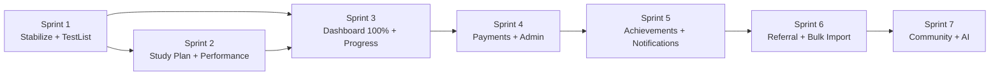

# Roadmap — UP Police Test Series

## Current State (Baseline)

- **Auth**: ✅ Complete (OTP + Google + sessions + CSRF + CAPTCHA)
- **Test Engine**: ✅ Complete (attempt → score → review)
- **Onboarding**: ✅ Complete
- **Gamification**: ✅ Partial (streak + coins + daily quiz + leaderboard working)
- **Dashboard**: ⚠️ 35% real, 65% hardcoded
- **TestListPage**: ❌ 100% hardcoded (API exists but unused)
- **StudyPlanPage**: ❌ 100% hardcoded (no backend)
- **ProgressPage**: ❌ 100% hardcoded (no backend)
- **ProfilePage**: ⚠️ 20% real (stats hardcoded)
- **Payments/Admin/Notifications/AI**: ❌ Not started

---

## Sprint 1 — Stabilization + TestListPage Wire (2 weeks)

**Goal:** Fix critical issues, wire TestListPage to existing API (zero backend work needed), prepare for first deployment.

### Critical Fixes (3 days)

| Task | Priority | Effort | Risk | Status |
|------|----------|--------|------|--------|
| Add Redis maxRetriesPerRequest + retryStrategy | 🔴 Critical | 1h | Backend crashes on Redis failure | ❌ Pending |
| Add React ErrorBoundary (global) | 🔴 Critical | 2h | White screen on any render error | ❌ Pending |
| Verify CSRF works in production mode | 🔴 Critical | 2h | Security gap if misconfigured | ❌ Pending |
| Add /api/health endpoint (already exists, verify) | Low | 30m | Monitoring readiness | ✅ Done |
| **Implement RBAC (role-based access control)** | 🔴 Critical | 3h | Any user can delete questions/tests | ✅ Done |

### TestListPage → Real Data (5 days)

| Task | Backend Work | Frontend Work | Effort |
|------|-------------|---------------|--------|
| Create `useTests` hook | None (API exists) | Fetch from GET /api/tests | 3h |
| Wire category filter (full_mock, subject_wise, etc.) | None | Pass query params | 2h |
| Wire subject dropdown | None (API exists) | Fetch from GET /api/subjects | 2h |
| Wire topic dropdown | None (API exists) | Fetch from GET /api/subjects/:id/topics | 2h |
| Replace MOCK test list with hook data | None | Remove hardcoded arrays | 4h |
| Add pagination (load more / infinite scroll) | None | Handle pagination response | 3h |
| Show user attempt status per test | None (API returns it) | Display "Attempted" badge | 2h |
| Handle empty state + error state | None | Loading/error/empty UI | 2h |
| Replace PERFORMANCE_STATS mock | None (reuse /api/dashboard/home later) | Placeholder for now | 1h |

### Deployment Setup (2 days)

| Task | Effort |
|------|--------|
| Configure Vercel for frontend | 2h |
| Configure Railway for backend (Docker) | 3h |
| Set up PostgreSQL on Railway/Supabase | 2h |
| Set up Redis on Upstash/Railway | 1h |
| Run migrations on production DB | 1h |
| Configure environment variables (production) | 2h |
| DNS + CORS + HTTPS verification | 2h |
| Smoke test all auth flows on production | 3h |

### Sprint 1 Deliverables

- ✅ App deployable to production (Vercel + Railway)
- ✅ TestListPage shows real tests from database
- ✅ No crash on Redis failure
- ✅ No white screen on React errors
- ✅ CSRF validated in production

---

## Sprint 2 — Dashboard Phase 2: Study Plan + Performance (2 weeks)

**Goal:** Replace dashboard hardcoded components with real backend data. Build Study Plan CRUD.

### Database (1 day)

| Task | Effort |
|------|--------|
| Create migration 019_create-study-plans-tables.ts | 2h |
| Run migration (4 new tables: study_plans, study_plan_items, user_active_plans, plan_item_completions) | 30m |

### Backend Services (4 days)

| Task | Effort | Dependencies |
|------|--------|-------------|
| Create study-plan.service.ts (CRUD + activate + complete) | 1.5d | Migration 019 |
| Create performance.service.ts (stats + weekly chart + Redis cache) | 1d | Existing tables |
| Create continue-learning.service.ts (latest incomplete topic) | 0.5d | Existing tables |
| Write property-based tests for all 3 services | 1d | Services |

### Backend Controllers (2 days)

| Task | Effort | Dependencies |
|------|--------|-------------|
| Create study-plans.controller.ts (9 endpoints) | 1d | study-plan.service |
| Add GET /dashboard/performance to dashboard.controller.ts | 3h | performance.service |
| Add GET /dashboard/continue-learning to dashboard.controller.ts | 2h | continue-learning.service |
| Register new route in routes/index.ts | 15m | Controller |

### Frontend Hooks (1 day)

| Task | Effort |
|------|--------|
| Create useTodayPlan hook | 2h |
| Create usePerformance hook | 2h |
| Create useContinueLearning hook | 2h |

### Frontend Wiring (3 days)

| Task | Effort | Component |
|------|--------|-----------|
| Wire TodaysPlan → useTodayPlan (replace MOCK_PLAN) | 3h | TodaysPlan.tsx |
| Wire ContinueLearning → useContinueLearning | 2h | ContinueLearning.tsx |
| Wire PerformanceCard → usePerformance (replace MOCK_STATS + chart) | 4h | PerformanceCard.tsx |
| Wire StudyPlanPage → Study Plan CRUD APIs | 1d | StudyPlanPage.tsx |
| Add completion checkbox interaction (optimistic UI) | 3h | TodaysPlan.tsx |
| Add empty states for all wired components | 2h | Various |

### Sprint 2 Deliverables

- ✅ Study Plan CRUD fully working (create/edit/delete/activate)
- ✅ Today's Plan shows real plan with completion tracking
- ✅ Continue Learning shows real latest incomplete topic
- ✅ Performance Card shows real stats + weekly chart from DB
- ✅ Study Plan Page connected to real APIs
- ✅ 3 new backend services with property tests
- ✅ Dashboard goes from 35% → 65% real data

---

## Sprint 3 — Remaining Dashboard + Progress Page (2 weeks)

**Goal:** Wire remaining dashboard components, build ProgressPage backend, wire ProfilePage stats.

### Backend (5 days)

| Task | Effort | New Endpoint |
|------|--------|-------------|
| Add GET /dashboard/weak-areas (group by subject, accuracy < 60%) | 3h | Yes |
| Add GET /dashboard/revision-due (from revision_marks, spaced repetition) | 4h | Yes |
| Add GET /dashboard/recommendations (based on weak areas + available tests) | 3h | Yes |
| Add daily challenge tracking to performance endpoint | 2h | Extend existing |
| Create progress.service.ts (overview, subjects, weekly, trends) | 1.5d | Yes |
| Add GET /api/progress/overview | 3h | Yes |
| Add GET /api/progress/subjects | 3h | Yes |
| Add GET /api/progress/weekly | 2h | Yes |
| Add GET /api/profile/stats (aggregated) | 3h | Yes |
| Write tests for new endpoints | 1d | — |

### Frontend (5 days)

| Task | Effort | Component |
|------|--------|-----------|
| Wire WeakAreas → /dashboard/weak-areas | 2h | WeakAreas.tsx |
| Wire RevisionDueToday → /dashboard/revision-due | 2h | RevisionDueToday.tsx |
| Wire RecommendedForYou → /dashboard/recommendations | 2h | RecommendedForYou.tsx |
| Wire DailyChallengeBar → real today's answer count | 2h | DailyChallengeBar.tsx |
| Create useProgress hook | 2h | New hook |
| Wire ProgressPage → /api/progress/* endpoints | 1.5d | ProgressPage.tsx |
| Add chart library (Recharts or Chart.js) for progress charts | 3h | — |
| Wire ProfileSettingsPage stats → /api/profile/stats | 3h | ProfileSettingsPage.tsx |
| Replace profile exam goal label with real exam name | 1h | ProfileSettingsPage.tsx |
| Handle loading/error/empty states for all new components | 3h | Various |

### Sprint 3 Deliverables

- ✅ Dashboard 100% real data (zero hardcoded components)
- ✅ ProgressPage shows real performance charts and subject breakdown
- ✅ ProfilePage shows real stats (tests, accuracy, score, time)
- ✅ WeakAreas, RevisionDueToday, RecommendedForYou all dynamic
- ✅ Daily Challenge shows real progress
- ✅ Chart visualizations working

---

## Sprint 4 — Payments + Admin Basics + Polish (2 weeks)

**Goal:** Monetization, basic admin for content management, production polish.

### Payments (5 days)

| Task | Effort |
|------|--------|
| Create migration 020_create-payments-tables.ts (subscriptions, payments, coupons) | 3h |
| Integrate Razorpay SDK (backend) | 1d |
| Create payment.service.ts (create order, verify, manage subscription) | 1d |
| Create payments.controller.ts (create-order, verify, status) | 4h |
| Frontend: Premium test lock icon + "Buy" button | 3h |
| Frontend: Payment flow modal (Razorpay checkout) | 4h |
| Frontend: Subscription status display on profile | 2h |
| Test full payment cycle (sandbox) | 3h |

### Admin Basics (3 days)

| Task | Effort |
|------|--------|
| Add `role` column to users table (migration 021) | 1h |
| Create requireRole middleware | 2h |
| Protect question/test CRUD endpoints with requireRole('admin') | 1h |
| Simple admin login page (separate route /admin) | 3h |
| Admin: Question creation form (bilingual fields) | 1d |
| Admin: Test creation wizard (select questions, set config) | 1d |

### Production Polish (2 days)

| Task | Effort |
|------|--------|
| Add structured logging (pino) | 3h |
| Add request correlation IDs | 1h |
| Configure Sentry or similar error tracking | 2h |
| Add robots.txt + basic SEO meta tags | 1h |
| PWA manifest + basic service worker (cache static assets) | 4h |
| Remove Community from bottom nav (add "Coming Soon" badge) | 30m |
| Account deletion cron job (process deletion_scheduled_at) | 2h |
| Performance audit (Lighthouse) | 2h |
| Security audit (OWASP checklist) | 3h |

### Sprint 4 Deliverables

- ✅ Razorpay payment integration working (sandbox)
- ✅ Premium tests locked for free users
- ✅ Admin can create questions and tests via UI
- ✅ Role-based access control on admin endpoints
- ✅ Structured logging + error tracking
- ✅ PWA installable
- ✅ Production-hardened

---

## Post-Sprint Backlog (Prioritized)

| Priority | Feature | Effort | Sprint Target |
|----------|---------|--------|---------------|
| P1 | Achievements/Badges system | 1 week | Sprint 5 |
| P1 | Push notifications (FCM) | 1 week | Sprint 5 |
| P2 | Coupon/promo code system | 3 days | Sprint 5 |
| P2 | In-app notification center | 4 days | Sprint 5 |
| P2 | Bulk question import (CSV) | 3 days | Sprint 6 |
| P3 | Referral program | 1 week | Sprint 6 |
| P3 | Community/discussion forum | 2 weeks | Sprint 7 |
| P3 | AI personalized study plan | 2 weeks | Sprint 7 |
| P4 | Multi-state expansion (Bihar, MP, Rajasthan) | 1 week (data only) | Sprint 8 |
| P4 | Central exams (SSC GD, CISF) | 1 week (data only) | Sprint 8 |

---

## Sprint Dependency Graph

---

## Velocity Assumptions

| Metric | Value |
|--------|-------|
| Sprint duration | 2 weeks |
| Team size | 1-2 developers |
| Daily capacity | 6 productive hours/developer |
| Sprint capacity (solo) | 60 hours |
| Sprint capacity (pair) | 120 hours |
| Buffer for bugs/reviews | 20% |

---

## Success Metrics

| Sprint | Key Metric | Target |
|--------|-----------|--------|
| 1 | App deployed + TestListPage real data | 100% tests from DB |
| 2 | Dashboard dynamic % | 65%+ (from 35%) |
| 3 | Dashboard dynamic % | 100% (zero hardcoded) |
| 4 | First payment processed | ₹1 transaction via Razorpay sandbox |
| End of 4 sprints | Production-ready MVP | All core features working with real data |

---

## Risk Register

| Risk | Probability | Impact | Mitigation |
|------|------------|--------|-----------|
| Redis unavailability in production | Medium | High (auth + rate limit broken) | Sprint 1: maxRetries + fail-open |
| Payment gateway integration complexity | Medium | Medium (delays Sprint 4) | Use Razorpay's simplest flow first |
| Performance at scale (leaderboard queries) | Low (< 1000 users initially) | Medium | Add indexes in Sprint 3, read replicas later |
| Exam date changes requiring content updates | High | Low | Admin panel in Sprint 4 enables self-service |
| Single developer bottleneck | High | High (bus factor = 1) | Document everything (this /docs folder) |

---

## Admin Panel Plan (Updated)

**Status:** 📋 Planned (docs/ADMIN_PLAN.md created with full details)

| Sprint | Focus | Effort |
|--------|-------|--------|
| Sprint A | Backend foundation (controllers + migration + activity service) | 2 days |
| Sprint B | Admin shell + dashboard + role redirect | 2 days |
| Sprint C | Question management (editor + bilingual + bulk import) | 3 days |
| Sprint D | Test wizard (5-step creation flow) | 2 days |
| Sprint E | User management + subjects/exams + activity log | 1.5 days |

**Key decisions:**
- No separate login — reuse existing auth, redirect by role
- Test creation = 5-step wizard (Details → Config → Questions → Preview → Publish)
- Bulk import with CSV/Excel + client-side preview + error reporting
- Admin activity log (new table: admin_activity_log)
- All admin code isolated in `src/admin/` folder
